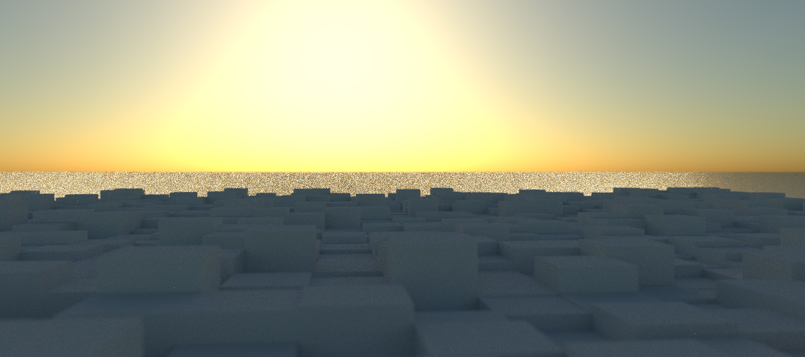

# rays.rust
[](https://travis-ci.org/peterbraden/rays.rust)

## Gallery



[See full gallery of test scenes](./demo/scenes.md)

[See the cloud atlas](./demo/cloud-atlas.md): every kind of cloud it can render, with a scene for each.

A raytracer written in rust.

Supports:

  - Tracing (Integrator)
    - Whitted tracing
    - Path tracing with basic Monte-Carlo global illumination
      - Lambertian 
      - Specular
      - Dielelectric
      - Leaf (translucent: diffuse reflection and transmission under a glossy coat)
    - Spectral rendering (`"spectral": true`): dispersion, blackbody emitters

  - Objects
    - Sphere
    - Plane
    - Mesh
    - OBJ file to mesh import
    - Infinite Mesh
    - The shapes of POV-Ray: cylinder, cone, disc, torus, quadric and polynomial surfaces,
      polygon, prism, lathe, surface of revolution, sphere sweep, blob, isosurface,
      superellipsoid, Julia fractal, height field, parametric surface, bicubic patch and text
      ([reference](./docs/shapes.md))
    - Constructive solid geometry: union, merge, intersection and difference of any solid
      shapes, with inverse and clipping, and materials for each part
    - Transforms (scale, rotate, translate) and object instancing

## Instancing

Name a geometry once under `"geometries"`, then place it as many times as you like with
`transform`s. It's loaded and built once, and every instance shares it, so each copy costs only
its transform, whatever the size of the mesh. Each instance has its own material.

```json
"geometries": {
  "teapot": { "type": "smoothmesh", "src": "./demo/teapot.obj" }
},
"objects": [
  { "type": "transform", "item": "teapot", "translate": [-4, 0, 0], "material": "GOLD" },
  { "type": "transform", "item": "teapot", "scale": 0.5, "rotate": { "pitch": 90 }, "material": "GLASS" }
]
```

A name can be used wherever a geometry is expected (eg. the `a` and `b` of a `difference`), and
geometries can be built from each other. See [demo/scenes/instances.json](demo/scenes/instances.json).

## Spectral rendering

With `"spectral": true`, each sample traces light at three wavelengths instead of red, green
and blue (hero wavelength sampling, after PBRT's chapter 4), and the film turns them into a
colour through the CIE matching functions. Colours in the scene are turned into smooth spectra
(Jakob and Hanika's sigmoid polynomials), so a scene under white light looks as it does in RGB;
what changes is coloured light on coloured surfaces, and what RGB can't do at all:

- Dispersion: a dielectric's `refractive_index` can be a named glass (`"BK7"`, `"fused silica"`,
  `"SF11"`, `"diamond"`), `{"cauchy": [a, b]}` or `{"sellmeier": {"b": [..], "c": [..]}}`.
- Blackbody emitters: `{"type": "diffuse-light", "temperature": 2700, "intensity": 10}`, and
  `"temperature"` on point lights, emit Planck's spectrum (scaled to unit luminance).

See [demo/scenes/spectral-prism.json](demo/scenes/spectral-prism.json) and
[demo/scenes/blackbody.json](demo/scenes/blackbody.json), and `src/spectrum.rs` for the details.

## Forests

A `forest` covers part of a surface with trees: a few distinct trees are grown per species,
then placed thousands of times as instances, each turned, scaled and maybe mirrored. Trees keep
their distance from each other in proportion to their size, species grow in stands, clearings
are left open, and steep ground stays bare. The surface can be any geometries, named or inline:
eg. a heightmap `terrain`, which grass can share.

```json
"variables": { "land": { "type": "noise", "min": [-250, -50], "max": [250, 450], "amplitude": 90, "scale": 260 } },
"geometries": { "land": { "type": "terrain", "heightmap": "$land" } },
"objects": [
  { "type": "transform", "item": "land", "material": "SOIL" },
  { "type": "forest", "seed": 1, "surface": "land", "area": { "min": [-200, 0], "max": [200, 400] },
    "spacing": 9, "clearings": 0.2, "patchiness": 0.7, "max_slope": 35, "variants": 3, "autumn": 0.4,
    "species": [
      { "species": "scots-pine", "weight": 2, "bark": "PINE_BARK", "leaves": "NEEDLES", "params": { "autumn": 0 } },
      { "species": "quaking-aspen", "spacing": 0.7, "bark": "PALE_BARK", "leaves": "ASPEN_LEAF" },
      { "species": "shrub", "weight": 3, "spacing": 0.35, "scale_v": 0.3, "leaves": "SHRUB_LEAF" }
    ] }
]
```

See [demo/scenes/forest.json](demo/scenes/forest.json): 19,000 trees from 15 distinct ones on
heightmap terrain, behind a meadow of grass.

  - Scene files: our JSON, NFF (Eric Haines' Neutral File Format, of the Standard
    Procedural Database), or Tungsten's JSON (as in Bitterli's Rendering Resources), with
    OBJ, PLY and Tungsten `.wo3` meshes
  - Bump mapping: bumps, dents, wrinkles, ripples and waves ([reference](./docs/bump-mapping.md))

  - Skysphere with Rayleigh and Mie Scattering
  - Procedural Objects
    - Ocean (Tessendorf's algorithm with Phillips spectrum)
    - Trees (Weber and Penn's parametric model, with presets for several species, autumn colours and dead branches)
    - Forests of instanced trees over any surface
    - Terrain evolved through time from seeded noise by tectonic uplift, river incision and
      deposition, glacial erosion (shallow ice approximation), volcanism, deltas and
      meandering rivers with ox-bow lakes, over layered geology, on a patch or a whole planet
      (see `src/terrain/`)
    - Random Cubes
    - Terrain from heightmaps (fractal noise or images)
    - Grass on any terrain: species presets (lawn, meadow, tussock, reed...) and conditions (wind, drought, frost, rain, mowing...)
    - Rocks: bedrock outcrops, boulders and pebbles, with procedural stone materials
      (granite, basalt, sandstone, limestone, slate, quartzite)
  - Multithreaded
  - Progressive rendering


## Install / Run
```
cargo run --release -- demo/demo.json
```

## Blog Posts

- [Simulating Ocean Waves](https://peterbraden.co.uk/article/simulation-ocean-waves/)

## References
- [An Efficient Parametric Algorithm for Octree Traversal, J. Revelles, C. Urena, M. Lastra](http://wscg.zcu.cz/wscg2000/Papers_2000/X31.pdf)
- [Simulating Ocean Water, J. Tessendorf](http://citeseerx.ist.psu.edu/viewdoc/download?doi=10.1.1.161.9102&rep=rep1&type=pdf)
- [Physically Based Raytracing, M. Pharr, W. Jakob, G. Humphreys](http://www.pbr-book.org/)
- [Haines, E. (1987). A Proposal for Standard Graphics Environments. IEEE CG&A 7(11).](https://github.com/erich666/StandardProceduralDatabases)
- [Creation and Rendering of Realistic Trees, J. Weber, J. Penn](https://doi.org/10.1145/218380.218427)
- [Roth, S. D. (1982). Ray casting for modeling solids.](sci-hub.se/10.1016/0146-664x%2882%2990169-1)


## Previous Work

This is the latest in a series of raytracers I've implemented to make art,
learn languages, and explore algorithms.

- [Rays (c++)](https://github.com/peterbraden/rays)
- [JS Raytracer](https://github.com/peterbraden/js-raytracer)
