# Cloud atlas

The clouds rays.rust can render, arranged as in the WMO's [International Cloud
Atlas](https://cloudatlas.wmo.int/): high clouds (cirrus, cirrocumulus, cirrostratus) from about
6 km up, middle clouds (altocumulus, altostratus) from about 2 km, and low clouds (stratocumulus,
stratus, cumulus) below. Each entry has a scene to render it from, what makes it, and what it
can't do yet.

Every cloud is a participating medium of the same kind (see `src/volume.rs`): delta tracking
through a density field, lit by the sun and the sky, under the same atmosphere that reddens the
sun and hazes the distance. Cloud layers curve with the planet's surface, so distant clouds drop
towards the horizon and sink below it. What differs is where the density comes from. There are
seven generators:

| Generator | Makes | Approach |
|---|---|---|
| `hogan_kew_cirrus` | cirrus, cirrostratus | Ice falling from generating cells in wind shear (Hogan & Kew 2005) |
| `benard_altocumulus` | altocumulus, cirrocumulus | Rayleigh-Bénard convection cells in a thin layer |
| `nubis_clouds` | cumulus, stratocumulus, stratus, altostratus | Noise-based modelling (Schneider, Horizon Zero Dawn's Nubis) |
| `harris_cumulus` | cumulus, as they grow and die | A simulation of a sunny day (Harris et al. 2003) |
| `lenticular` | lenticular clouds | Moist layers lifted by a mountain's lee waves |
| `mammatus` | mammatus under an anvil | Sinking, evaporating lobes under a cloud's base |
| `precipitation` | rain shafts and virga | Raindrops by rain rate (Marshall-Palmer), falling through shear |

Render any of them with `cargo run --release -- demo/scenes/<scene>.json`. The altostratus, stratocumulus
and stratus images are quick previews (480 x 300, 8 samples per pixel), so they are noisy.

| | Cloud | Scene |
|---|---|---|
| High | [Cirrus](#cirrus) | `hogan-kew-cirrus.json` |
| | [Cirrocumulus](#cirrocumulus) | `cirrocumulus.json` |
| | [Cirrostratus, with halos](#cirrostratus) | `cirrostratus-halos.json` |
| Middle | [Altocumulus](#altocumulus) | `benard-altocumulus.json` |
| | [Altocumulus undulatus](#altocumulus-undulatus) | `altocumulus-undulatus.json` |
| | [Altocumulus lenticularis](#altocumulus-lenticularis) | `lenticular.json` |
| | [Altostratus](#altostratus) | `altostratus.json` |
| Low | [Stratocumulus](#stratocumulus) | `stratocumulus.json` |
| | [Stratus](#stratus) | `stratus.json` |
| | [Cumulus, modelled](#cumulus-modelled) | `nubis-clouds.json` |
| | [Cumulus, simulated](#cumulus-simulated) | `harris-cumulus.json` |
| Phenomena | [Rain and rainbows](#rain-and-rainbows) | `rain.json` |
| | [Mammatus](#mammatus) | `mammatus.json` |
| | [Iridescence](#iridescence) | `cirrus-iridescence.json` |
| | [Clouds from orbit](#clouds-from-orbit) | `orbit.json` |

## High clouds

### Cirrus

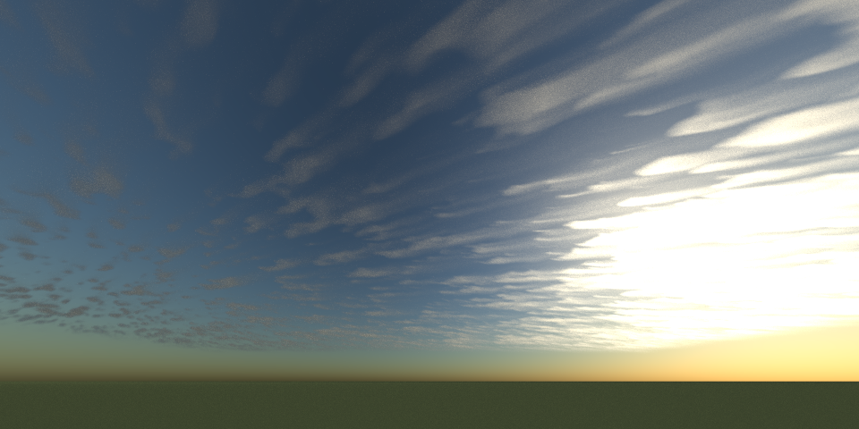

`hogan-kew-cirrus.json`: `{"type": "hogan_kew_cirrus", "genus": "cirrus"}`

Fibrous streaks with hooked ends (cirrus fibratus and uncinus). This follows R. J. Hogan and
S. F. Kew, "A 3D stochastic cloud model for investigating the radiative properties of inhomogeneous
cirrus clouds" (QJRMS 2005). Ice crystals form in generating cells near the top of the layer: an
anisotropic random field with a k^-5/3 spectrum. They then fall through wind that strengthens and
veers with depth, so each cell trails a curved fallstreak. Fibres, a large-scale flow that bends
the streaks, and varied fall speeds make them wispy. `time` animates the layer.

### Cirrocumulus

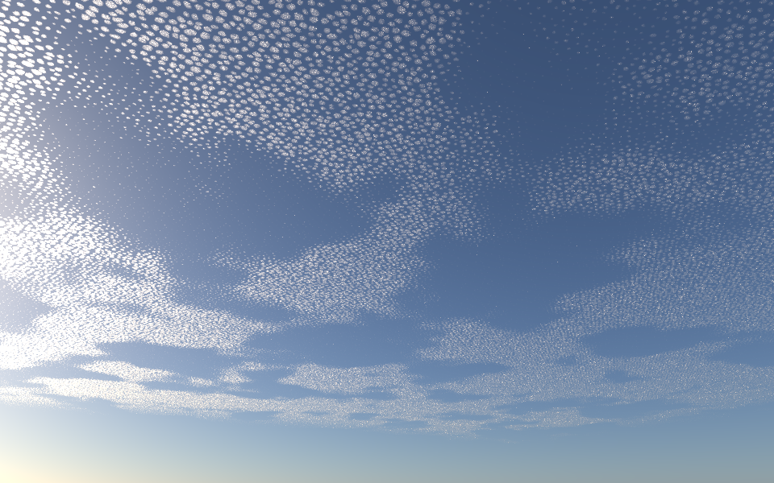

`cirrocumulus.json`: `{"type": "benard_altocumulus", "base": 7500, "thickness": 60, "cell_size": 160}`

A sheet of tiny grains or ripples, each under 1° across. Cirrocumulus forms by the same
small-scale convection as altocumulus, only higher and finer, so it uses the altocumulus
generator with smaller, thinner cells (see [Altocumulus](#altocumulus)). `hogan_kew_cirrus` also
has a `"cirrocumulus"` genus, with generating cells 400 m across and little fall. It reads as a
patchy veil more than grains, but it is what the iridescence scene uses.

### Cirrostratus

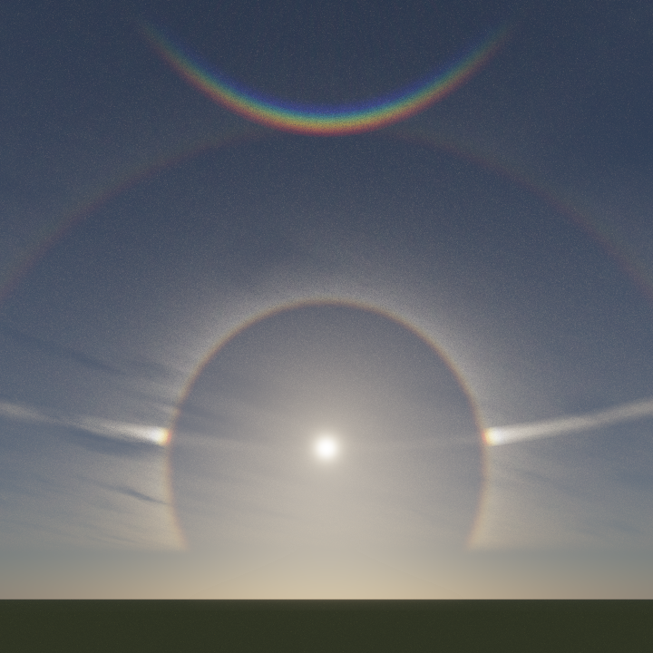

`cirrostratus-halos.json`: `{"type": "hogan_kew_cirrus", "genus": "cirrostratus", "halos": true}`

A thin, nearly uniform veil of ice: the cloud of halos. Light is traced through hexagonal ice
prisms, plates, columns and randomly oriented crystals, with refraction, reflection and total
internal reflection. The result is tabulated by viewing direction. This gives the 22° and 46°
halos, sun dogs, the parhelic circle and the circumzenithal arc in the right places and colours
(`src/material/ice_halos.rs`). Without `halos`, the ice scatters with a smooth forward-peaked
phase function.

## Middle clouds

### Altocumulus

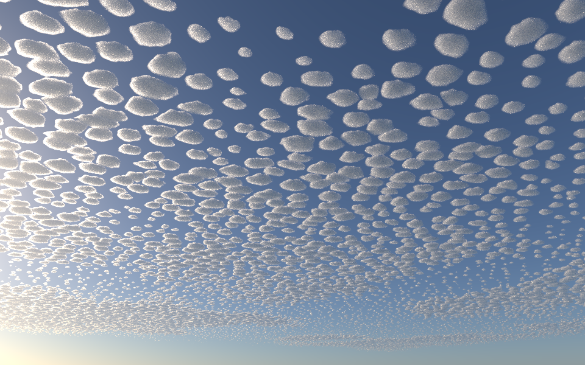

`benard-altocumulus.json`: `{"type": "benard_altocumulus", "base": 4000, "thickness": 200}`

Rounded cloudlets in a regular sheet: the "mackerel sky". A thin layer cooled at its top
overturns in convection cells, like Rayleigh-Bénard cells in a heated fluid. Air rises in each
cell's middle, where it condenses into a cloudlet, and sinks at its edges, leaving clear gaps.
The cells are a jittered, warped hexagonal lattice. Each cloudlet is a flat-based dome with
turrets, grey in the middle and bright at the edges when the sun is ahead. `coverage` takes the
sheet from scattered cloudlets to joined ones with holes between (perlucidus); `anisotropy` and
`wind_direction` draw the cells out into rows; `patchiness` breaks the sheet into patches.

### Altocumulus undulatus

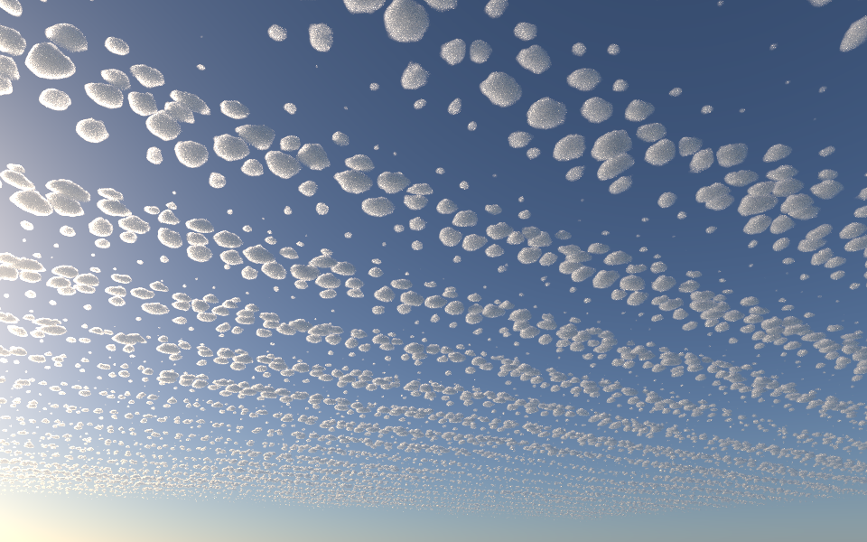

`altocumulus-undulatus.json`: `{"type": "benard_altocumulus", "undulation": 0.8, "wind_direction": [0, 1]}`

Altocumulus in parallel bands, where gravity waves ripple the layer. `undulation` raises and
grows the cloudlets along wave crests across the wind, `wavelength` apart, and thins them in the
troughs.

### Altocumulus lenticularis

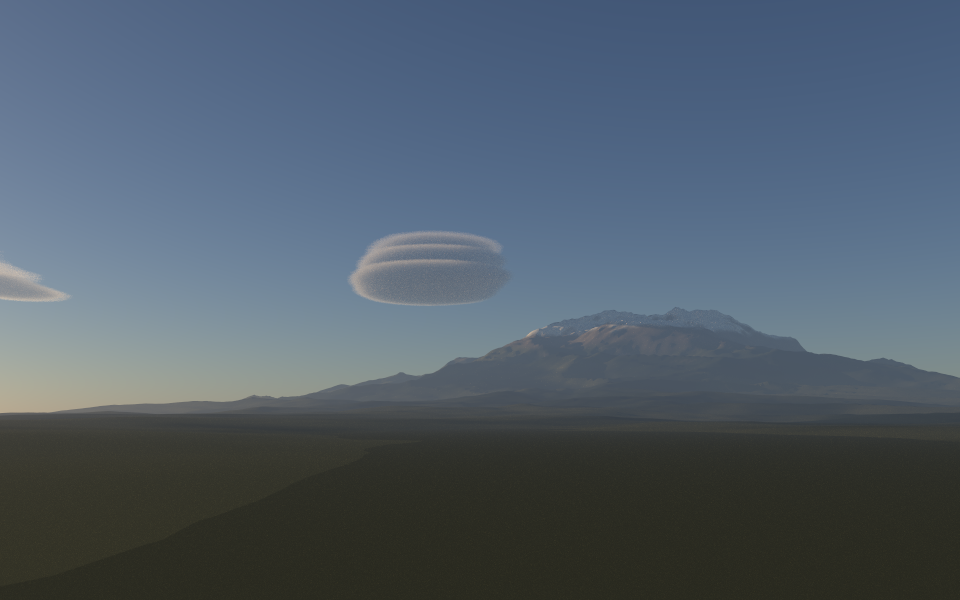

`lenticular.json`: `{"type": "lenticular", "ridge": [0, 0], "ridge_length": 800, "wind_direction": [1, 0], "oz": true}`, over `{"type": "terrain", "peak": [-1500, 0]}`

Smooth lenses standing over the lee of a mountain, often stacked like a pile of plates. Stable air
blowing over a ridge oscillates, and the oscillation stays trapped below some height as a train of
standing lee waves downstream (Scorer 1949). The air rises over each crest and sinks in each
trough. A moist layer condenses where a crest lifts it past saturation and evaporates beyond, so
the cloud stays still while the wind blows through it.

The field is computed in physical units. The wave is a decaying cosine downstream of the ridge,
fading beyond the ridge's ends. Each moist layer is given by its height, depth and *deficit*: the
lift it needs to saturate. The lift past saturation sets the cloud water (`condensation_rate`, about
1.5 g/kg per km), and the droplet size turns that into extinction. Each layer makes a lens on every
crest that lifts it high enough. Thin, separate moist layers give the stack. On the weaker crests
downstream, only the moistest layer condenses: in the scene, the second crest holds a single
plate. Humidity varies slowly from place to place, and fine strata and eddies texture the lenses.
A short ridge gives the saucers of an isolated peak; a long one gives bands across the wind. The
scene puts a mountain under them: `terrain` is a meshed heightfield of ridged multifractal noise
around a massif. It lies on the planet's curve, with snow, rock and vegetation by height and
slope.

Seen from the side, a lens is lit mostly by light scattered many times, so the scene uses the Oz
approximation (`"oz": true`). Without it, the render sparkles with noise.

### Altostratus

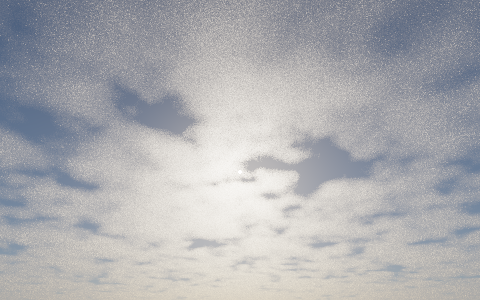

`altostratus.json`: `{"type": "nubis_clouds", "base": 3000, "top": 4500, "coverage": 1, "cloud_type": 0, "density": 0.003}`

A grey or bluish sheet through which the sun shows as if through ground glass. It is Nubis's
stratus profile at middle height, optically thin (an optical depth of a few through the sheet).
This is an approximation: real altostratus is a smooth, often fibrous sheet, while Nubis still
shapes it from billowing noise.

## Low clouds

### Stratocumulus

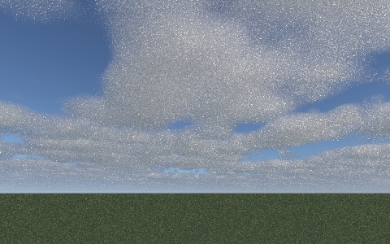

`stratocumulus.json`: `{"type": "nubis_clouds", "base": 700, "top": 1500, "coverage": 0.8, "cloud_type": 0.5}`

Lumpy rolls and patches in a layer, with darker bases. This is Nubis (A. Schneider and N. Vos,
"The Real-time Volumetric Cloudscapes of Horizon: Zero Dawn", SIGGRAPH 2015), with the
stratocumulus height profile. A weather map says where the cloud is, Perlin-Worley noise gives
it billowing shapes, and Worley noise erodes the edges. `cloud_type` blends the height profile
from stratus (0) through stratocumulus (0.5) to cumulus (1).

### Stratus

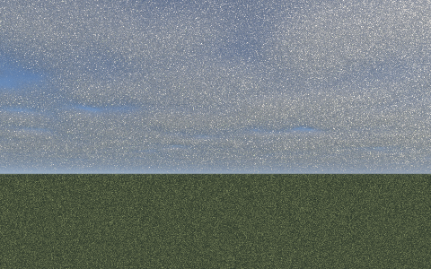

`stratus.json`: `{"type": "nubis_clouds", "base": 300, "top": 800, "coverage": 1, "cloud_type": 0}`

A low, grey overcast: Nubis with the stratus profile and full coverage.

### Cumulus, modelled

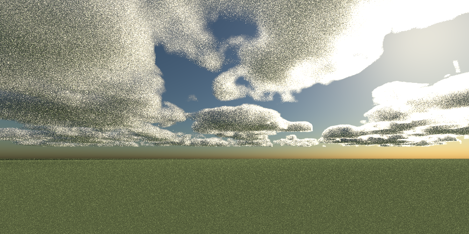

`nubis-clouds.json`: `{"type": "nubis_clouds", "base": 1500, "top": 3000, "coverage": 0.55, "cloud_type": 1}`

Fair-weather cumulus (humilis and mediocris): flat bases and rounded tops, from Nubis's
cumulus profile, with clouds growing taller where the weather map is stronger. They cast
shadows on the ground. They are shaped from noise, so they don't change over time.

### Cumulus, simulated

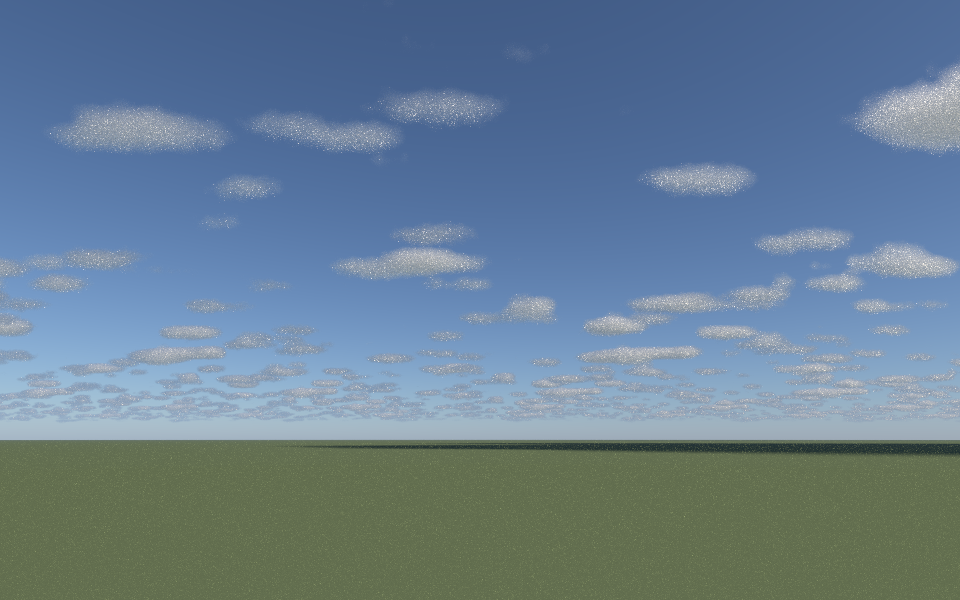

`harris-cumulus.json`: `{"type": "harris_cumulus", "time": 3600, "follow_wind": true, "cache": "demo/scenes/.cumulus-cache"}`

Cumulus grown by simulating the air they form in, after M. J. Harris et al., "Simulation of
Cloud Dynamics on Graphics Hardware" (Graphics Hardware 2003): fluid flow carrying heat, water
vapour and cloud water, with buoyancy, condensation and latent heat, plus subgrid turbulence
(Smagorinsky, with Lilly's stability correction) and rain-out of excess cloud water. The day is a
real one: the ARM Southern Great Plains case (Oklahoma, 21 June 1997; Brown et al., QJRMS 2002),
an intercomparison case for large-eddy models. It gives the sounding, the ground's heat and
moisture through the day, and the air mass's slow changes.

The ground heats the air, and thermals rise through the boundary layer and condense at the
lifting condensation level. That gives a flat cloud base, set by the morning's humidity rather
than by hand. Latent heat keeps cloudy air buoyant, so turrets boil upwards; their edges mix with
dry air and evaporate, and clouds cut off from their thermals dissipate. Through the late morning
the field fills in, then breaks into taller towers (congestus) by midday.

The simulation starts at 09:30, as the first cumulus form, and runs for `time` seconds when the
scene loads. The grid is 64 x 44 x 64 cells of 100 m by default, periodic, and tiled across the
sky. States are cached in `cache`, so an animation simulates only from frame to frame:

```bash
scripts/animate.py demo/scenes/harris-cumulus.json --start 1800 --end 9000 --frames 72 --samples 8 -- --width 480 --height 300
```

[The result](./scenes/harris-cumulus.mp4) runs from 10:00 to 12:00: clear sky, first wisps, a
field that fills in, then clumps that break up as the ground's moisture flux falls.

At 100 m the grid resolves clouds down to a few hundred metres. Worley erosion adds finer detail
at their edges.

## Phenomena

### Rain and rainbows


`rain.json`: `{"type": "precipitation", "base": 1500, "rain_rate": 12, "rainbow": true}`, under
`{"type": "nubis_clouds", "base": 1500, "top": 5500, "coverage": 1}`

Rain shafts under a storm, lit by the low sun behind the viewer, with a rainbow. Rain is thin
compared with cloud. Its drops are a millimetre or two across, so its extinction depends on how
hard it rains: with the Marshall-Palmer drop sizes, about 0.001 per metre at 5 mm/h, a
visibility of a few kilometres. Shafts fall from cells and lean downwind as the wind changes
with height (`shear`), streaked where drops fall together. With a `fall_depth`, the
precipitation evaporates as it falls: that is virga, its streaks fraying out before they reach
the ground.

The rainbow comes from tracing sunlight through water spheres by geometric optics: reflected,
or refracted in and out after one, two or three internal reflections, with Fresnel's split at
each surface. It is traced per wavelength across each colour channel, since water's refractive
index falls from blue to red, and averaged over the sun's disc (`src/material/rainbow.rs`). The
primary bow lies 42° from the point opposite the sun, red outside; the fainter secondary lies at
51°, its colours reversed. Between them is Alexander's dark band, and inside the primary the sky
is brighter. Like halos, the bow applies to direct sunlight at a path's first scattering.

### Mammatus

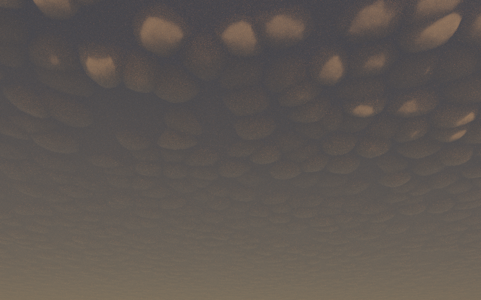

`mammatus.json`: `{"type": "mammatus", "base": 7000, "thickness": 2000, "edge_direction": [-1, 0], "oz": true}`

Pouches hanging from the underside of an anvil: a supplementary feature (mamma) of cumulonimbus,
and sometimes of altocumulus or stratocumulus. Cloudy air sinking from the base cools as its ice
or droplets evaporate. Where that cooling outpaces the warming of its descent, it keeps sinking
in lobes into the drier air below (Schultz et al., J. Atmos. Sci. 2006). Each pouch is a
kilometre or two across and a few hundred metres deep, with a sharp, smooth boundary where the
cloud evaporates.

The anvil is a thick sheet covering the sky beyond a ragged edge, thinning towards it. Under it
hangs a jittered hexagonal lattice of half-ellipsoids, varied in depth and gathered into
clusters, deepest a few kilometres in from the edge. In the scene the sun is setting beyond the
anvil's edge. Its light, reddened by its long path through the air, comes in under the base and
catches the sides of the nearest pouches, while the anvil overhead hides most of the sky. The
scene uses Reinhard tone mapping with an exposure of 3, as a photograph at dusk would.

### Iridescence

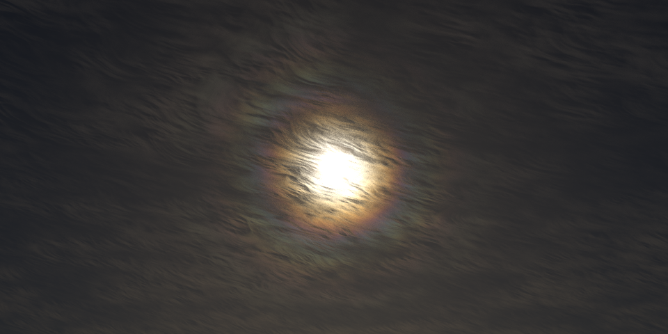

`cirrus-iridescence.json`: `{"type": "hogan_kew_cirrus", "genus": "cirrocumulus", "particle_radius": 4, "diffraction": {"spread": 0.1}}`

Pastel colours near the sun, in thin cloud of small, even particles: here, young ice at the
edges of cirrocumulus cells. Diffraction by the particles is modelled as an Airy pattern,
averaged over their sizes and over wavelengths across each colour channel
(`src/material/diffraction.rs`). Where particles are larger, the colours wash out. Any cloud
generator that reports particle sizes can show it: `benard_altocumulus` (`particle_radius`) and
`harris_cumulus` (`droplet_radius`) do.

### Clouds from orbit

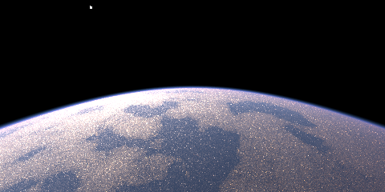

`orbit.json`: `{"type": "nubis_clouds", "mapping": "global"}` and `{"type": "hogan_kew_cirrus", "mapping": "global"}`

Cumulus and cirrus over the whole planet, seen from 400 km. With `"mapping": "global"`, the
weather map is a cube-sphere over the globe, with no seams or poles. Climate bands give cloudy
tropics and storm tracks and clear subtropics. Cirrus follows a planet-wide wind field. The render
is still noisy: from orbit, cloud detail is much smaller than a pixel.

## Not yet

- **Nimbostratus**: a thick, dark rain cloud. `precipitation` can now fall from a thick
  `nubis_clouds` stratus, but there is no scene for it yet.
- **Cumulonimbus**: anvils and overshooting tops. `harris_cumulus` could grow them with a deeper
  grid, a weaker inversion and ice microphysics.
- **Castellanus, fractus and other species**: each needs its own mechanism (turrets from
  mid-level convection, shreds torn by the wind).
- **Snow, hail and lightning**; supernumerary bows (they need wave optics) and fogbows.
