# Cloud atlas

The clouds rays.rust can render, arranged as in the WMO's [International Cloud
Atlas](https://cloudatlas.wmo.int/): high clouds (cirrus, cirrocumulus, cirrostratus) from about
6 km up, middle clouds (altocumulus, altostratus) from about 2 km, and low clouds (stratocumulus,
stratus, cumulus) below. Each entry has a scene to render it from, what makes it, and what it
can't do yet.

Every cloud is a participating medium of the same kind (see `src/volume.rs`): delta tracking
through a density field, lit by the sun and the sky, under the same atmosphere that reddens the
sun and hazes the distance. Cloud layers curve with the planet's surface, so distant clouds drop
towards the horizon and sink below it. What differs is where the density comes from. There are
ten generators:

| Generator | Makes | Approach |
|---|---|---|
| `hogan_kew_cirrus` | cirrus, cirrostratus | Ice falling from generating cells in wind shear (Hogan & Kew 2005) |
| `benard_altocumulus` | altocumulus, cirrocumulus | Rayleigh-Bénard convection cells in a thin layer |
| `nubis_clouds` | cumulus, stratocumulus | Noise-based modelling (Schneider, Horizon Zero Dawn's Nubis) |
| `harris_cumulus` | cumulus, as they grow and die | A simulation of a sunny day (Harris et al. 2003) |
| `lenticular` | lenticular clouds | Moist layers lifted by a mountain's lee waves |
| `mammatus` | mammatus under an anvil | Sinking, evaporating lobes under a cloud's base |
| `overcast` | nimbostratus, stratus, altostratus, stratocumulus overcast, scud | A deck lumpy underneath, lit by diffusion through each column |
| `cumulonimbus` | cumulonimbus: towers, flanking line, anvil, overshooting top | Shaped by parcel theory: updraft from CAPE, overshoot w / N, anvil carried by the wind aloft |
| `mountains` `"cloud"` | hill fog, cap clouds | Damp air lifted over high ground past its saturation, streaming off the crests |
| `precipitation` | rain shafts and virga | Raindrops by rain rate (Marshall-Palmer), falling through shear |

And `lightning`, which isn't a cloud but lights one: a branching channel grown as a stepped
leader, glowing as bright as measured strokes, sampled as a light.

### The ten genera

The WMO's atlas sorts every cloud into ten genera. All ten have a scene:

| Genus | Generator | Scene |
|---|---|---|
| Cirrus (Ci) | `hogan_kew_cirrus` | `hogan-kew-cirrus.json` |
| Cirrocumulus (Cc) | `benard_altocumulus`, small and high | `cirrocumulus.json` |
| Cirrostratus (Cs) | `hogan_kew_cirrus`, with halos | `cirrostratus-halos.json` |
| Altocumulus (Ac) | `benard_altocumulus`, `lenticular` | `benard-altocumulus.json`, `altocumulus-undulatus.json`, `lenticular.json` |
| Altostratus (As) | `overcast`, thin and smooth | `altostratus.json` |
| Nimbostratus (Ns) | `overcast`, thick, with rain | `overcast.json` |
| Stratocumulus (Sc) | `nubis_clouds` | `stratocumulus.json` |
| Stratus (St) | `overcast`, low and even | `stratus.json` |
| Cumulus (Cu) | `nubis_clouds`, `harris_cumulus` | `nubis-clouds.json`, `harris-cumulus.json` |
| Cumulonimbus (Cb) | `cumulonimbus` | `cumulonimbus.json`, `lightning.json` |

Render any of them with `cargo run --release -- demo/scenes/<scene>.json`. The scenes stand on the
sea (`{"type": "ocean"}`, the planet's surface), whose reflections show the sky and clouds again.
The sea follows the weather: its `wind` (m/s) raises waves and roughness as measured for that
wind, and whitecaps over the fraction of the sea that wind breaks (Monahan's fit: a few in a
moderate breeze, 2% at 12 m/s, 5% at 14 m/s). Fair-weather scenes have a moderate breeze
(7 m/s); stratus a near calm (3 m/s); altostratus, ahead of a front, a fresh breeze (9 m/s);
the squalls and rain a strong breeze (11 to 12 m/s); and the thunderstorm's gust front a near
gale (14 m/s). The stratocumulus
image is a quick preview (480 x 300, 8 samples per pixel), so it is noisy.

### All together

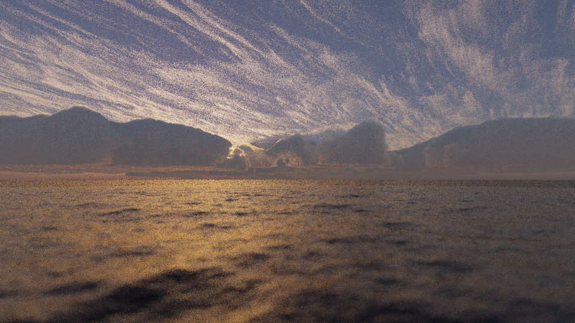

`sunset-squalls.json`: sunset over the sea, behind a distant line of cumulonimbus. The towers
are Nubis cumulus 9 km deep, broken into clusters, with an anvil spreading from their tops
and mammatus beneath it. Squalls trail rain shafts from their bases, and cirrus streams high
overhead. The sun, 3° up, is behind the line; with crepuscular rays on, its light fans out
through the gaps. The cirrus catches the last direct light, and the sea reflects it all, the
glitter path running in to the camera.

| | Cloud | Scene |
|---|---|---|
| High | [Cirrus](#cirrus) | `hogan-kew-cirrus.json` |
| | [Cirrocumulus](#cirrocumulus) | `cirrocumulus.json` |
| | [Cirrostratus, with halos](#cirrostratus) | `cirrostratus-halos.json` |
| Middle | [Altocumulus](#altocumulus) | `benard-altocumulus.json` |
| | [Altocumulus undulatus](#altocumulus-undulatus) | `altocumulus-undulatus.json` |
| | [Altocumulus lenticularis](#altocumulus-lenticularis) | `lenticular.json` |
| | [Altocumulus castellanus](#altocumulus-castellanus) | `altocumulus-castellanus.json` |
| | [Altostratus](#altostratus) | `altostratus.json` |
| Low | [Stratocumulus](#stratocumulus) | `stratocumulus.json` |
| | [Stratus](#stratus) | `stratus.json` |
| | [Overcast: nimbostratus and scud](#overcast-nimbostratus-and-scud) | `overcast.json` |
| | [Fractus](#fractus) | `fractus.json` |
| | [Cumulus, modelled](#cumulus-modelled) | `nubis-clouds.json` |
| | [Cumulus, simulated](#cumulus-simulated) | `harris-cumulus.json` |
| | [Cumulonimbus](#cumulonimbus) | `cumulonimbus.json` |
| | [Cumulonimbus, simulated](#cumulonimbus-simulated) | `cumulonimbus-simulated.json` |
| Phenomena | [Sunset](#sunset) | `sunset.json` |
| | [Crepuscular rays](#crepuscular-rays) | `crepuscular-rays.json` |
| | [Rain and rainbows](#rain-and-rainbows) | `rain.json` |
| | [Snow showers](#snow-showers) | `snow-showers.json` |
| | [Fogbow](#fogbow) | `fogbow.json` |
| | [Mammatus](#mammatus) | `mammatus.json` |
| | [Lightning](#lightning) | `lightning.json` |
| | [Lightning under the anvil](#lightning-under-the-anvil) | `lightning-anvil.json` |
| | [Iridescence](#iridescence) | `cirrus-iridescence.json` |
| | [Clouds from orbit](#clouds-from-orbit) | `orbit.json` |

## High clouds

### Cirrus

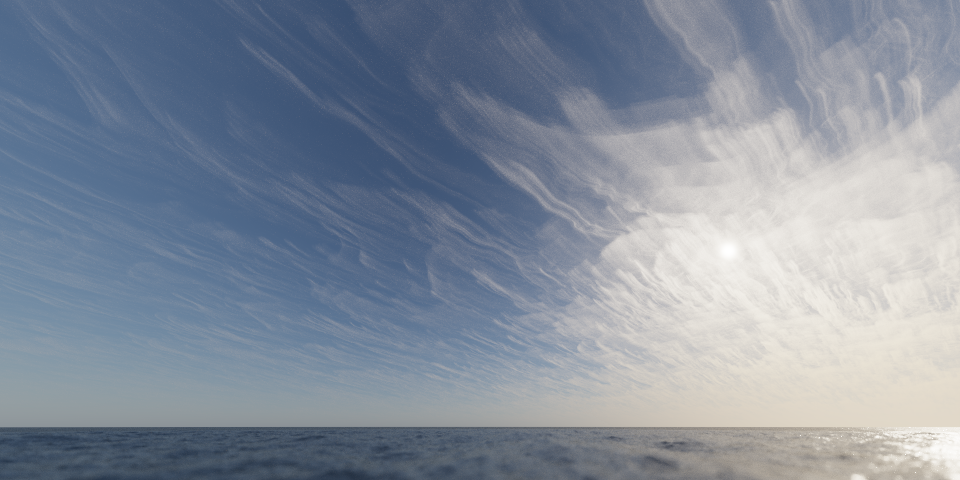

`hogan-kew-cirrus.json`: `{"type": "hogan_kew_cirrus", "genus": "cirrus"}`

Fibrous streaks with hooked ends (cirrus fibratus and uncinus). This follows R. J. Hogan and
S. F. Kew, "A 3D stochastic cloud model for investigating the radiative properties of inhomogeneous
cirrus clouds" (QJRMS 2005). Ice crystals form in generating cells near the top of the layer: an
anisotropic random field with a k^-5/3 spectrum. They then fall through wind that strengthens and
veers with depth, so each cell trails a curved fallstreak. Fibres, a large-scale flow that bends
the streaks, and varied fall speeds make them wispy. `time` animates the layer.

### Cirrocumulus

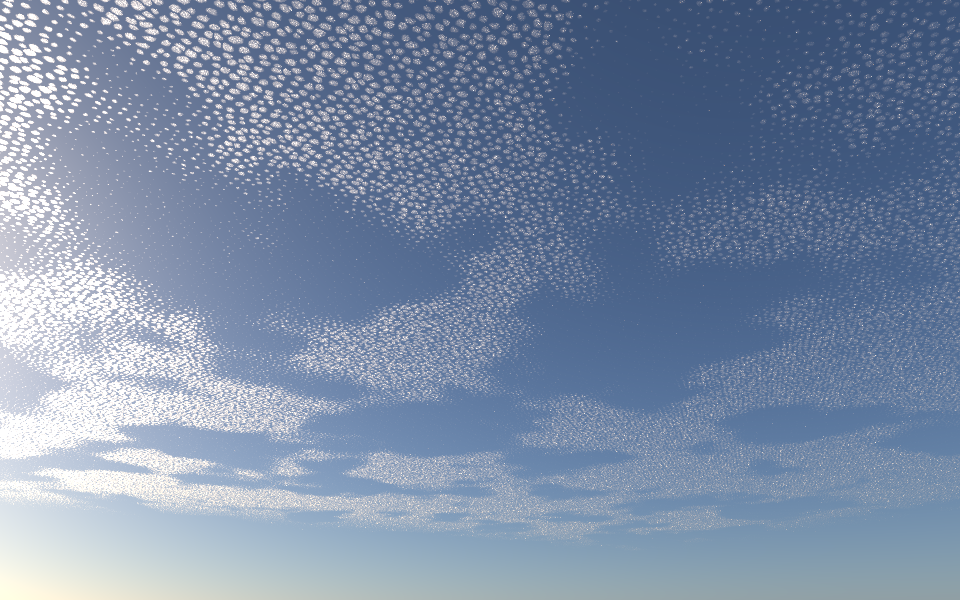

`cirrocumulus.json`: `{"type": "benard_altocumulus", "base": 7500, "thickness": 60, "cell_size": 160}`

A sheet of tiny grains or ripples, each under 1° across. Cirrocumulus forms by the same
small-scale convection as altocumulus, only higher and finer, so it uses the altocumulus
generator with smaller, thinner cells (see [Altocumulus](#altocumulus)). `hogan_kew_cirrus` also
has a `"cirrocumulus"` genus, with generating cells 400 m across and little fall. It reads as a
patchy veil more than grains, but it is what the iridescence scene uses.

### Cirrostratus

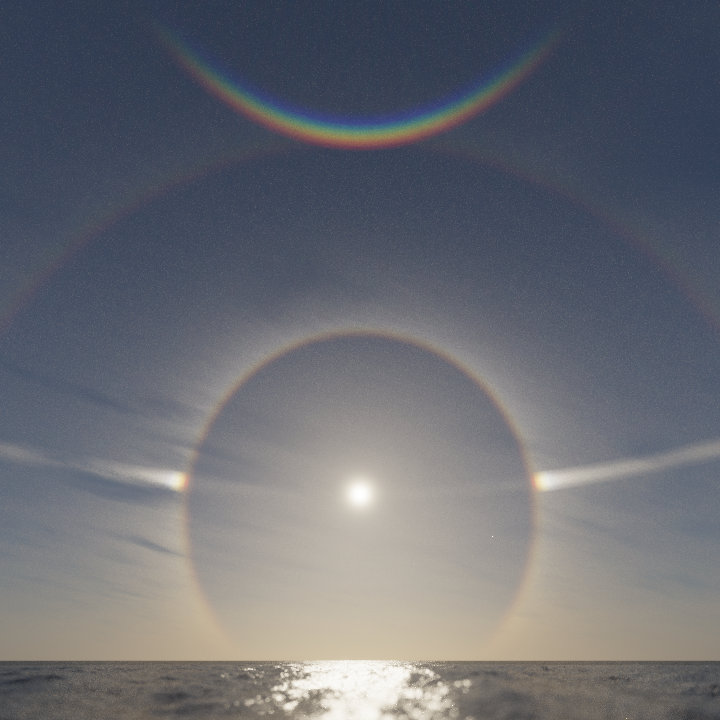

`cirrostratus-halos.json`: `{"type": "hogan_kew_cirrus", "genus": "cirrostratus", "halos": true}`

A thin, nearly uniform veil of ice: the cloud of halos. Light is traced through hexagonal ice
prisms, plates, columns and randomly oriented crystals, with refraction, reflection and total
internal reflection. The result is tabulated by viewing direction. This gives the 22° and 46°
halos, sun dogs, the parhelic circle and the circumzenithal arc in the right places and colours
(`src/material/ice_halos.rs`). Without `halos`, the ice scatters with a smooth forward-peaked
phase function.

## Middle clouds

### Altocumulus

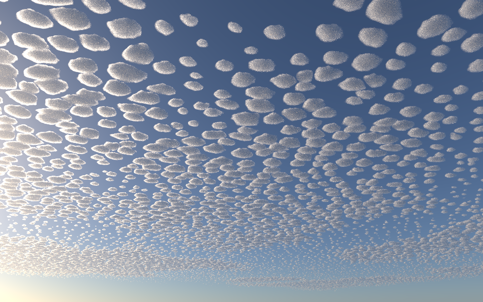

`benard-altocumulus.json`: `{"type": "benard_altocumulus", "base": 4000, "thickness": 200}`

Rounded cloudlets in a regular sheet: the "mackerel sky". A thin layer cooled at its top
overturns in convection cells, like Rayleigh-Bénard cells in a heated fluid. Air rises in each
cell's middle, where it condenses into a cloudlet, and sinks at its edges, leaving clear gaps.
The cells are a jittered, warped hexagonal lattice. Each cloudlet is a flat-based dome with
turrets, grey in the middle and bright at the edges when the sun is ahead. `coverage` takes the
sheet from scattered cloudlets to joined ones with holes between (perlucidus); `anisotropy` and
`wind_direction` draw the cells out into rows; `patchiness` breaks the sheet into patches.

### Altocumulus undulatus

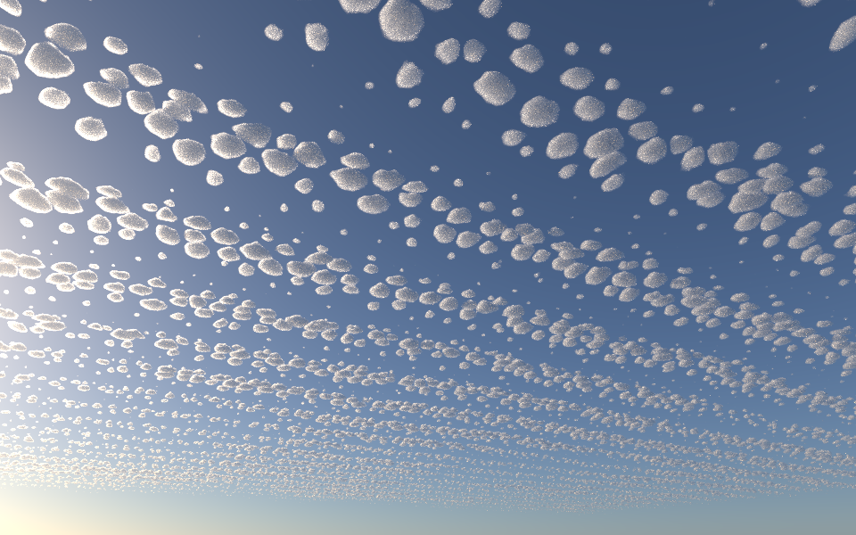

`altocumulus-undulatus.json`: `{"type": "benard_altocumulus", "undulation": 0.8, "wind_direction": [0, 1]}`

Altocumulus in parallel bands, where gravity waves ripple the layer. `undulation` raises and
grows the cloudlets along wave crests across the wind, `wavelength` apart, and thins them in the
troughs.

### Altocumulus lenticularis

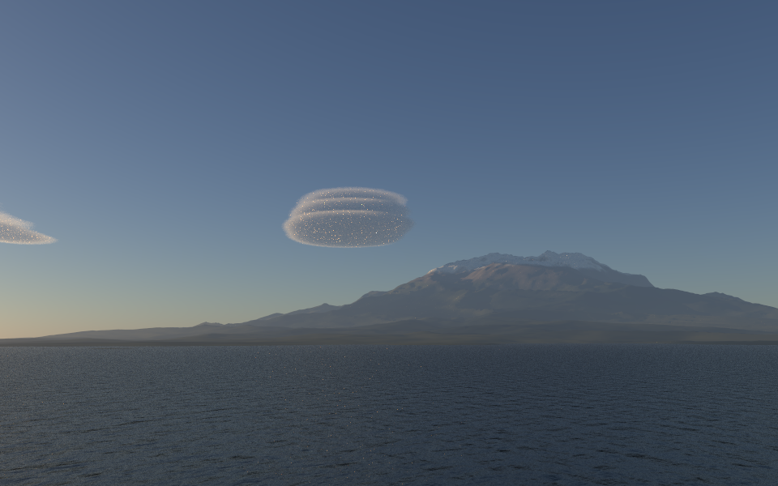

`lenticular.json`: `{"type": "lenticular", "ridge": [0, 0], "ridge_length": 800, "wind_direction": [1, 0], "oz": true}`, over `{"type": "mountains", "peak": [-1500, 0]}`

Smooth lenses standing over the lee of a mountain, often stacked like a pile of plates. Stable air
blowing over a ridge oscillates, and the oscillation stays trapped below some height as a train of
standing lee waves downstream (Scorer 1949). The air rises over each crest and sinks in each
trough. A moist layer condenses where a crest lifts it past saturation and evaporates beyond, so
the cloud stays still while the wind blows through it.

The field is computed in physical units. The wave is a decaying cosine downstream of the ridge,
fading beyond the ridge's ends. Each moist layer is given by its height, depth and *deficit*: the
lift it needs to saturate. The lift past saturation sets the cloud water (`condensation_rate`, about
1.5 g/kg per km), and the droplet size turns that into extinction. Each layer makes a lens on every
crest that lifts it high enough. Thin, separate moist layers give the stack. On the weaker crests
downstream, only the moistest layer condenses: in the scene, the second crest holds a single
plate. Humidity varies slowly from place to place, and fine strata and eddies texture the lenses.
A short ridge gives the saucers of an isolated peak; a long one gives bands across the wind. The
scene puts a mountain under them: `terrain` is a meshed heightfield of ridged multifractal noise
around a massif. It lies on the planet's curve, with snow, rock and vegetation by height and
slope.

Seen from the side, a lens is lit mostly by light scattered many times, so the scene uses the Oz
approximation (`"oz": true`). Without it, the render sparkles with noise.

### Altocumulus castellanus

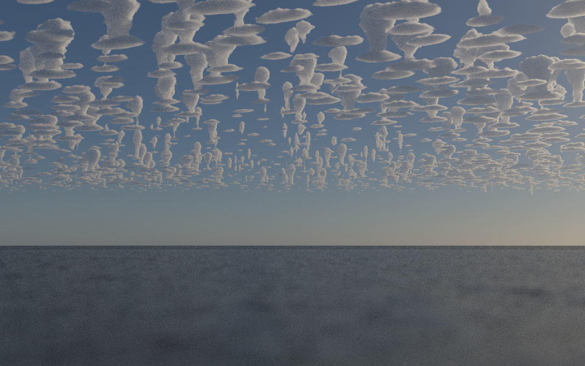

`altocumulus-castellanus.json`: `{"type": "benard_altocumulus", "castellanus": 0.4, "turret_height": 6}`

Altocumulus whose cloudlets grow turrets: when a mid-level layer turns unstable, by cooling
aloft or by moist air lifted into it, the rising air in some cells keeps rising, and those
cloudlets grow into little cumulus with stems and billowing heads, all standing on the layer's
common base and lined up in its rows. It is a forecaster's sign: castellanus in the morning, a
thunderstorm by afternoon. `castellanus` is the share of cells that grow one, `turret_height`
how tall the tallest grow, in layer thicknesses. Seen from far off along the layer, as here,
the turrets stand up like battlements.

### Altostratus

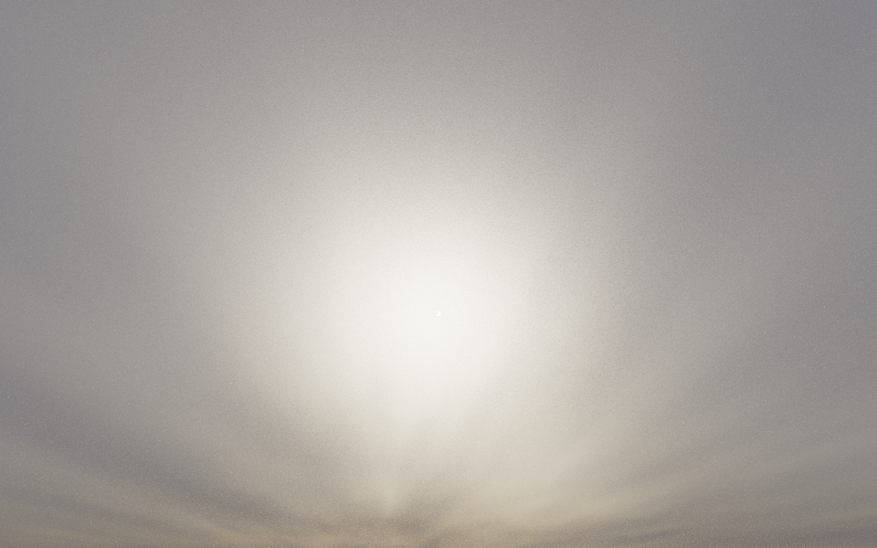

`altostratus.json`: `{"type": "overcast", "base": 3000, "thickness": 1500, "density": 0.0025, "contrast": 0.25, "anisotropy": 6, "diffusion": true}`

A grey or bluish sheet through which the sun shows as if through ground glass. It is the
`overcast` deck at middle height, made smooth and thin: an optical depth of three to six,
enough to hide the blue sky but not the sun, whose disc still shines through, dimmed, in a
bright patch of forward-scattered light. Little `contrast` between thicker and thinner
patches, and lumps drawn out six times along the wind (`anisotropy`), give the faint striations
of altostratus rather than the lumpy underside of rain cloud. The thinner patches
(`thickness_variation`) are where the sun shows best.

## Low clouds

### Stratocumulus

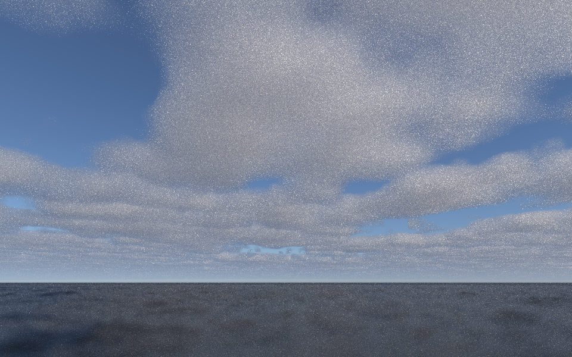

`stratocumulus.json`: `{"type": "nubis_clouds", "base": 700, "top": 1500, "coverage": 0.8, "cloud_type": 0.5}`

Lumpy rolls and patches in a layer, with darker bases. This is Nubis (A. Schneider and N. Vos,
"The Real-time Volumetric Cloudscapes of Horizon: Zero Dawn", SIGGRAPH 2015), with the
stratocumulus height profile. A weather map says where the cloud is, Perlin-Worley noise gives
it billowing shapes, and Worley noise erodes the edges. `cloud_type` blends the height profile
from stratus (0) through stratocumulus (0.5) to cumulus (1).

### Stratus

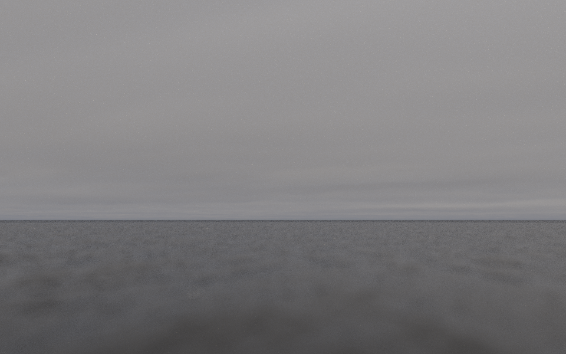

`stratus.json`: `{"type": "overcast", "base": 350, "thickness": 500, "density": 0.03, "contrast": 0.15, "base_variation": 40, "diffusion": true}`

A low, featureless grey sheet with an even base, hiding the sun completely: the dull sky of a
damp, still day. It is the `overcast` deck brought down to a few hundred metres and made
even: little `contrast` between thick and thin, a base that hardly varies, and a little scud.
An optical depth of 15 to 20 diffuses the sunlight evenly, so the sky is one soft grey, a
little brighter where the deck is thinner, its base lost in the haze at the horizon.

### Overcast: nimbostratus and scud

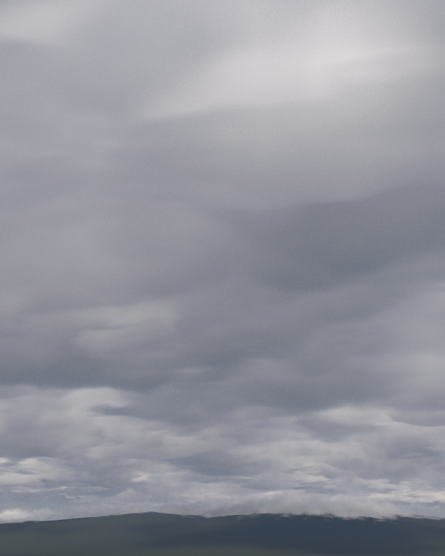

`overcast.json`: `{"type": "overcast", "base": 1200, "thickness": 2200, "density": 0.03, "diffusion": true}`,
with a `precipitation` shower over the hills, and hill cloud on the ridge.

Bad weather: a deck of cloud kilometres thick (an optical depth of 30 to 100) with no blue
anywhere, as on a wet, windy day. From below it is anything but uniform. Its underside hangs in
rounded masses (`lump_size`, `base_variation`), lumps of lumps lined up in rolls along the
wind (`anisotropy`, `wind_direction`), and the deck is thicker over them (`contrast`) and in broad
patches (`system_size`, `thickness_variation`): where it is thick the base is slate grey, in the
seams between it glows. Ragged scud hangs below (`scud`, `scud_depth`), low enough to catch on
hills; `breaks` opens gaps.

Under such a deck, sunlight arrives only after hundreds of scatterings, which a path tracer
finds by a random walk that rarely gets there: slow, and speckled with fireflies. So the deck
uses the diffusion approximation (`"diffusion": true`, `volume::ScatteringApproximation`): at
each path's first vertex in it, the light diffused through a plane-parallel slab as thick as the
column of cloud over and under that point (the independent column approximation of cloud
radiation). The light under the deck is then exactly as bright as the deck above it is thin,
without noise; paths carry on to gather the sky and the ground. It is an approximation: light
doesn't spread sideways from column to column, so seams are sharper than they would be, and
the sides of the lumps are lit like their bases. The air under the deck needs
`"crepuscular_rays": true` on the skysphere, or it is hazed blue as if the sun shone on it.

The cloud on the hills is the ridge's own: a `"cloud"` on the `mountains` object
(`procedural::hill_cloud`). On a raw day the air near the ground needs only a few hundred metres
of lift to saturate (`deficit`), and wind blowing over the hills gives it that, the lift dying
away with height above the ground (`decay`). So the higher summits vanish into cloud while lower
ground stays clear, the cloud streams off downwind of the crests (`trail`), and patches of
damper air (`humidity_variation`) cap some summits and leave others bare. In a scene with an
overcast it joins the deck's volume, so the light diffused down through the deck lights it too;
on its own, a thin cloud in a dark scene would be lit only by random walks that reach the
deck, which are noisy.

### Fractus

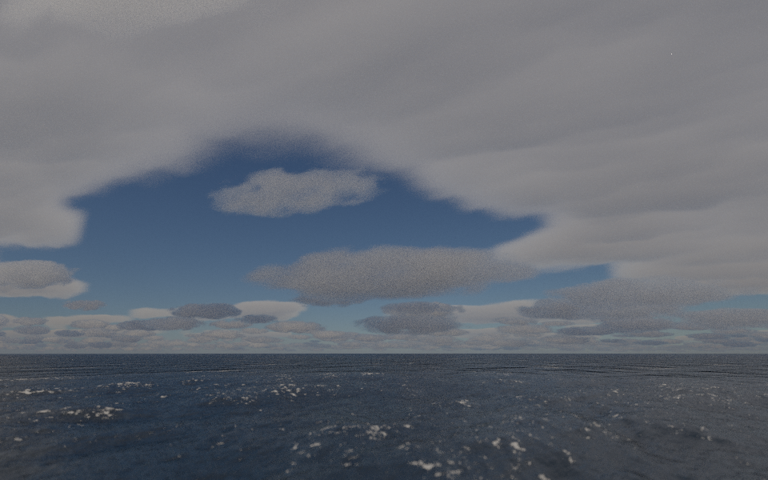

`fractus.json`: `{"type": "fractus", "base": 350, "depth": 500, "spacing": 900, "coverage": 0.45, "size": 300}`,
under broken stratocumulus

Ragged shreds of low cloud, torn from the base of other cloud or stirred up by a strong wind,
drifting fast and changing shape by the minute: stratus or cumulus fractus, and under rain,
pannus (`procedural::fractus`). Each shred stands at its own height in a layer, is drawn out
along the wind and leans downwind, and falls apart into lumps and wisps with sky between: noise
a third of its size cuts it into pieces, finer noise wears their edges, and the density inside
follows the noise rather than filling the outline, so each is grey in places and thin in others.
The overcast deck's scud is the same thing under a deck, and now drifts on under its `breaks`.

### Cumulus, modelled

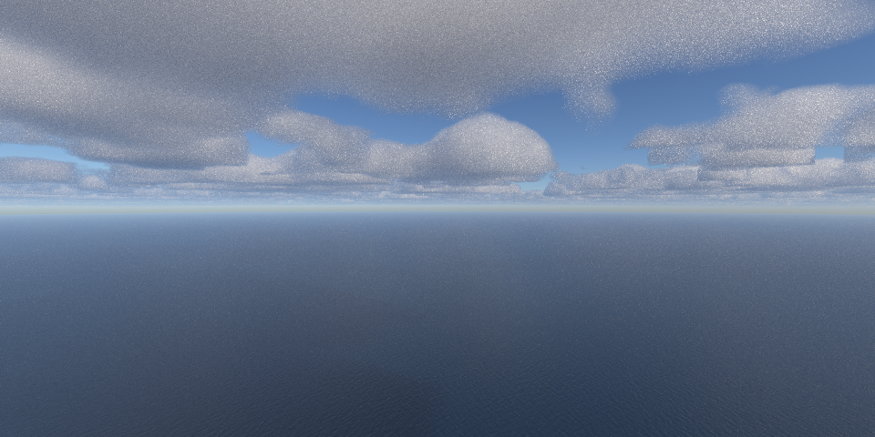

`nubis-clouds.json`: `{"type": "nubis_clouds", "base": 1500, "top": 3000, "coverage": 0.55, "cloud_type": 1}`

Fair-weather cumulus (humilis and mediocris): flat bases and rounded tops, from Nubis's
cumulus profile, with clouds growing taller where the weather map is stronger. They cast
shadows on the ground. They are shaped from noise, so they don't change over time.

### Cumulus, simulated

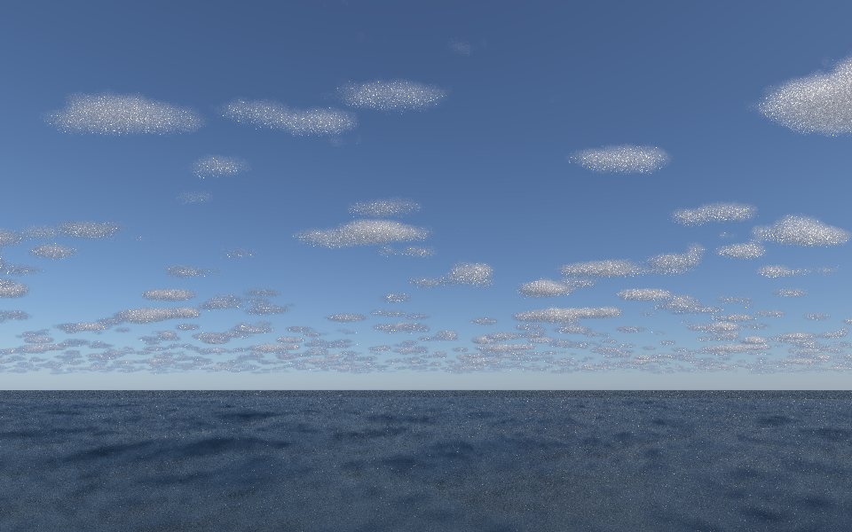

`harris-cumulus.json`: `{"type": "harris_cumulus", "time": 3600, "follow_wind": true, "cache": "demo/scenes/.cumulus-cache"}`

Cumulus grown by simulating the air they form in, after M. J. Harris et al., "Simulation of
Cloud Dynamics on Graphics Hardware" (Graphics Hardware 2003): fluid flow carrying heat, water
vapour and cloud water, with buoyancy, condensation and latent heat, plus subgrid turbulence
(Smagorinsky, with Lilly's stability correction) and rain-out of excess cloud water. The day is a
real one: the ARM Southern Great Plains case (Oklahoma, 21 June 1997; Brown et al., QJRMS 2002),
an intercomparison case for large-eddy models. It gives the sounding, the ground's heat and
moisture through the day, and the air mass's slow changes.

The ground heats the air, and thermals rise through the boundary layer and condense at the
lifting condensation level. That gives a flat cloud base, set by the morning's humidity rather
than by hand. Latent heat keeps cloudy air buoyant, so turrets boil upwards; their edges mix with
dry air and evaporate, and clouds cut off from their thermals dissipate. Through the late morning
the field fills in, then breaks into taller towers (congestus) by midday.

The simulation starts at 09:30, as the first cumulus form, and runs for `time` seconds when the
scene loads. The grid is 64 x 44 x 64 cells of 100 m by default, periodic, and tiled across the
sky. States are cached in `cache`, so an animation simulates only from frame to frame:

```bash
scripts/animate.py demo/scenes/harris-cumulus.json --start 1800 --end 9000 --frames 72 --samples 8 -- --width 480 --height 300
```

[The result](./scenes/harris-cumulus.mp4) runs from 10:00 to 12:00: clear sky, first wisps, a
field that fills in, then clumps that break up as the ground's moisture flux falls.

At 100 m the grid resolves clouds down to a few hundred metres. Worley erosion adds finer detail
at their edges.

### Cumulonimbus

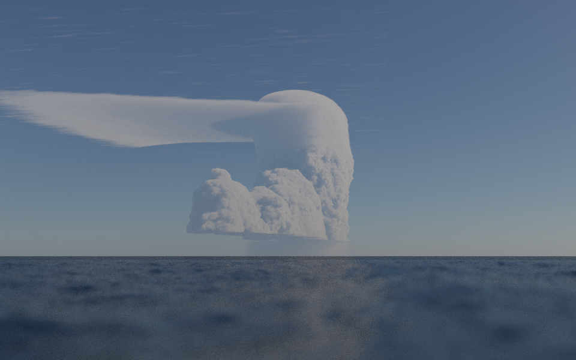

`cumulonimbus.json`: `{"type": "cumulonimbus", "base": 1300, "tropopause": 11500, "cape": 2500, "radius": 3800, "wind_direction": [1, 0.15], "upper_wind": 25, "age": 900, "flanking": 4, "oz": true}`

The thunderstorm cloud: a cumulus grown through the whole troposphere, with a rain shaft under
it. Its shape follows the physics of its updraft (`procedural::cumulonimbus`). This is one
storm, placed and shaped by hand; storms as part of a whole planet's weather, along fronts and
in the ITCZ, growing and raining out, come from `"weather"`'s convective layer
(docs/weather.md):

- **The tower.** Air rising from the base is buoyant as long as it is warmer than its
  surroundings, up to the equilibrium level, near the tropopause. Parcel theory gives the
  strongest updraft from the convective available potential energy, w = sqrt(2 CAPE), about
  half of it realised once entrainment and the water's weight are counted (`efficiency`).
  The updraft overshoots the equilibrium level by about w / N into the stable stratosphere,
  N its buoyancy frequency (`stability`, 0.02 s⁻¹): with CAPE 2500 J/kg, a dome some 1.8 km
  above the anvil. The tower leans downwind (`lean`), its surface pushed out in turrets a
  tower's width across, and those covered in cauliflower billows of billows.
- **Glaciation.** Above about -38 °C (`glaciation`, 8 km) every drop freezes. The hard
  billows of the liquid tower soften into streaks drawn out along the wind, and the
  extinction falls from that of dense liquid cloud (`density`, 0.04 per metre) to ice's
  (`ice_density`).
- **The anvil.** At the tropopause the outflow spreads, carried downwind by the wind aloft
  (`upper_wind` × `age`) and fanning out sideways at `outflow_speed`: a flat-topped wedge,
  thickest at the tower, thinning towards its far edge, a little of it pushed upwind.
- **The flanking line.** Younger towers stepping down away from the storm on the upwind side
  (`flanking`, `flank_angle`): cumulus congestus that will feed it.

Lit from the side, the turrets on the near side catch the sun, those beyond are in the
tower's shadow. Light scattered many times inside a tower so dense would make the render
noisy, so it uses the Oz approximation (`"oz": true`). Hail, wall clouds and the vault of a
supercell's updraft are not modelled; mammatus under the anvil is a separate `mammatus` object
(as in `sunset-squalls.json`).

### Cumulonimbus, simulated

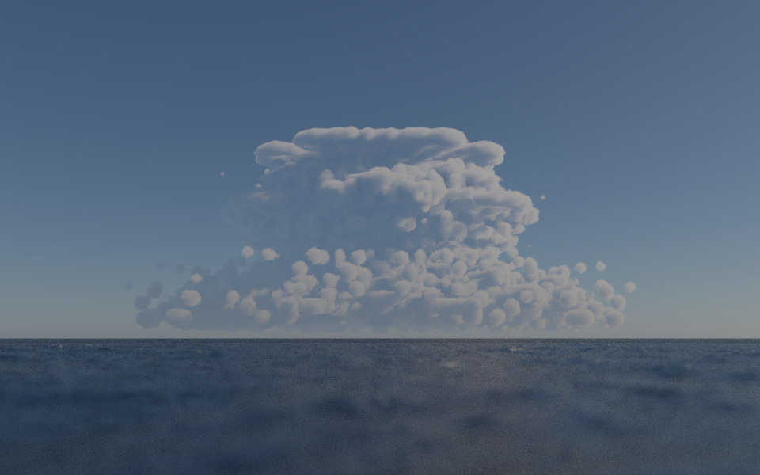

`cumulonimbus-simulated.json`: `{"type": "harris_cumulus", "sounding": "weisman_klemp", "ice": true, "grid": [64, 34, 64], "cell": 500, "time": 2400, "bubble": {...}}`

A thunderstorm grown by the cloud simulation, rather than shaped by hand. The air is Weisman
and Klemp's analytic sounding, the standard case for simulated storms (M. L. Weisman and
J. B. Klemp, Mon. Wea. Rev. 1982): conditionally unstable up to a tropopause at 12 km, moist
below and dry above, with a CAPE of about 2200 J/kg. A warm bubble, 2 K warmer than its
surroundings and 10 km across, starts the storm. Its updraft reaches 48 m/s (parcel theory
gives 66 m/s for this sounding, and real updrafts realise two thirds or so), its top reaches
the tropopause within fifteen minutes and overshoots to 14 km, and then the cloud spreads
sideways under the stable stratosphere: the anvil, flat-topped. Above freezing it condenses
water, below it a mixture of water and ice (`"ice": true`), whose latent heat of freezing
drives the upper tower half a kilometre higher. The grid is 32 km across and 17 km deep, in
500 m cells, so detail below that is added (`turbulence`); the simulation takes about ten
minutes, and is cached. The rain is Kessler's simplest scheme, which drains cloud water beyond
a gram per kilogram at once, so the core is thinner than a real storm's.

## Phenomena

### Sunset

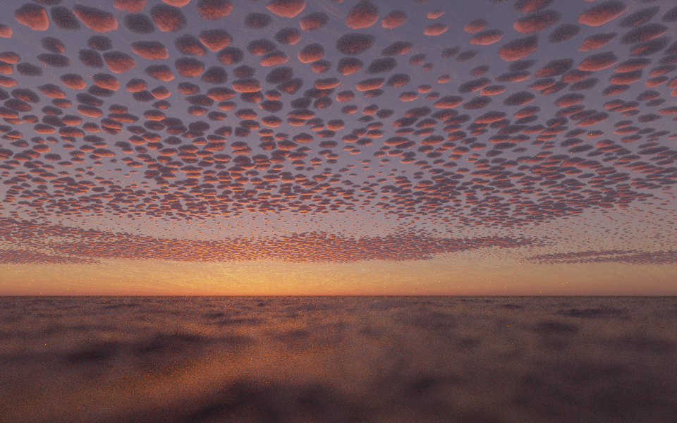

`sunset.json`: altocumulus at 4 km and cirrus at 9 km, the sun 1° below the horizon

Sunset colours come from two things. Sunlight reaching each point of a cloud has crossed the
atmosphere on its own path, looked up for the point's altitude and the sun's angle there. Near
the horizon that path runs for hundreds of kilometres through the lowest air, so blue is
scattered out and red is left. And the planet's shadow rises through the sky as the sun sinks,
so clouds go out from the bottom up. Once the sun has set at the ground, clouds at 4 km are still
lit for a few minutes, from below, by light that grazed the earth a few kilometres up: the "fire
sky", every cloudlet's underside pink and red.

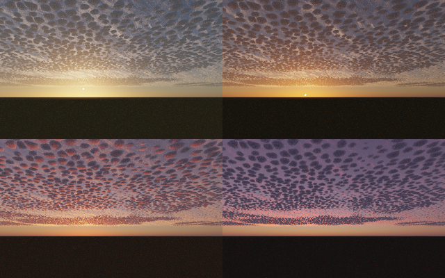

The sun at 4°, 1°, -1° and -3°: gold, then orange, then the undersides lit red from below, then
the altocumulus in the earth's shadow, grey against the twilight, with distant cloudlets towards
the sunset still catching the light. The light falls a hundredfold through the sequence; as a
photographer would, each frame is exposed for it (exposures 2, 3, 10 and 30, Reinhard tone
mapping).

### Crepuscular rays

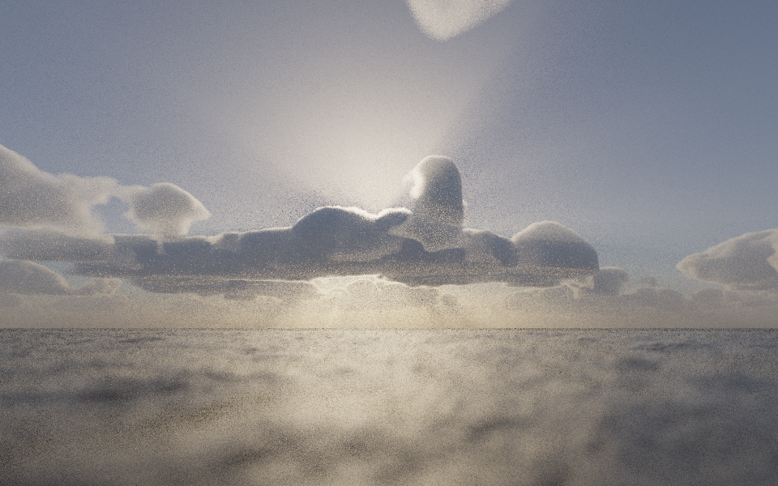

`crepuscular-rays.json`: `{"type": "skysphere", "crepuscular_rays": true, "mie_coefficient": 1e-4}`

Beams of sunlight through gaps in clouds, and shafts of shadow between them, in hazy air. The
sky's light is integrated along each view ray, but the air there is shadowed by clouds and
terrain. For each camera ray, two points along it are tested for sunlight through the scene, chosen
in proportion to the light the air there would scatter. The light that the shadowed air doesn't
scatter is taken away, an unbiased estimate. Clouds against a low sun then stand dark against
the glow, rather than washed out by haze that should have been in their shadow. Beams need haze
to show: this scene has about four times the default aerosol (`mie_coefficient`), a summer
afternoon's.

### Rain and rainbows

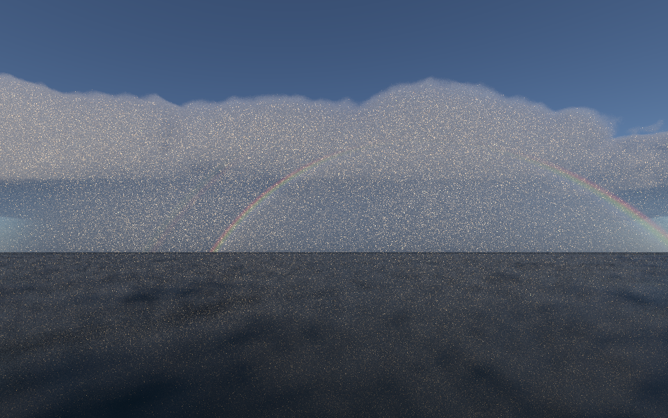

`rain.json`: `{"type": "precipitation", "base": 1500, "rain_rate": 12, "rainbow": true}`, under
`{"type": "nubis_clouds", "base": 1500, "top": 5500, "coverage": 1}`

Rain shafts under a storm, lit by the low sun behind the viewer, with a rainbow. Rain is thin
compared with cloud. Its drops are a millimetre or two across, so its extinction depends on how
hard it rains: with the Marshall-Palmer drop sizes, about 0.001 per metre at 5 mm/h, a
visibility of a few kilometres. Shafts fall from cells and lean downwind as the wind changes
with height (`shear`), streaked where drops fall together. With a `fall_depth`, the
precipitation evaporates as it falls: that is virga, its streaks fraying out before they reach
the ground.

The rainbow comes from tracing sunlight through water spheres by geometric optics: reflected,
or refracted in and out after one, two or three internal reflections, with Fresnel's split at
each surface. It is traced per wavelength across each colour channel, since water's refractive
index falls from blue to red, and averaged over the sun's disc (`src/material/rainbow.rs`). The
primary bow lies 42° from the point opposite the sun, red outside; the fainter secondary lies at
51°, its colours reversed. Between them is Alexander's dark band, and inside the primary the sky
is brighter. Like halos, the bow applies to direct sunlight at a path's first scattering.

### Snow showers


`snow-showers.json`: `{"type": "precipitation", "kind": "snow", "rain_rate": 1.2}` under cumulus

Snow falls slowly, about a metre a second, so on the same wind it drifts several times as far
as rain, and its shafts lean far over; and snowflakes are large for the water they hold, so a
little snow stops a lot of light: Gunn and Marshall's distribution of flake sizes, with flakes
three times their melted diameter, gives a visibility of some 500 m at 1.2 mm/h of water,
against kilometres for rain of the same rate. A `melting_level` turns it to rain below; `"kind":
"hail"` falls as ice stones of `hail_size` mm, which stop little light for the ice they carry.

### Fogbow


`fogbow.json`: a bank of sea fog, `"rainbow": {"drop_radius": 12, "spread": 0.25}`, the sun low behind

The rainbow of fog: broad, nearly white, a little inside the rainbow's 42°, with a faint bluish
inner edge. Fog droplets are some ten micrometres across, a few dozen wavelengths, too small
for the rays that explain the rainbow. Near a bow the light on either side of the rainbow ray
interferes, which Airy's theory gives as Ai² of the angle from it scaled by the drop's size
(`material::rainbow`). For raindrops the main peak is narrow and sits at the geometric 42°;
for fog droplets it is several degrees wide, so each colour's bow overlaps the others' into
white, and moves inwards. For drizzle, a fifth of a millimetre, the same theory gives the
supernumerary bows: pale pink and green fringes just inside the primary. `"rainbow": true`
keeps the geometric rays alone.

### Mammatus

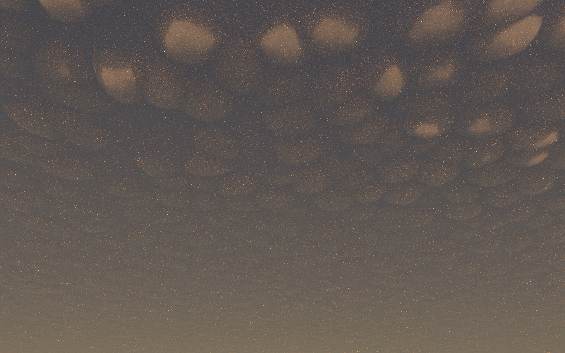

`mammatus.json`: `{"type": "mammatus", "base": 7000, "thickness": 2000, "edge_direction": [-1, 0], "oz": true}`

Pouches hanging from the underside of an anvil: a supplementary feature (mamma) of cumulonimbus,
and sometimes of altocumulus or stratocumulus. Cloudy air sinking from the base cools as its ice
or droplets evaporate. Where that cooling outpaces the warming of its descent, it keeps sinking
in lobes into the drier air below (Schultz et al., J. Atmos. Sci. 2006). Each pouch is a
kilometre or two across and a few hundred metres deep, with a sharp, smooth boundary where the
cloud evaporates.

The anvil is a thick sheet covering the sky beyond a ragged edge, thinning towards it. Under it
hangs a jittered hexagonal lattice of half-ellipsoids, varied in depth and gathered into
clusters, deepest a few kilometres in from the edge. In the scene the sun is setting beyond the
anvil's edge. Its light, reddened by its long path through the air, comes in under the base and
catches the sides of the nearest pouches, while the anvil overhead hides most of the sky. The
scene uses Reinhard tone mapping with an exposure of 3, as a photograph at dusk would.

### Lightning

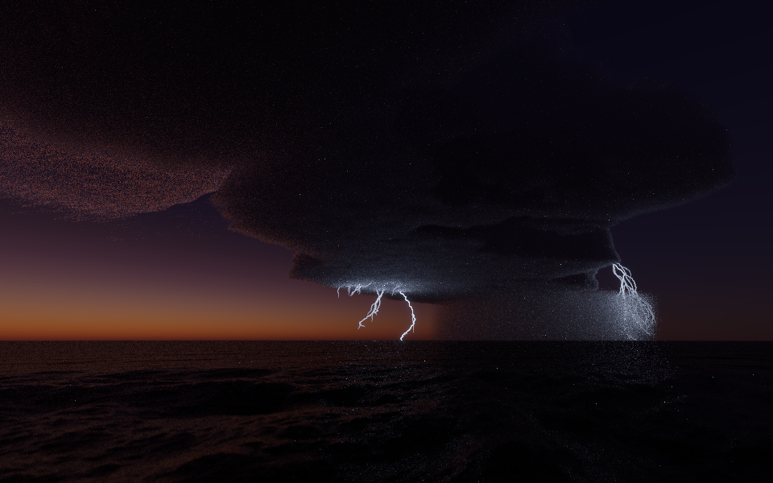

`lightning.json`: `{"type": "lightning", "start": [2000, 7500, 9000], "target": [8000, 4000], "seed": 5}`
and `{"type": "lightning", "kind": "intracloud", "start": [500, 8000, 9500], "cloud_length": 25000}`,
in the cumulonimbus at night (`"diffusion": true`)

A one-second exposure of a thunderstorm at night. A cloud-to-ground stroke leaves the storm
high on its flank, at 7.5 km where the leader set out from the charge region, runs out across
clear air and comes down kilometres in front of the rain; a second strikes through the rain
shaft, lighting the curtain it falls through. Inside the upper tower an intracloud flash
spreads through 25 km of channel, and the whole storm glows with its light, against a black
sky.

The sea shows the lightning the way water does: it reflects only a few percent of the light
falling on it diffusely (its body is dark), so it isn't lit up like ground; instead it mirrors
whatever is bright. The bolt lays a path of glitter across the waves towards the camera, and
the lit rain a fainter sheen.

The channel is grown as a *stepped leader* (`procedural::lightning`), in the storm's electric
field. The cloud is a tripole of charge regions: the negative one where the flash starts, a
positive one 4 km above it and a small positive pocket below; the leader carries negative
charge of its own, about a millicoulomb per metre; and each charge has its image in the
conducting ground. Leader tips push out in steps of tens of metres (`step`). At each step every
tip probes the field just ahead of it, and advances with probability (E / E_max)^η, as in the
dielectric breakdown model (Niemeyer, Pietronero and Wiesmann 1984; η = 3, `eta`, for the
sparse branching of lightning); a tip left behind for long stalls. So the channel's own charge
screens the branches beside it, which stay short, and with its image draws the leading tip to
the ground ever harder as it nears it. Each step turns by about 16° from the last, as measured
in photographs of channels (Hill 1968), about the field's direction, and a `target` draws it
too. Tips fork (`branching`); when one comes within
`striking_distance` of the ground, an upward leader meets it and the return stroke flows
along that path, the main channel. Each straight step is then broken into a fractal path down
to a couple of metres (`detail`, `roughness`), so the channel is jagged at every scale. The
branches that lost the race carry only the charge stored along them, so each glows in
proportion to the length of channel beyond it, fading towards its tips. Inside the cloud the
flash spreads sideways in a fainter network (`cloud_length`); `"kind": "intracloud"` gives that
network alone, sheet lightning. Each generation of branch forks a third as often as the one it
grew from, so a flash has a few dozen branches, not a bush.

It is as bright as the real thing. A return stroke radiates a few hundred joules per metre in
the visible and near infrared (Krider et al. 1968), about 1.5·10⁴ lumen-seconds per metre
(`luminous_energy`); averaged over `strokes` strokes and the `shutter` time, that is the light
per metre of channel, on the same scale as the sun (whose intensity, 4.9 here, it follows). A
metre or so from the channel it is far brighter than daylight; a kilometre away it gives a few
lux, tens of times full moonlight: a stroke a kilometre away gives a few lux-seconds, which
is why lightning is photographed at f/8 and ISO 100 to 400, and its glow inside a cloud at
ISO 1600 or more. So the scene is exposed as a night photograph would be (`"exposure": 3000`),
the channel itself blown out, with glare. Its colour is its spectrum
(`spectrum::lightning`): a channel at some 30 000 K emits mostly lines, broadened by its pressure
to a few nanometres, of singly ionised nitrogen in the blue and green, hydrogen's Hα in the red
and neutral oxygen and nitrogen in the near infrared, over a continuum (Orville 1968; Salanave
1961). That is bluish white, far whiter than a blackbody at the channel's temperature; in
spectral rendering each line is traced at its wavelength.

The channel is a light, sampled directly: a light BVH over its segments chooses one by the
light it could send to the point being lit, then a point on the side facing it. Seen from
kilometres away a channel a few centimetres across is far thinner than a pixel, and most
samples would miss it; what a camera records of it there is its light per metre, so each
segment is widened to half a pixel as seen from the camera, its radiance lowered to keep its
light per metre (`pixel_width`). The channel casts no shadow.

A cloud absorbs next to nothing, so light from a channel inside it can't go anywhere but out:
nearly all of it emerges, after hundreds of scatterings, and the cloud glows. A path tracer
finds those paths only by chance, so the storm uses the diffusion approximation
(`"diffusion"`, as overcast decks do for sunlight): at a path's first vertex in the cloud, each
light sample's direct light is attenuated as usual, and what it loses on the way arrives
diffused. Light from a source inside a cloud is trapped, scattered to and fro until it leaks
out, so near the surface over it the cloud is brighter than the source alone would make it
there. The diffusion solution for a point source buried in a half-space is a dipole, the source
and its negative image above the surface (Farrell, Patterson and Wilson 1992; the same as
Jensen et al.'s BSSRDF for subsurface scattering): straight over a deep source, four times as
bright as in empty space, and fading to the sides, so the glow gathers over the channels. The
cloud's coefficients are measured along the line to each light sample, and the light that
leaves by the cloud's far side is taken off by diffusion's split through a slab. Real cloud
droplets absorb about a hundred-thousandth of the light at each scattering, so trapped light
spreads for kilometres; at the albedo of 0.99 the other cloud scenes use it would die out in a
few hundred metres, so the storm has 0.9999. Paths in the cloud end after a few vertices
(`max_depth`), since later ones gather nothing at night: the first has counted the flashes.

### Lightning under the anvil

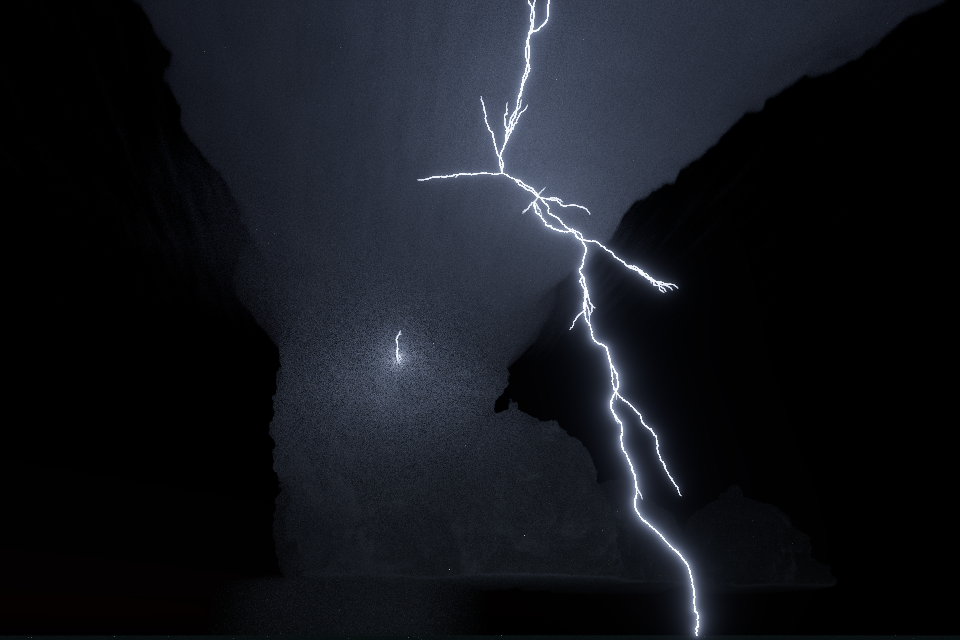

`lightning-anvil.json`: `{"type": "lightning", "kind": "intracloud", "start": [-1500, 9000, 8000], "cloud_length": 40000}`,
a cloud-to-ground stroke and a flash inside the tower, seen from under the anvil's leading edge

The storm from beneath, at night: the anvil spreads overhead towards the camera (`wind_direction`
towards it), and the tower rises through the middle of the view. Channels crawl across the sky
under the anvil's base (spider lightning, `"kind": "intracloud"` held near its `start` height by
`cloud_depth`), lighting its underside; one comes down to the ground. A flash about a kilometre
inside the tower lights it from within, through the diffusion approximation. Seen from below, the
anvil flares down into the tower, its underside hanging in soft lobes and its edges scalloped.
A further flash spreads through the anvil off to the left; in a long exposure a storm flashes
many times, and each lights its own part of it. Exposed as long exposures of storms are
(`"exposure": 6000`, about ISO 3200).

The clear air glows too. At night the sky is no light source, but the air is still there to
scatter the flashes: the lowest 3 km are a `volume` with the sea-level air's scattering, Rayleigh's
for the molecules (5.8, 13.5 and 33·10⁻⁶ per metre in red, green and blue) plus a little haze, so
the sky around the storm is deep blue where the flashes light it, brightest around each channel,
with the cloud dark against it. With several flashes, `"light_sampler": "bvh"` samples the ones
near each point rather than choosing by their total power. `lightning.json` has the same air.

### Iridescence

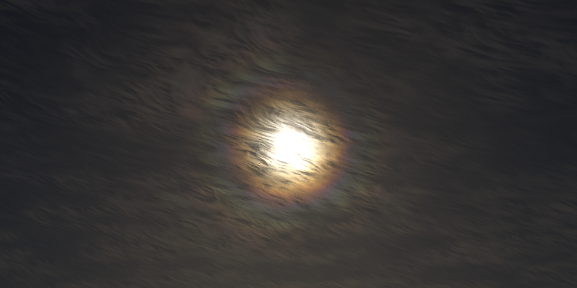

`cirrus-iridescence.json`: `{"type": "hogan_kew_cirrus", "genus": "cirrocumulus", "particle_radius": 4, "diffraction": {"spread": 0.1}}`

Pastel colours near the sun, in thin cloud of small, even particles: here, young ice at the
edges of cirrocumulus cells. Diffraction by the particles is modelled as an Airy pattern,
averaged over their sizes and over wavelengths across each colour channel
(`src/material/diffraction.rs`). Where particles are larger, the colours wash out. Any cloud
generator that reports particle sizes can show it: `benard_altocumulus` (`particle_radius`) and
`harris_cumulus` (`droplet_radius`) do.

### Clouds from orbit

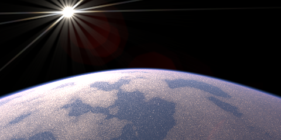

`orbit.json`: `{"type": "nubis_clouds", "mapping": "global"}` and `{"type": "hogan_kew_cirrus", "mapping": "global"}`

Cumulus and cirrus over the whole planet, seen from 400 km. With `"mapping": "global"`, the
weather map is a cube-sphere over the globe, with no seams or poles. Climate bands give cloudy
tropics and storm tracks and clear subtropics. Cirrus follows a planet-wide wind field. The render
is still noisy: from orbit, cloud detail is much smaller than a pixel.

## Not yet

- **Lightning seen through cloud**: the dipole finds the cloud's surface near each point from
  the density's gradient over 25 m, so turrets' relief follows their curvature; but it still
  treats that surface as a plane, so light from a flash deep inside a tower reaches its far
  side too evenly.
- **Lightning's physics**: the leader's field is from point charges and their images, not
  solved around the conducting channel; the channel's light in time is a sequence of strokes
  without its cooling between them.
- **A simulated storm's microphysics**: rain in the simulation is Kessler's simplest scheme,
  and ice is a mixed phase decided by temperature alone; a storm with graupel and hail, and
  rain that falls through the cloud rather than leaving it at once, needs a fuller scheme.
- **Other species**: fibratus, floccus, volutus (roll clouds), arcus (shelf clouds) and the
  rest each need their own mechanism.
- **Small droplets' optics**: below about 10 µm, Airy's theory of the bow fails and Mie theory is
  needed; the glory, round the camera's shadow on cloud, needs it too.
