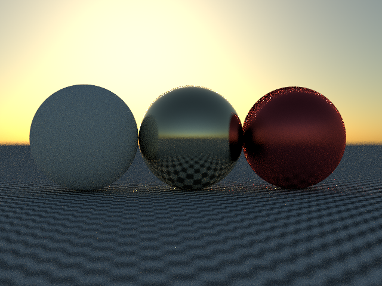
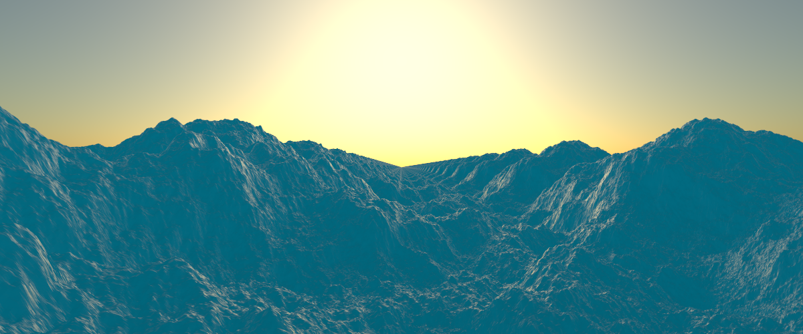
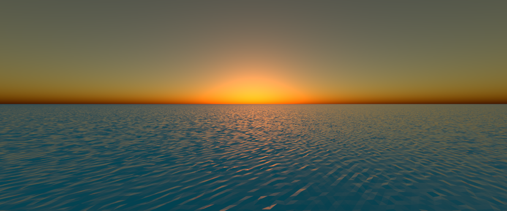
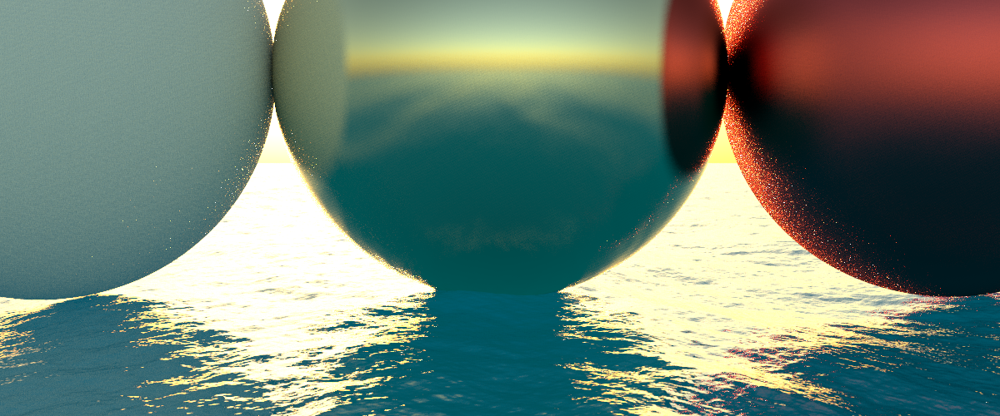
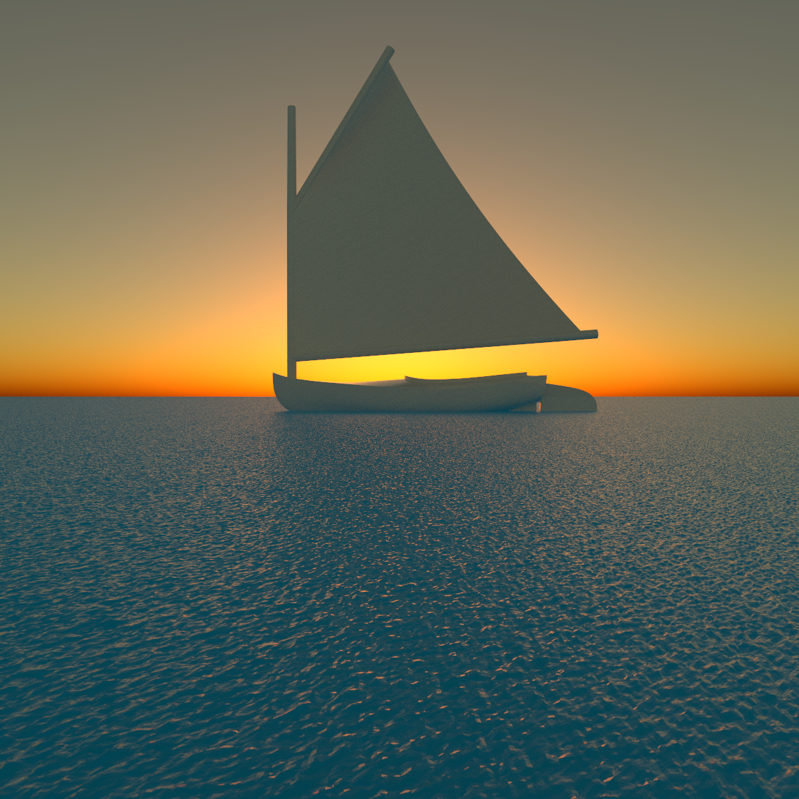
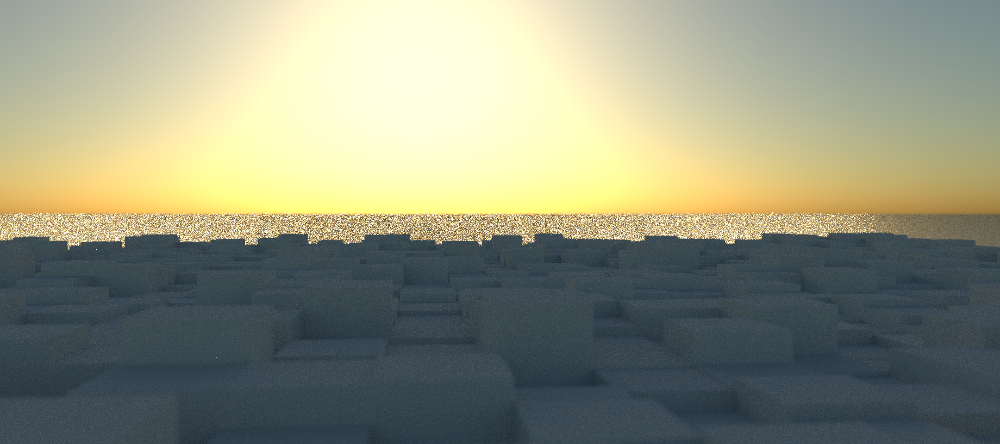
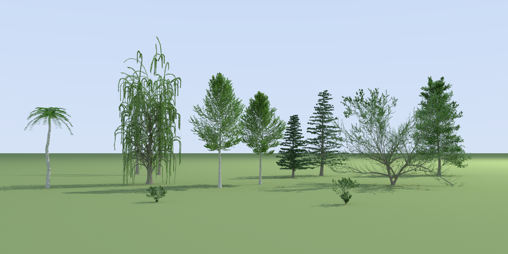
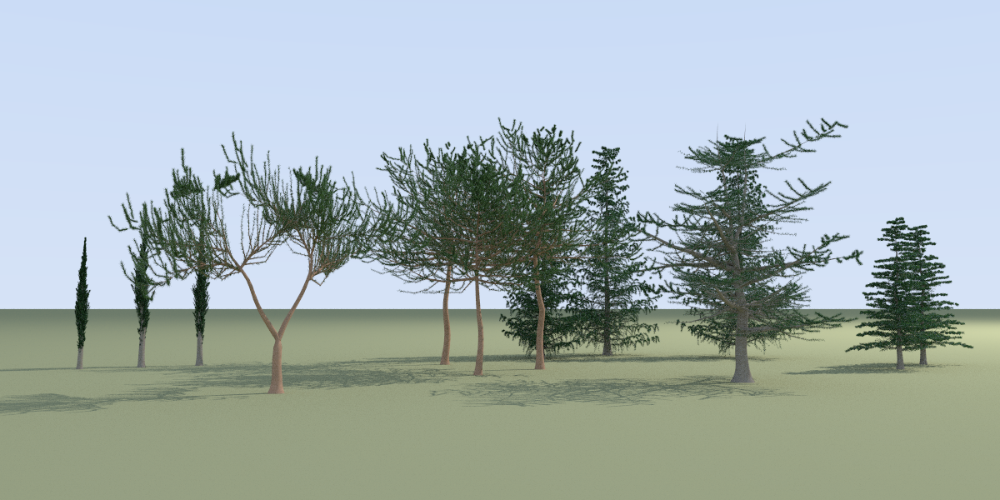
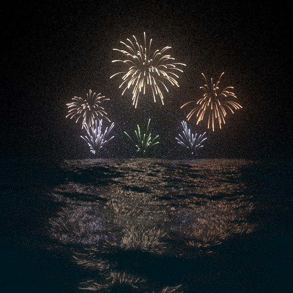

# Test Scenes

## Spheres
Spheres demonstrating 3 different materials.

## Ocean scenes
Demonstrating the ocean generation.

## Block Terrain
Procedural art with a block city skyline at sunset.

## Trees
Procedural trees (Weber and Penn's parametric model). From left to right: palm, weeping willow
(with two Lombardy poplars mostly hidden behind it), quaking aspens, balsam firs, California
black oak and black tupelo, with shrubs in front. Each is
`{"type": "tree", "species": "...", "seed": 0, "location": [x, y, z], "bark": material, "leaves": material}`,
with optional `"params"` overriding the species' parameters (see `src/procedural/tree.rs`).
`"leaves"` may list several materials, each leaf taking one at random. The leaves here use the
translucent `leaf` material, so they glow where the sun, behind and to the right, shines
through them, and the bark is textured with noise.

Evergreens, from left to right: Italian cypresses, a forked stone (umbrella) pine, Scots pines,
Norway spruces, a cedar of Lebanon and balsam firs. Trees of the same species differ only by
their seed.

## Fireworks

