# Test Scenes

For clouds, see the [cloud atlas](./cloud-atlas.md).

## Bump mapping
Bumps, dents, wrinkles, ripples and waves (see [bump mapping](../docs/bump-mapping.md)).
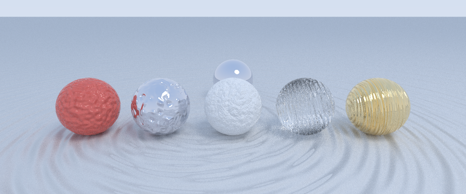

## Shapes
Every shape modelled on POV-Ray's (see the [shape reference](../docs/shapes.md)).
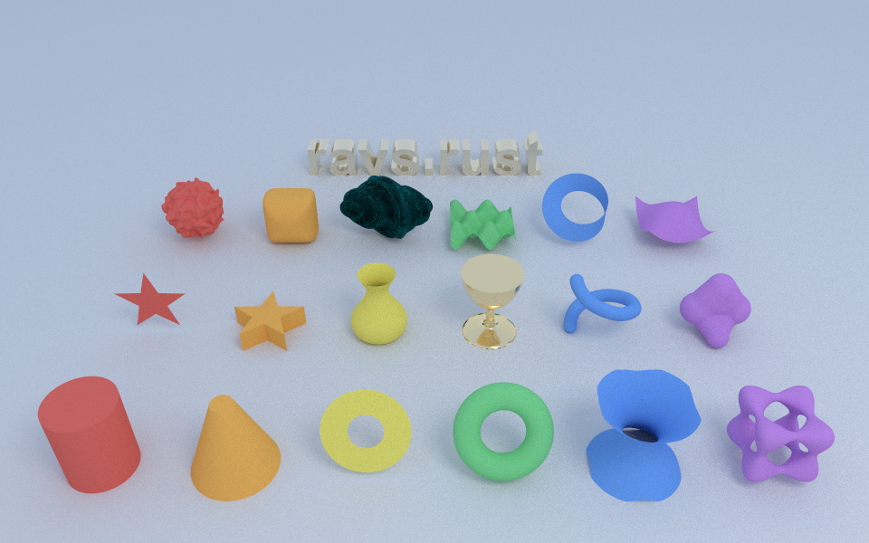

## CSG
Shapes combined: union, merge, intersection, difference and clipping (see the
[shape reference](../docs/shapes.md#combining-shapes-csg)).
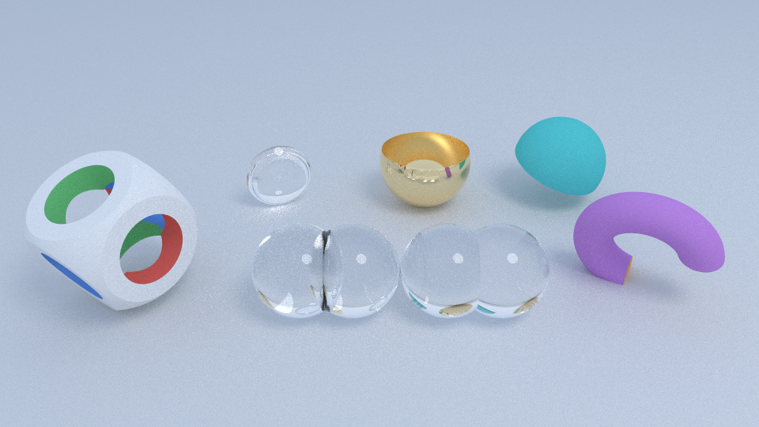

## Spectral rendering
White light dispersed by a diamond and a prism of SF11 flint glass, traced at sampled
wavelengths (`"spectral": true`; see `src/spectrum.rs`).
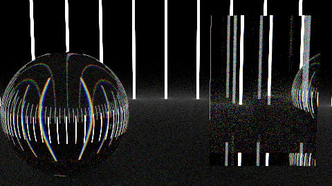

Lamps glowing as blackbodies at 1900, 2700, 4000, 6500 and 12000 K, at equal luminance.
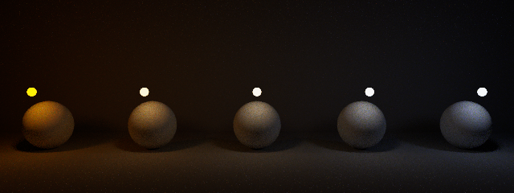

## Cameras and film
A double Gauss lens at f/2, traced element by element: depth of field and vignetting.
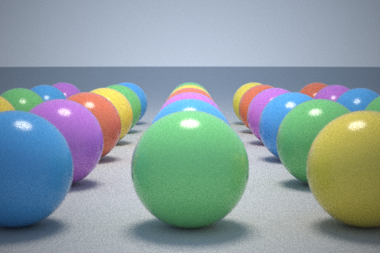

Motion blur: a sphere sliding, a box turning, a sphere rising, while the shutter is open.
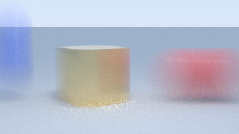

A spherical (equirectangular) panorama of the lamps scene.
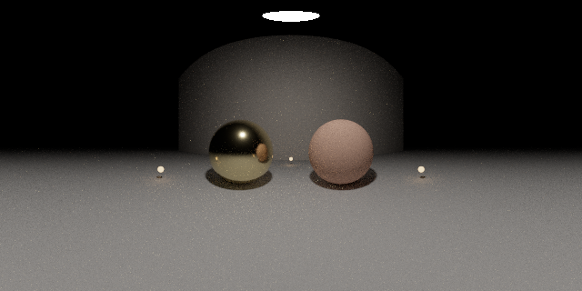

A star test of a lens's (Seidel) astigmatism: points blur into radial lines that grow with the
square of the distance from the centre.
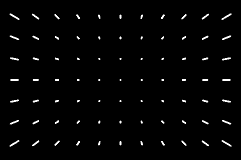

Lens flare: ghosts of the sun from reflections between the coated surfaces of a double Gauss
lens (exaggerated tenfold), and the starburst of a six-bladed aperture.
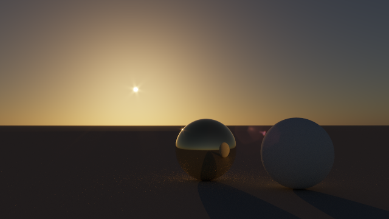

## Shapes after PBRT
Texture-space checkers on a sphere and a saddle (a bilinear patch), a cube smoothed by Loop
subdivision, ribbon and cylinder curves, lit by a quad light.
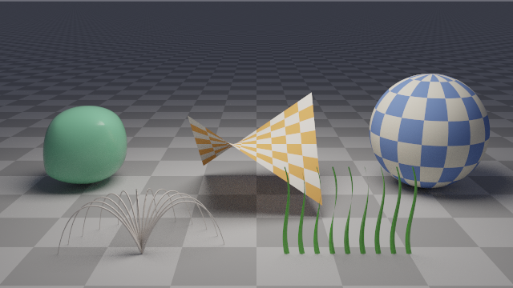

A ball of fur: 40,000 Bézier curves.
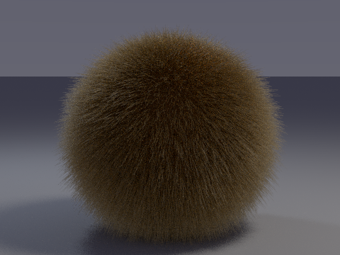

## Materials after PBRT
Measured metals (gold, copper, brass, silver, aluminium), brushed aluminium, frosted glass, a
thin pane, and a worn mix of paint and gold leaf.
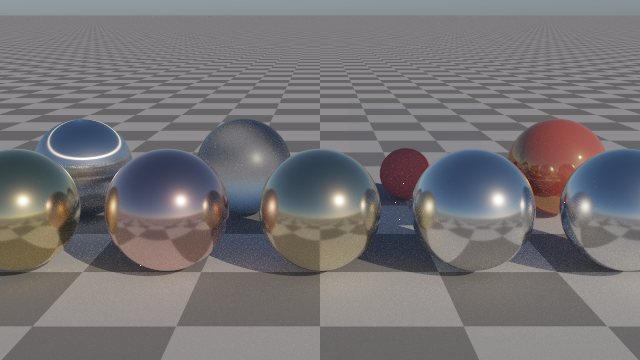

## Textures
Image textures and a normal map on a brick wall and sphere, paint worn to copper by a dirt mask,
and a checkerboard filtered into the distance.
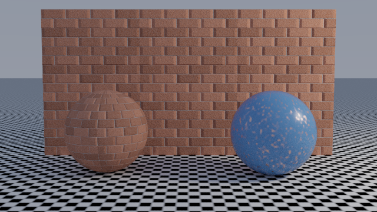

## Coats and subsurface scattering
Varnished bricks, a tinted coat and lacquered copper (pbrt's layered BSDFs), and jade, skin,
marble and a wax candle (random-walk subsurface scattering), backlit by a low sun.
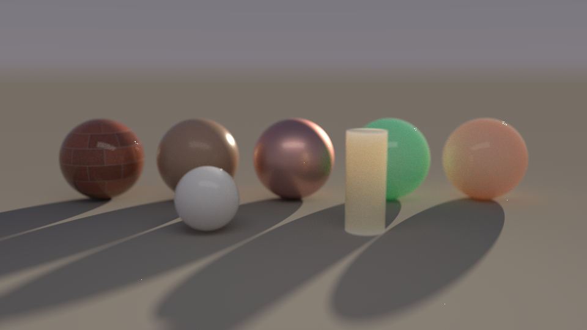

## Lights
A spot light on a red ball, a projector throwing a rose window on the wall, a goniometric lamp
with a shade, a stained-glass window as a textured area light, and strings of fairy lights,
sampled with the light BVH.
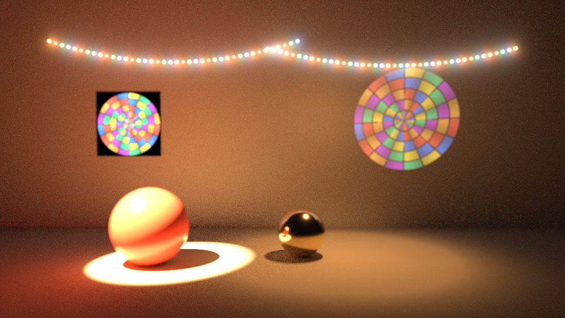

900 lamps, sampled by the light BVH.
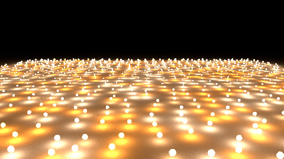

## Participating media
A smoke plume and its fire from voxel grids (blackbody emission by temperature), a glass ball
of red liquid (a chromatic absorber inside a dielectric), and a ball of medium that scatters
blue most, casting an orange shadow.
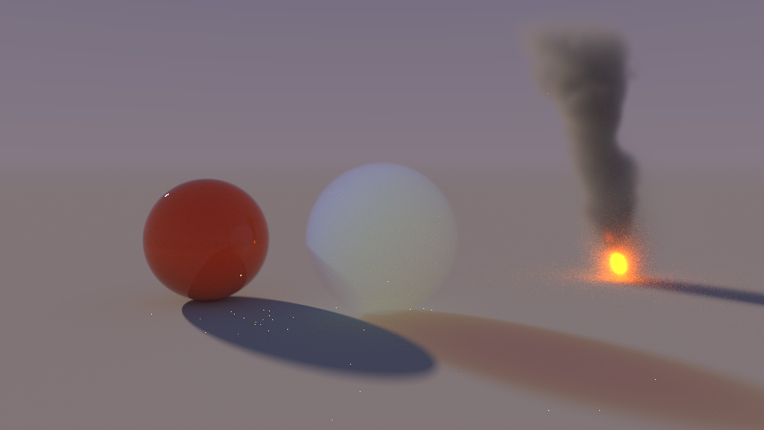

## Spheres
Spheres demonstrating 3 different materials.
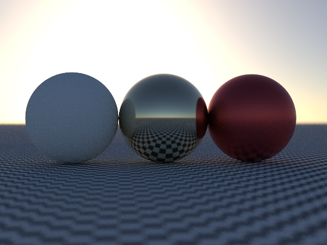

## NFF
A scene in Eric Haines' Neutral File Format, the format of the Standard Procedural Database,
written by hand in the style of its "balls" scene.
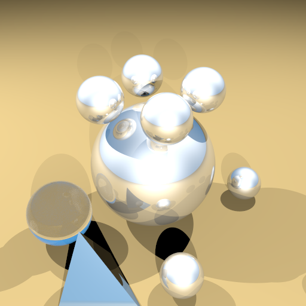

## Ocean scenes
Demonstrating the ocean generation.
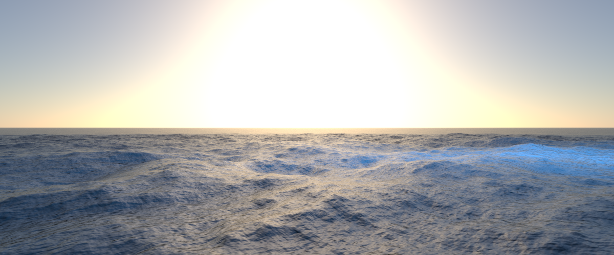

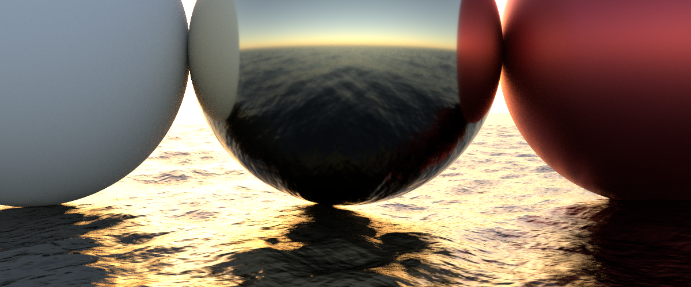

## Block Terrain
Procedural art with a block city skyline at sunset.
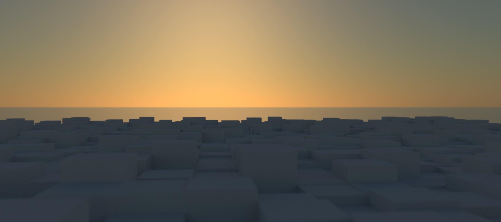

## Trees
Procedural trees (Weber and Penn's parametric model). From left to right: palm, weeping willow
(with two Lombardy poplars mostly hidden behind it), quaking aspens, balsam firs, California
black oak and black tupelo, with shrubs in front. Each is
`{"type": "tree", "species": "...", "seed": 0, "location": [x, y, z], "bark": material, "leaves": material}`,
with optional `"params"` overriding the species' parameters (see `src/procedural/tree.rs`).
`"leaves"` may list several materials, each leaf taking one at random. The leaves here use the
translucent `leaf` material, so they glow where the sun, behind and to the right, shines
through them, and the bark is textured with noise.
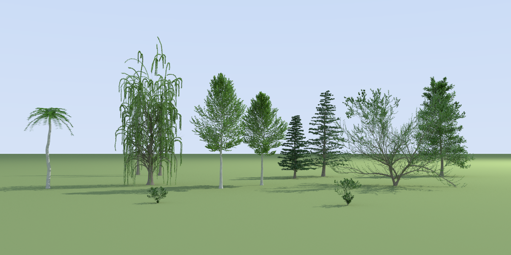

Evergreens, from left to right: Italian cypresses, a forked stone (umbrella) pine, Scots pines,
Norway spruces, a cedar of Lebanon and balsam firs. Trees of the same species differ only by
their seed.
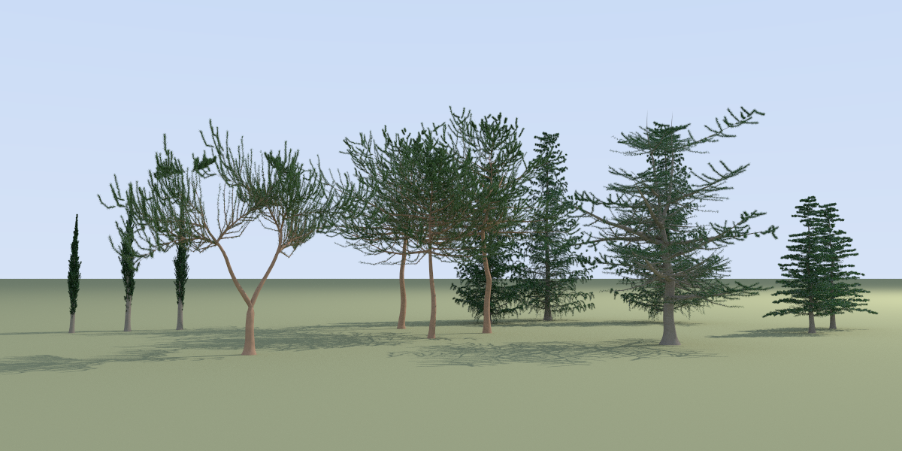

Autumn: each tree's `"autumn"` parameter says how far through the season it is, and its `leaf`
material gives autumn colours for shaded and sunlit leaves (`"autumn"`, `"autumn_sun"`) and a
dead colour (`"dead"`). Exposed leaves at the top and outside of a crown turn and fall first.
From left to right: a Lombardy poplar and a dead tree (`"dead_branches": 1`), a weeping willow
just turning, quaking aspens, evergreens, a California black oak with some dead limbs, a black
tupelo (scarlet in the sun, orange in shade) and, far right, an oak keeping its dead leaves
(`"leaf_fall": 0.35`); red shrubs in front.
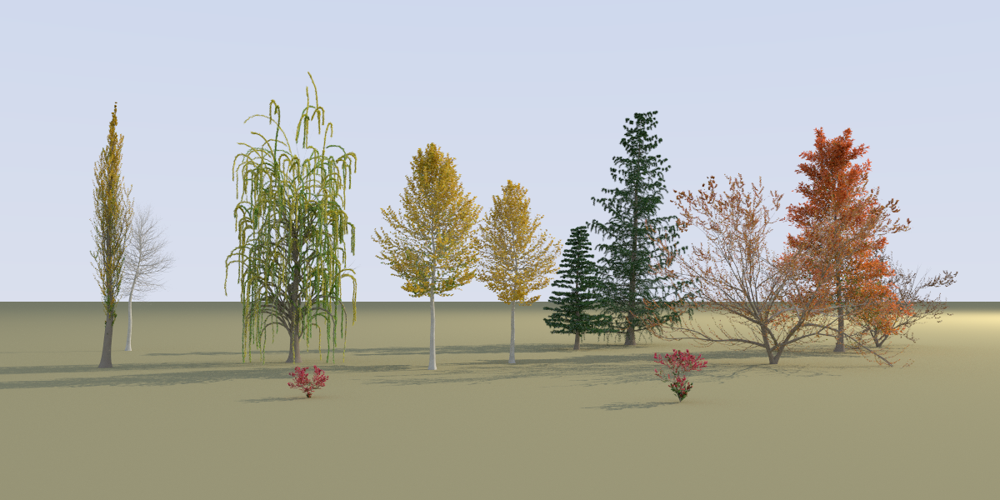

## Forest
A mixed forest of about 19,000 trees on heightmap terrain, seen across an autumn meadow of grass
under the sky model's low sun: Scots pines, Norway spruces, quaking aspens and black tupelos
turning in autumn, with a shrub understory. Each species is three distinct trees, instanced;
species grow in stands, with clearings, and none on steep slopes.
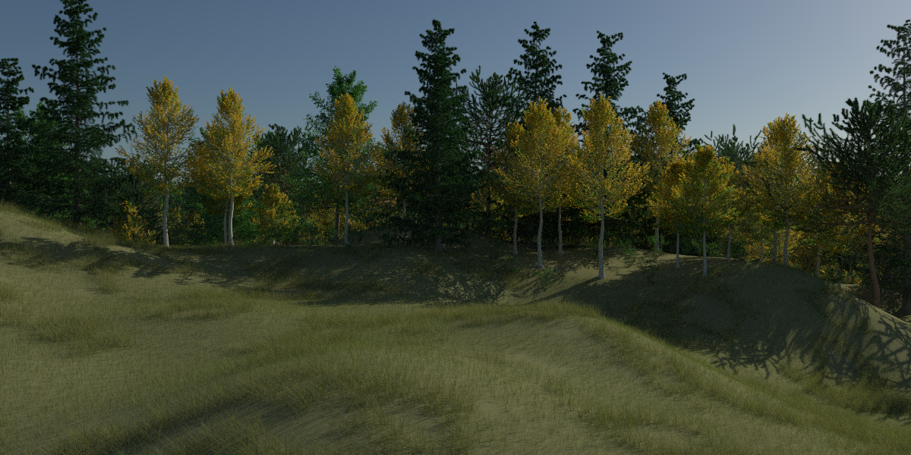
## Desert
Desert plants: `tree` species for the arid Southwest. From left to right: a sagebrush, a
creosote bush, a saguaro, an ocotillo and a Joshua tree; in front, a prickly pear, an agave
and a barrel cactus. The bushes and the Joshua tree are Weber and Penn trees; the succulents are
built by `src/procedural/succulent.rs` (ribbed columns with arms, squat barrels, chains of
pads, rosettes of channelled leaves, fans of canes), their `"bark"` the green body and their
`"leaves"` the spines. Like any species they can grow in a `forest`.
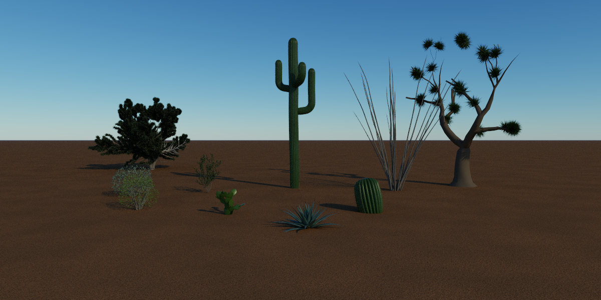

Mesas and buttes at sundown, over a Sonoran saguaro forest (about 30,000 instanced plants of
seven species). The terrain is a `"mesas"` heightmap: outlines cut from noise, each scarp a
caprock cliff stepping down in ledges to a talus apron, profiled by the exact distance from
the edge. Sandstone shows on the slopes too steep for the desert soil, by a `mix` material
whose `amount` is the slope (`{"slope": [26, 40], "jitter": 8}`).

## Alpine terrain
Mountains from seeded noise after one 100,000 year glacial cycle: tectonic uplift, river
incision and glacial erosion (`src/terrain/`).

Volcanic mountains after the same cycle: a stratovolcano with lava flows, alluvial valley
floors and filled lake basins.
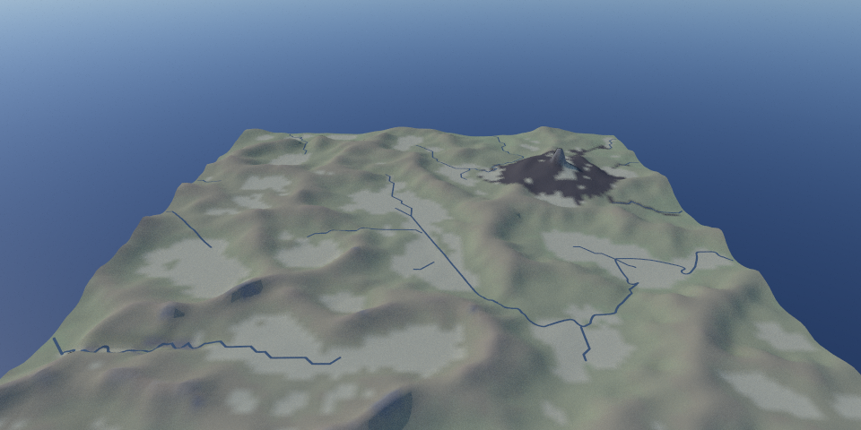

A coastal plain below mountains: rivers meandering to the sea, building deltas.
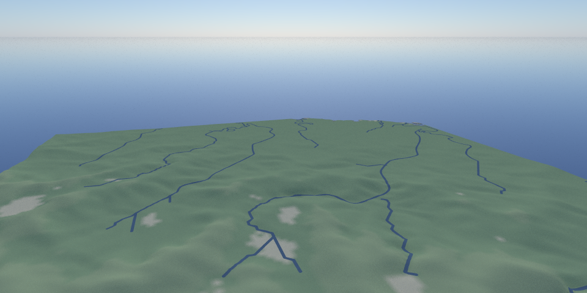

## Instancing
Twenty instances of one teapot mesh, each with its own transform and material.
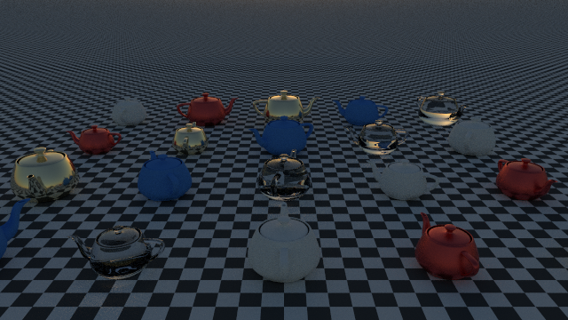

## Rocks
A terraced sandstone outcrop, granite, limestone and basalt boulders, and a scatter of mixed pebbles.
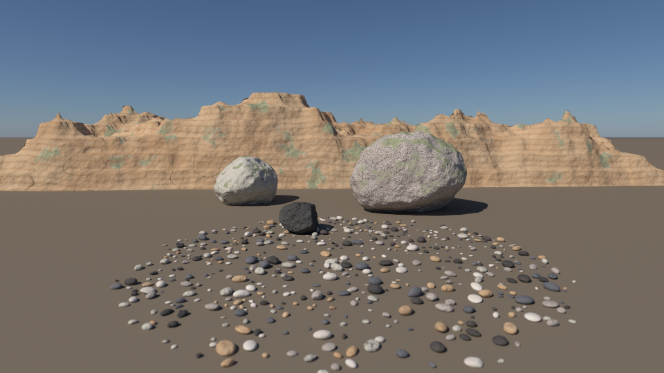

A pebble beach in close-up at sunset: dry shingle in the foreground, wet stones at the waterline, seen through refracting water.
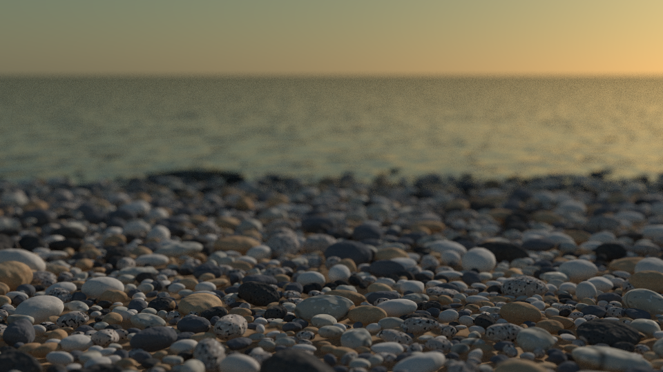

## Fireworks

## Grass
Procedural grass on a noise heightmap: a mix of meadow, tall and fescue species, grouped
into zones, in a summer breeze and lit from behind so the blades glow.

Species and conditions side by side. Front, left to right: tall grass on a windy day, a
summer meadow, a mown lawn with stripes. Back: reeds after rain, savanna in a drought,
tussocks in frost.
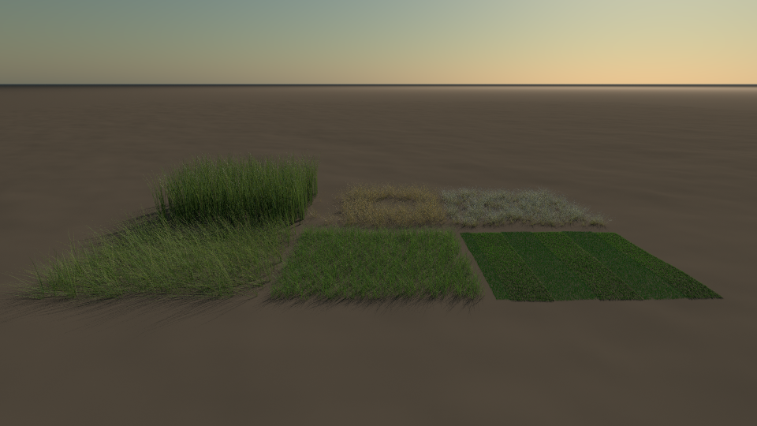
