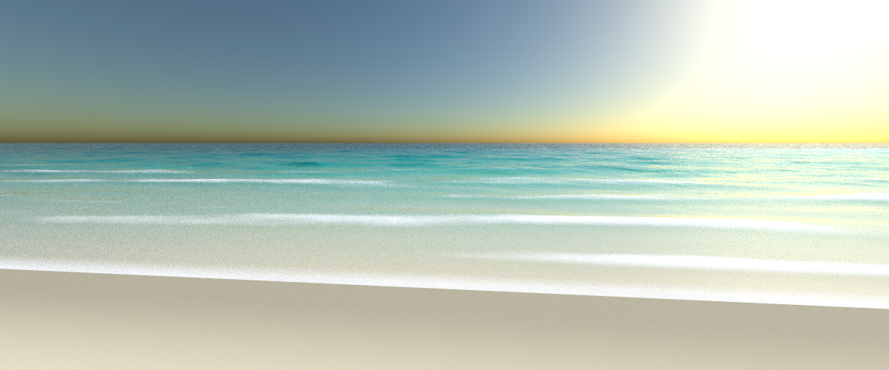

# Test Scenes

## Spheres
Spheres demonstrating 3 different materials.

## Ocean scenes
Demonstrating the ocean generation.

## Beach
The ocean meeting a sloping beach: waves shorten, refract parallel to the shore, steepen and
break, with foam on the breaking crests, shallow water over sand, and wet sand at the waterline.

## Block Terrain
Procedural art with a block city skyline at sunset.

## Fireworks

