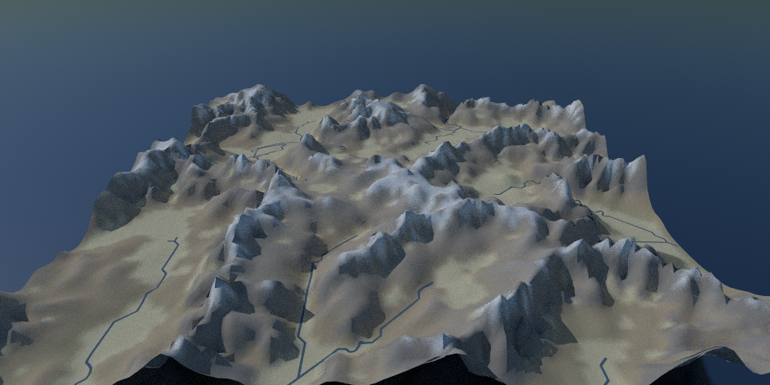
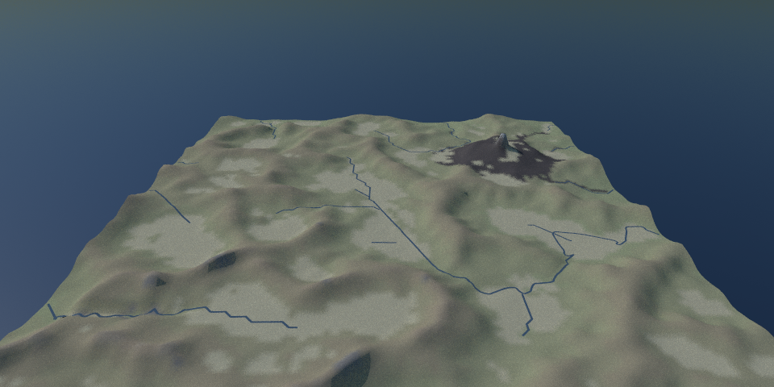
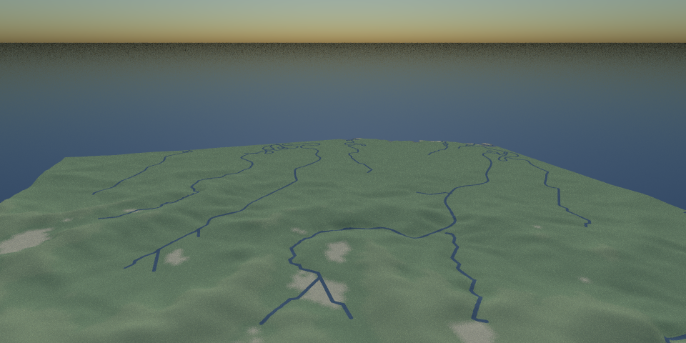

# Test Scenes

## Spheres
Spheres demonstrating 3 different materials.

## Ocean scenes
Demonstrating the ocean generation.

## Block Terrain
Procedural art with a block city skyline at sunset.

## Alpine terrain
Mountains from seeded noise after one 100,000 year glacial cycle: tectonic uplift, river
incision and glacial erosion (`src/terrain/`).

Volcanic mountains after the same cycle: a stratovolcano with lava flows, alluvial valley
floors and filled lake basins.

A coastal plain below mountains: rivers meandering to the sea, building deltas.

## Fireworks

