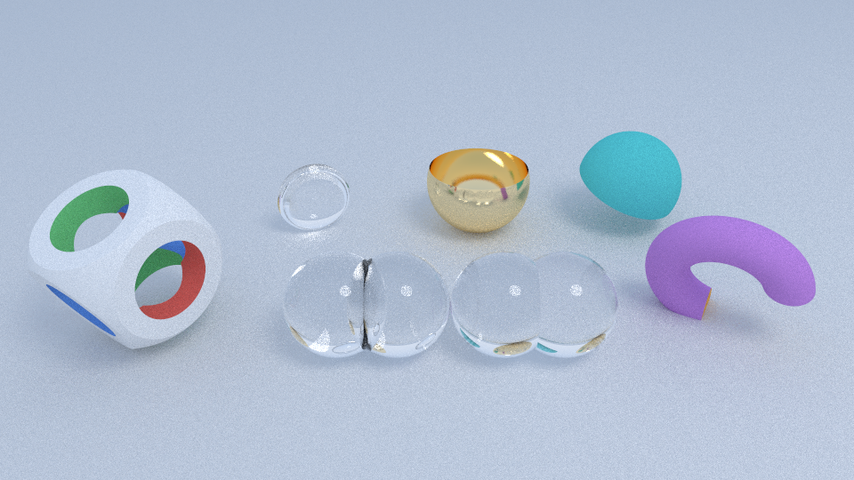
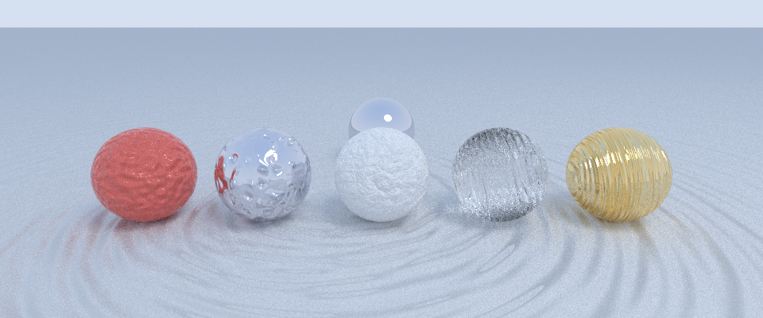
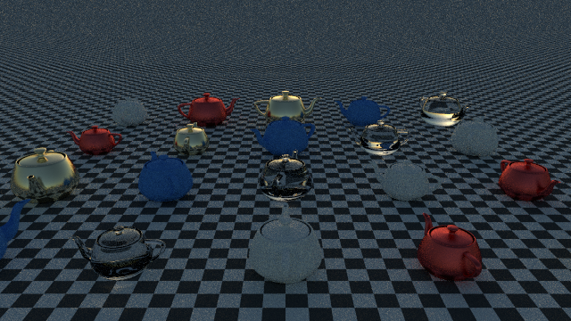
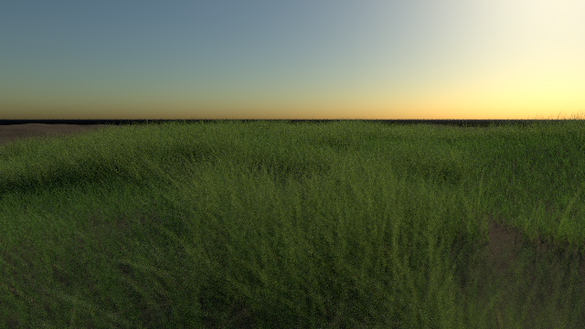
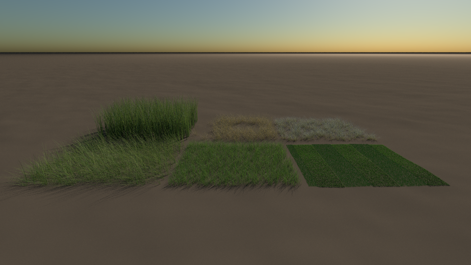

# Test Scenes

## Shapes
Every shape modelled on POV-Ray's (see the [shape reference](../docs/shapes.md)).

## CSG
Shapes combined: union, merge, intersection, difference and clipping (see the
[shape reference](../docs/shapes.md#combining-shapes-csg)).

## Bump mapping
Bumps, dents, wrinkles, ripples and waves (see [bump mapping](../docs/bump-mapping.md)).

## Spheres
Spheres demonstrating 3 different materials.

## Ocean scenes
Demonstrating the ocean generation.

## Block Terrain
Procedural art with a block city skyline at sunset.

## Instancing
Twenty instances of one teapot mesh, each with its own transform and material.

## Fireworks

## Grass
Procedural grass on a noise heightmap: a mix of meadow, tall and fescue species, grouped
into zones, in a summer breeze and lit from behind so the blades glow.

Species and conditions side by side. Front, left to right: tall grass on a windy day, a
summer meadow, a mown lawn with stripes. Back: reeds after rain, savanna in a drought,
tussocks in frost.

