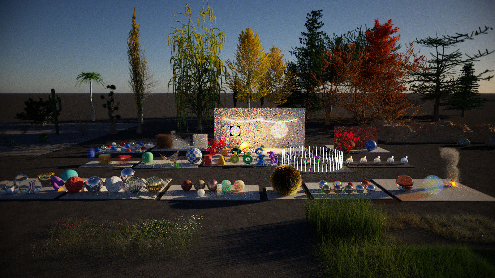
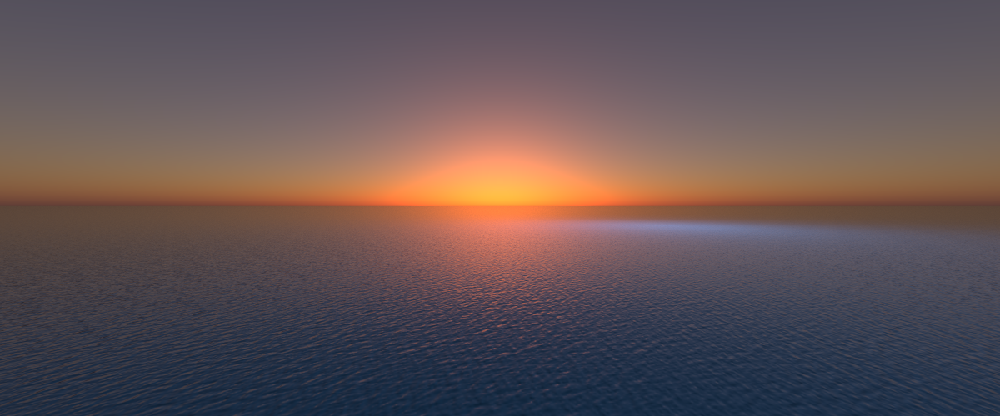
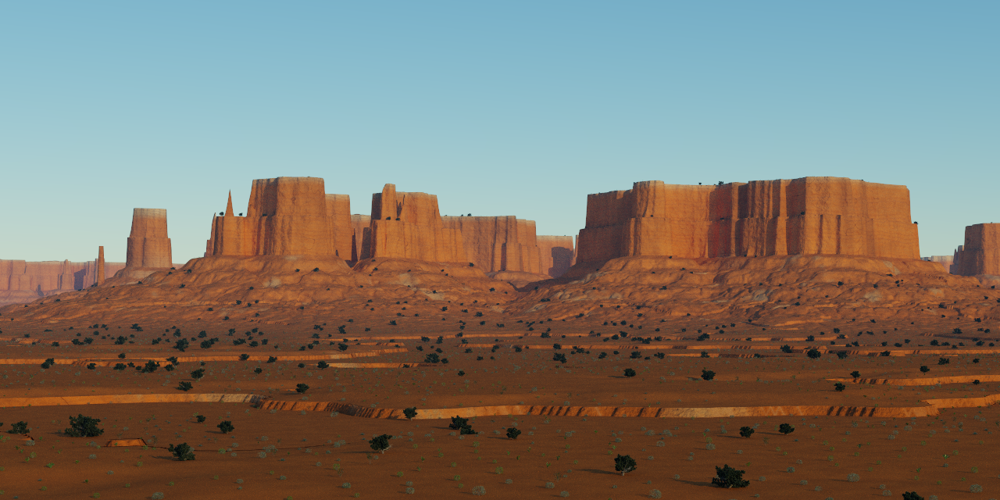
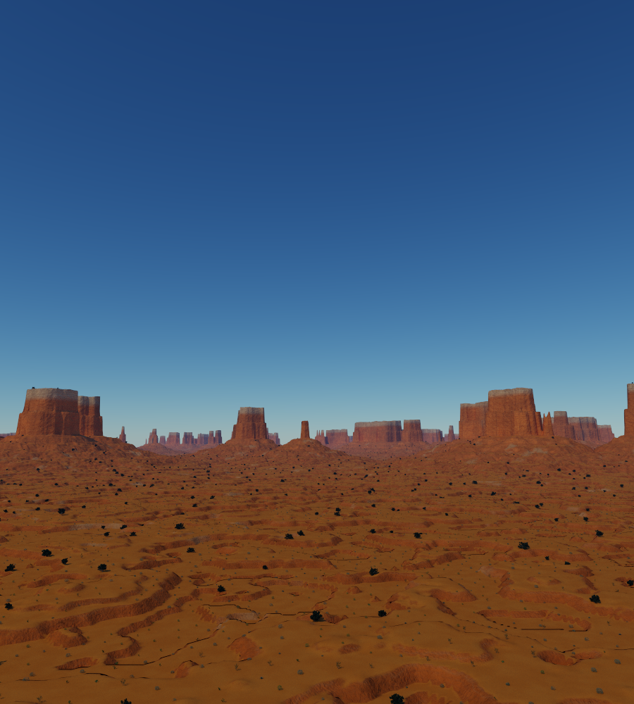
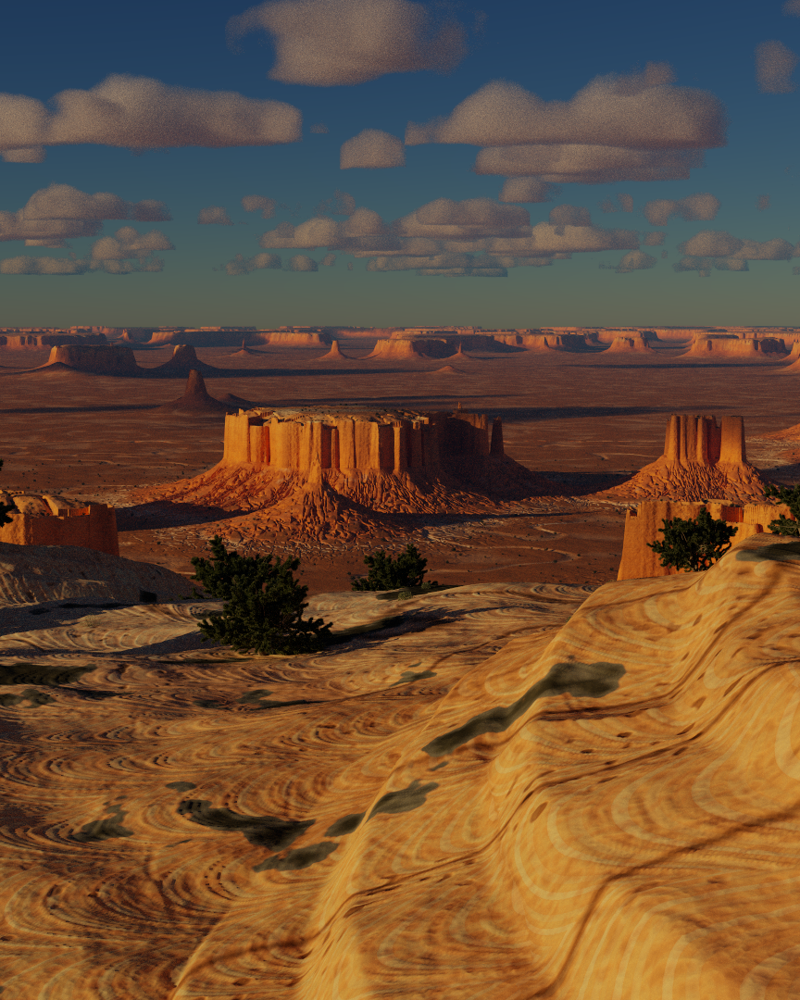
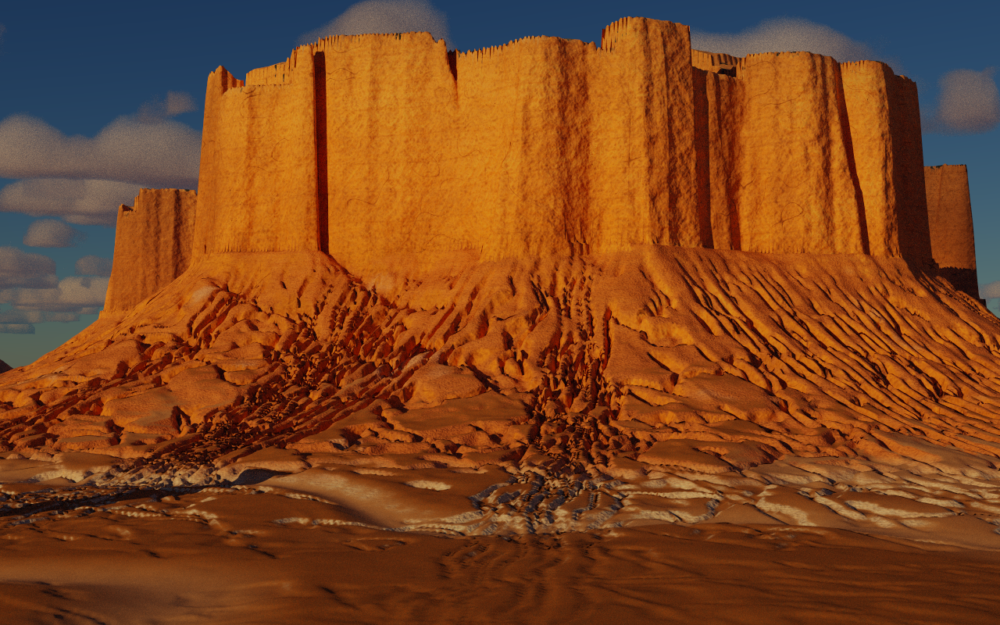
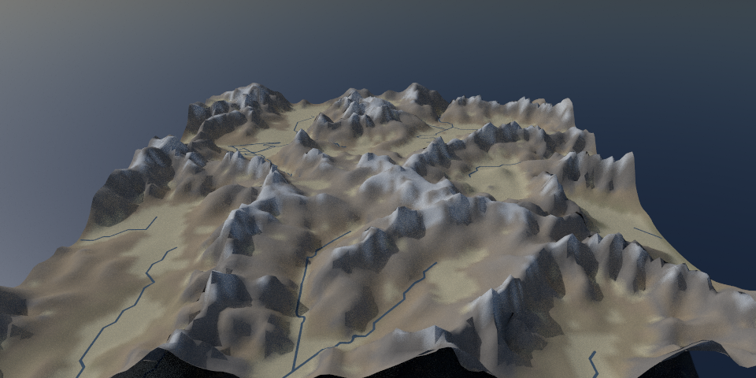
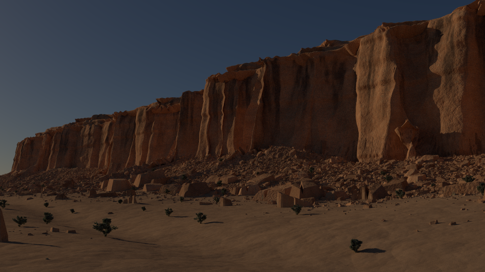
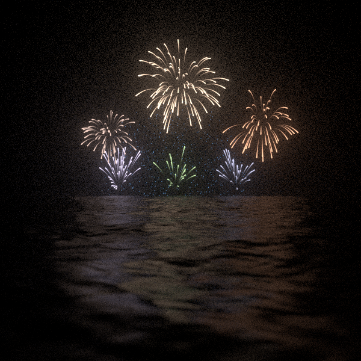
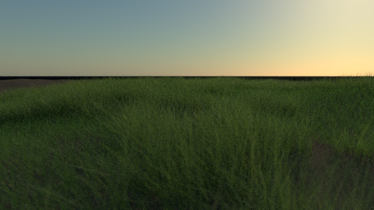

# Test Scenes

For clouds, see the [cloud atlas](./cloud-atlas.md).

## Stress test
Nearly every feature that only needs showing to work, in one garden at golden hour
(`stress-test.json`), rendered spectrally with the light BVH, motion blur, adaptive sampling,
and a real wide-angle lens (`wide.22mm`) with its flare. Plots, front row from right to left:
media (a smoke plume and its fire from voxel grids, a glass of red liquid, a ball that scatters
blue), measured and rough metals and glasses, a ball of fur, coats and subsurface scattering,
bump patterns on a floor of waves, and CSG. Second row: blackbody lamps from 1900 K to
12000 K, a prism and a diamond dispersing a ring of light bars, every POV-Ray shape, PBRT's
shapes (bilinear patch, Loop subdivision, curves), and motion blur. Behind: a textured,
normal-mapped brick wall, a wall lit by a spot light, a projector, a goniometric lamp, a
stained-glass area light and fairy lights, constant and noisy volumes, and instanced teapots.
Around them, trees in autumn and evergreens, desert plants on desert soil, a sandstone outcrop
with boulders and pebbles, and patches of each grass species and condition and of
wildflowers. Plant, grass and rock species are each shown once; for scenes made of them, see
the forests, meadows and deserts below.

## NFF
A scene in Eric Haines' Neutral File Format, the format of the Standard Procedural Database,
written by hand in the style of its "balls" scene.

## Ocean scenes
Demonstrating the ocean generation.

## Block Terrain
Procedural art with a block city skyline at sunset.

## Forest
A mixed forest of about 19,000 trees on heightmap terrain, seen across an autumn meadow of grass
under the sky model's low sun: Scots pines, Norway spruces, quaking aspens and black tupelos
turning in autumn, with a shrub understory. Each species is three distinct trees, instanced;
species grow in stands, with clearings, and none on steep slopes.

## Desert
Buttes, mesas and spires in late sun, after Monument Valley: each a vertical, fluted cliff of
sandstone streaked with desert varnish, standing on a broad cone of debris and ledgy shale
that makes up half its height, over a red floor terraced by low ledges and dotted with
sagebrush, juniper, creosote, prickly pear and agave. The terrain is a `"mesas"` heightmap:
outlines cut from noise, profiled by the exact distance from the edge, with free-standing
towers and fins on their own debris cones (`towers`), gullies and fallen blocks on the slopes
(`roughness`), hummocky tops (`relief`) and a ledged floor (`floor_ledges`). Three materials
by slope (`mix` with a `{"slope": [from, to]}` amount): sand on the floor, rubbly rock on the
debris slopes and sandstone on the cliffs, both coloured by formation (`"layers"` by
elevation), by bed (`"beds"`) and by stains (`"variety"`), the cliffs `"varnish"`ed and
`"flutes"`d.

The same country at midday from an overlook (`desert-noon.json`): a few small buttes and
spires far out on a hummocky, ledged floor of orange sand. The film's white balance is set for
a bluer light than the noon sun and sky (`"white_balance": 7000`), warming the sand as a
photographer's shade setting would.

From the rim of a higher mesa (`desert-overlook.json`), after the view from Hunts Mesa: its
top weathered into slickrock domes (`domes`) of cross-bedded sandstone, whose laminae curve
into festoons, cut off by each set above (`material::rock::cross_beds`), and stand out as real
relief on an 8 cm grid near the camera (`laminae`): harder laminae as ribs, partings worn
back. The rock carries lichen, bleached patches, desert varnish and fine turbulent bump
(`"fractal"`). Below, a valley of landmark buttes (`buttes`): flat, thin caprock over walls
split into slabs and fins along one dominant set of joints (`joints`), standing on concave cones of
gullied debris; pale sand gathers in the washes and hollows, where the plants crowd
(`{"terrain": ...}` textures and a forest's `"favour"`), and the country rises to long
tablelands at the horizon (`valley`). Sunlit cumulus cast shadows across it; the sky is on the
sun's scale, a filmic tone curve gives it a photograph's contrast, and it is rendered
adaptively (`"adaptive"`). The near country is a 1.5 m grid and the far, to the horizon, a
30 m grid of the same mesas (`domain`), each with a `hole` where the finer one is.

One of the overlook's buttes from the valley floor (`desert-butte.json`): sheer walls of
sandstone, split along their joints into rounded buttresses, on a cone of debris half its
height, concave and steepest under the cliff, cut by gullies radiating down it (each found
from where on the cliff's foot its slope falls from), with blocks fallen from the cliff.

## Alpine terrain
Mountains from seeded noise after one 100,000 year glacial cycle: tectonic uplift, river
incision and glacial erosion (`src/terrain/`).

Volcanic mountains after the same cycle: a stratovolcano with lava flows, alluvial valley
floors and filled lake basins.

A coastal plain below mountains: rivers meandering to the sea, building deltas.

## Rocks
A sandstone escarpment after the Wingate cliffs of the Colorado Plateau, seen along its length in raking late light: its 1 m heightmap displaced at render time by a function graph into buttresses, joints, alcoves, fallen blocks on the talus and outcrops in the sand, diced to the size of a pixel; sand, rock and streaks of desert varnish are chosen by graphs too (see [displacement](../docs/displacement.md)).

A pebble beach in close-up at sunset: dry shingle in the foreground, wet stones at the waterline, seen through refracting water.

## Fireworks

## Grass
Procedural grass on a noise heightmap: a mix of meadow, tall and fescue species, grouped
into zones, in a summer breeze and lit from behind so the blades glow.

