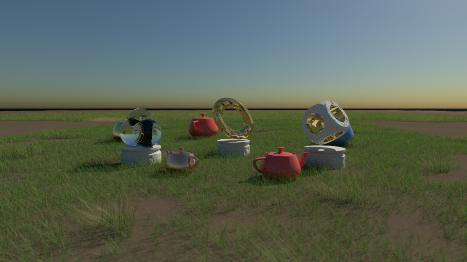
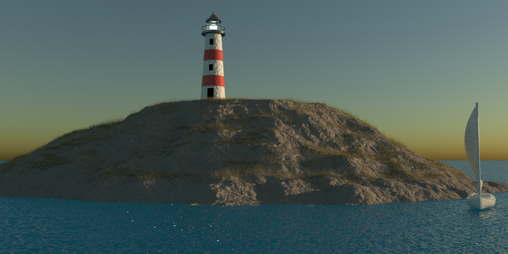
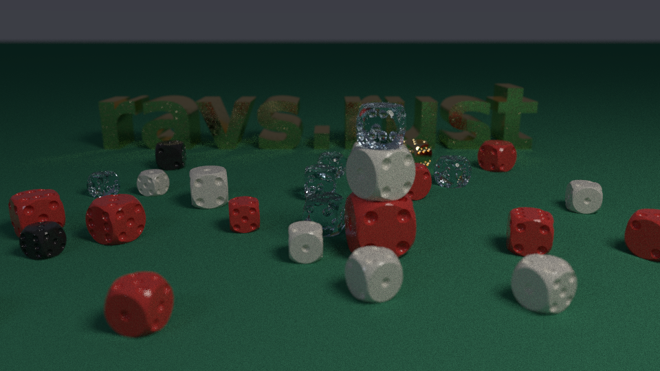

# Test Scenes

## Combined demos
These scenes use several features together.

**Sculpture meadow** (`sculpture-meadow.json`): a noise heightmap shared by the terrain and two grass
fields. The sculptures stand on instanced CSG plinths, which are bump mapped with `dents`. One is a
marble CSG cube with gold parts, placed with transform `steps`. One is a ripple-bumped gold torus,
sheared with a `matrix` step. One is a glass `merge`. Instanced teapots stand in the grass.

**Lighthouse island** (`lighthouse-island.json`): an image heightmap
(`scripts/gen-island-heightmap.py`) used as rock terrain, bump mapped with `wrinkles`. Dry, windswept
grass grows above the waterline (`min_altitude`). The ocean and sunset sky surround it. The
lighthouse is built from CSG: a cone with red bands (parts with their own material) and windows cut
out. Instanced sailboats are placed by transform `steps`.

**Dice** (`dice.json`, written by `scripts/gen-dice-scene.py`): one CSG die (a rounded cube less 21
pips) defined once in `geometries` and instanced 29 times with random turns. Behind them is extruded,
dent-bumped `text`.

## Shapes
Every shape modelled on POV-Ray's (see the [shape reference](../docs/shapes.md)).

## CSG
Shapes combined: union, merge, intersection, difference and clipping (see the
[shape reference](../docs/shapes.md#combining-shapes-csg)).

## Bump mapping
Bumps, dents, wrinkles, ripples and waves (see [bump mapping](../docs/bump-mapping.md)).

## Spheres
Spheres demonstrating 3 different materials.

## Ocean scenes
Demonstrating the ocean generation.

## Block Terrain
Procedural art with a block city skyline at sunset.

## Instancing
Twenty instances of one teapot mesh, each with its own transform and material.

## Fireworks

## Grass
Procedural grass on a noise heightmap: a mix of meadow, tall and fescue species, grouped
into zones, in a summer breeze and lit from behind so the blades glow.

Species and conditions side by side. Front, left to right: tall grass on a windy day, a
summer meadow, a mown lawn with stripes. Back: reeds after rain, savanna in a drought,
tussocks in frost.

