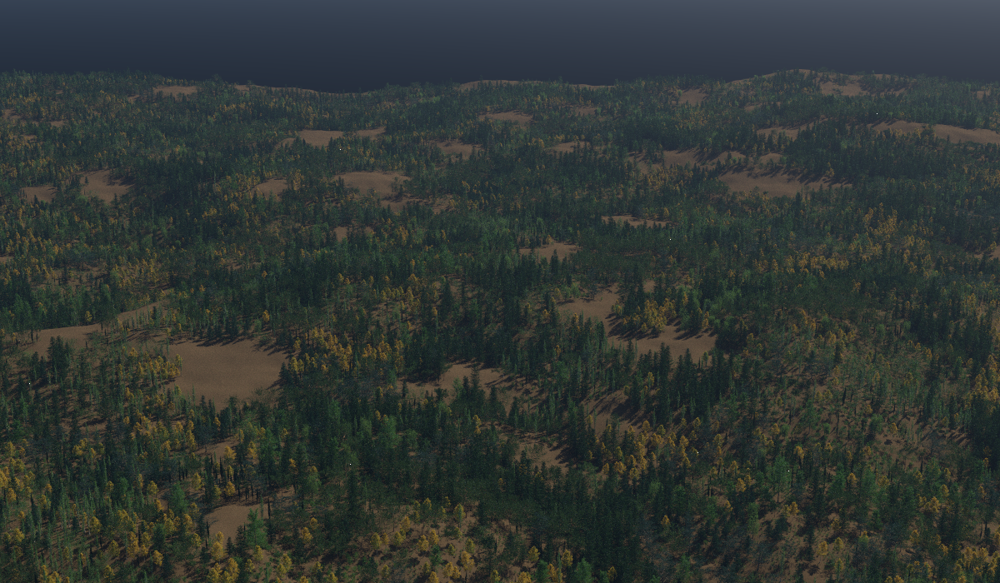

# Adaptive meshes

A generated tree is 50,000 to 400,000 triangles, most of them leaves a few centimetres across.
Seen from a few hundred metres, a pixel covers tens of centimetres, so each pixel sees hundreds of
leaves: that detail costs memory and build time, and the renderer can only average it away with
samples. A forest's `"lod"` sees each placed tree at a level of detail made for the size of the
pixels it covers (`src/shapes/lod.rs`).

```json
{ "type": "forest", "lod": { "pixels": 1 }, ... }
```

| Field | Default | |
|---|---|---|
| `lod` | off | `true`, or an object with the fields below, to choose each tree's detail by its distance from the camera. |
| `lod.pixels` | 1 | The largest detail dropped, in pixels. Smaller is finer and slower. |
| `lod.max_level` | 12 | The coarsest level used. |

## How

Level `k` drops detail up to `base · 2^(k-1)`, where `base` is the size of the tree's leaves (the
median longest edge of their triangles); level 0 is the tree as grown. Each placed tree gets the
coarsest level whose dropped detail is no larger than `pixels` pixels at the tree's nearest point
to the camera, in the tree's own units (a tree scaled up is seen finer). Only the levels in use are
built, and every placement of a level shares it, as instances.

Two kinds of geometry need two ways of being simplified:

- **Surfaces** (bark) by vertex clustering (Rossignac and Borrel, "Multi-resolution 3D
  approximations for rendering complex scenes", 1993): the vertices in each cell of a grid as
  large as the detail to drop merge at their mean, with their normals averaged, and triangles that
  collapse go. Twigs thinner than a cell, thinner than a pixel there, disappear.

- **Aggregates** (leaves and needles) can't be: each leaf would collapse, and the crown with it.
  Nearby leaves are gathered into clusters as large as the detail to drop, by median splits, and
  each cluster becomes one rectangular **card**, as Cook, Halstead, Planck and Ryu replace a
  plant's leaves by fewer, larger ones ("Stochastic Simplification of Aggregate Detail",
  SIGGRAPH 2007), keeping the area the eye sees:
  - the card lies in the plane the leaves cover most of: the major eigenvector of the second
    moment of their normals, `Σ a n nᵀ`, as of the SGGX microflake distribution (Heitz et al.,
    EGSR 2015);
  - its sides follow the principal axes of the leaves' spread over that plane, and its area is
    what the leaves cover, overlaps counted as for leaves scattered at random over the cluster's
    extent `R`: `R (1 - exp(-S/R))` of their projected area `S` (Beer-Lambert, as in canopy
    models).

  **Normal perturbation.** A flat card shaded with its own normal would look like a flat card;
  a crown's light and shade come from leaves facing every way. So each card keeps its leaves'
  normals and faces (up to 32, an even sample of a larger cluster), and a ray that hits it is
  shaded as one of them, chosen in proportion to the area that leaf shows the ray, `a |n · d|`:
  the distribution of visible normals of microfacet theory (Heitz, "Understanding the
  Masking-Shadowing Function", JCGT 2014), whose facets are the original leaves. The face carries
  the leaf's own state, so autumn colours, dead leaves and the choice between leaf materials
  survive. Averaged over a pixel's samples, the card reflects and transmits as its leaves would.
  The choice is a hash of the ray, so it doesn't use up the sampler's dimensions and doesn't
  depend on the order objects are searched.

The level is chosen per placed tree, not per ray as R-LODs do (Yoon, Lauterbach and Manocha,
2006): every ray, from the camera, a light or a bounce, then meets the same surface, so shadows
and reflections stay consistent, and only the levels in use are built. Hybrid mesh-volume
LoDs (Loubet and Neyret, Eurographics 2017) go further, turning sub-pixel aggregates into
volumes with SGGX phase functions; the cards here are the surface counterpart of that idea.

## A test: a forest from the air

[`demo/scenes/forest-aerial.json`](../demo/scenes/forest-aerial.json): 243,016 trees of 14
species, 6 variants each (84 distinct trees, 50,000 to 400,000 triangles apiece), over 3.3 by
3.2 km of hills, seen from 420 m up.



Rendered at 600 × 350 with 64 samples per pixel, on 4 cores, against the same scene with
`"lod": false`:

| | Triangles built | Triangles placed | Peak memory | Render | Mean FLIP vs full |
|---|---|---|---|---|---|
| Full detail | 16.8 M | 24.7 G | 4.2 GB | 216 s | 0.035 (another seed: the noise) |
| `"pixels": 0.5` | 9.7 M | 0.69 G | 4.25 GB | 140 s | 0.052 |
| `"pixels": 1` | 2.6 M | 0.16 G | 1.84 GB | 84 s | 0.057 |

At one pixel, rendering is 2.6 times faster and needs less than half the memory. The difference
from full detail is a little above the noise between two full renders, spread evenly over the
trees, with no seams between levels and no change of hue; but the forest is about 3% brighter
(in displayed values, 1-2% far off, 3-4% near). The likeliest cause is what cards can't keep:
a cluster's leaves shade one another, while its card is one sunlit layer; thin twigs that
vertex clustering removes may add to it. Storing each card's self-shadowing, or making the
coarsest levels volumes as Loubet and Neyret do, would be the next step.

Most of the memory left is the full trees, grown once each to be simplified, and building
(about 95 s, the same either way) is mostly growing them and placing the trees; with `"lod"`,
many more variants cost little, as distant ones are kept only as cards.
