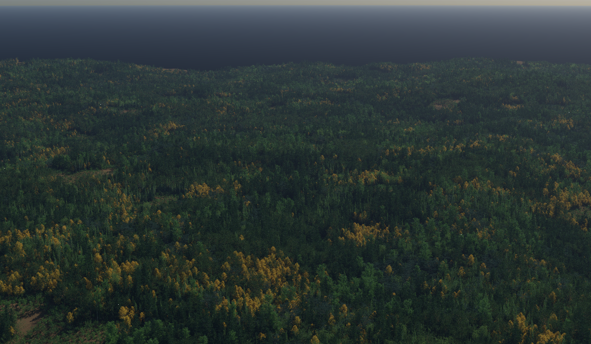
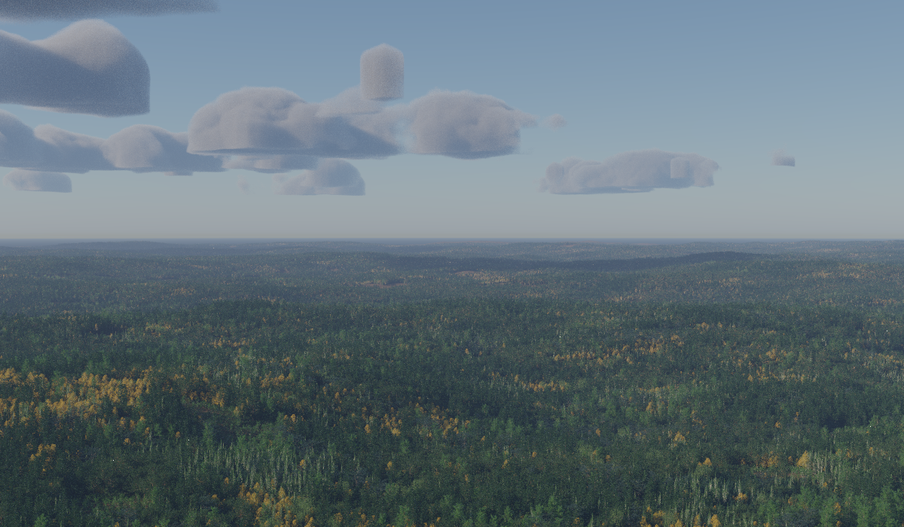

# Adaptive meshes

A generated tree is 50,000 to 400,000 triangles, most of them leaves a few centimetres across.
Seen from a few hundred metres, a pixel covers tens of centimetres, so each pixel sees hundreds of
leaves: that detail costs memory and build time, and the renderer can only average it away with
samples. A forest's `"lod"` sees each placed tree at a level of detail made for the size of the
pixels it covers (`src/shapes/lod.rs`).

```json
{ "type": "forest", "lod": { "pixels": 1 }, ... }
```

| Field | Default | |
|---|---|---|
| `lod` | off | `true`, or an object with the fields below, to choose each tree's detail by its distance from the camera. |
| `lod.pixels` | 1 | The largest detail dropped, in pixels. Smaller is finer and slower. |
| `lod.max_level` | 12 | The coarsest level used. |

## How

Level `k` drops detail up to `base · 2^(k-1)`, where `base` is the size of the tree's leaves (the
median longest edge of their triangles); level 0 is the tree as grown. Each placed tree gets the
coarsest level whose dropped detail is no larger than `pixels` pixels at the tree's nearest point
to the camera, in the tree's own units (a tree scaled up is seen finer). Only the levels in use are
built, and every placement of a level shares it, as instances.

Two kinds of geometry need two ways of being simplified:

- **Surfaces** (bark) by vertex clustering (Rossignac and Borrel, "Multi-resolution 3D
  approximations for rendering complex scenes", 1993): the vertices in each cell of a grid as
  large as the detail to drop merge at their mean, with their normals averaged, and triangles that
  collapse go. Twigs thinner than a cell, thinner than a pixel there, disappear.

- **Aggregates** (leaves and needles) can't be: each leaf would collapse, and the crown with it.
  Nearby leaves are gathered into clusters as large as the detail to drop, by median splits, and
  each cluster becomes one rectangular **card**, as Cook, Halstead, Planck and Ryu replace a
  plant's leaves by fewer, larger ones ("Stochastic Simplification of Aggregate Detail",
  SIGGRAPH 2007), keeping the area the eye sees:
  - the card lies in the plane the leaves cover most of: the major eigenvector of the second
    moment of their normals, `Σ a n nᵀ`, as of the SGGX microflake distribution (Heitz et al.,
    SIGGRAPH 2015);
  - its sides follow the principal axes of the leaves' spread over that plane, and its area is
    chosen so that rays hit it as often as they would the leaves: the area the leaves cover
    together (the union of their projections, rasterised), averaged over 8 directions spread
    over the hemisphere, divided by a flat card's mean `|n · d|` over them. An estimate of their
    overlaps as for leaves scattered at random over the cluster (Beer-Lambert,
    `R (1 - exp(-S/R))`) made cards too small: a leaf's own triangles never overlap, and leaves
    on a twig spread out, so at the finer levels cards were hit a quarter less often than their
    leaves.

  **Normal perturbation.** A flat card shaded with its own normal would look like a flat card;
  a crown's light and shade come from leaves facing every way. So each card keeps its leaves'
  normals and faces, and a ray that hits it is
  shaded as one of them, chosen in proportion to the area that leaf shows the ray, `a |n · d|`:
  the distribution of visible normals of microfacet theory (Heitz, "Understanding the
  Masking-Shadowing Function", JCGT 2014), whose facets are the original leaves. The face carries
  the leaf's own state, so autumn colours, dead leaves and the choice between leaf materials
  survive. Averaged over a pixel's samples, the card reflects and transmits as its leaves would.
  The choice is a hash of the ray, so it doesn't use up the sampler's dimensions and doesn't
  depend on the order objects are searched.

  **What a card keeps.** A leaf's triangles with the same normal are merged into one
  constituent (exact: the choice is by area, which adds), which halves the lists of broadleaf
  trees. A cluster still of more than 16 keeps 16 representatives: grouped by k-means on their
  normals' axes, each one of its group's own normals, with the face of a leaf drawn from the
  group by area (so autumn colours stay in proportion), and their areas refitted by
  non-negative least squares so that their projected area matches the cluster's from every
  direction. Measured against all of a cluster's leaves, the expected shading of the leaf a hit
  chooses is then within 1–2% at every level, where an even sample of 32 had 6–10% from the
  fourth level on.

The level is chosen per placed tree, not per ray as R-LODs do (Yoon, Lauterbach and Manocha,
2006): every ray, from the camera, a light or a bounce, then meets the same surface, so shadows
and reflections stay consistent, and only the levels in use are built. Hybrid mesh-volume
LoDs (Loubet and Neyret, Eurographics 2017) go further, turning sub-pixel aggregates into
volumes with SGGX phase functions; the cards here are the surface counterpart of that idea.

## A test: a forest from the air

[`demo/scenes/forest-aerial.json`](../demo/scenes/forest-aerial.json): 243,016 trees of 14
species, 6 variants each (84 distinct trees, 50,000 to 400,000 triangles apiece), over 3.3 by
3.2 km of hills, seen from 420 m up.


Rendered at 600 × 350 with 64 samples per pixel, on 4 cores, against the same scene with
`"lod": false`:

| | Triangles built | Triangles placed | Peak memory | Build | Render | Mean FLIP vs full |
|---|---|---|---|---|---|---|
| Full detail | 16.8 M | 24.7 G | 3.9 GB | 57 s | 288 s | 0.035 (another seed: the noise) |
| `"pixels": 0.5` | 9.7 M | 0.69 G | 1.37 GB | 64 s | 137 s | 0.051 |
| `"pixels": 1` | 2.6 M | 0.16 G | 0.67 GB | 61 s | 113 s | 0.057 |

At one pixel, rendering is 2.5 times faster in a sixth of the memory. The difference from full
detail is a little above the noise between two full renders, spread evenly over the trees, with
no seams between levels and no change of hue.

The table above was made with cards sized by a random-overlap estimate. Those cards were hit a
quarter less often than their leaves at the finer levels, and the forest came out brighter than
in full detail. Measured in linear light, binned by depth, on another machine (600 × 350, 64 spp,
4 cores; both images clamped at the full render's 99.9th percentile against sun-glint
fireflies):

| | Build | Render | Peak memory | Mean FLIP vs full | Brightness vs full: near / far / all |
|---|---|---|---|---|---|
| Full detail | 186 s | 338 s | 3.98 GB | | |
| Cards by random overlap | 189 s | 108 s | 0.71 GB | 0.0585 | +7.4% / +2.2% / +4.6% |
| Cards hit as often as their leaves | 208 s | 108 s | 0.70 GB | 0.0545 | −2.5% / −0.7% / −1.2% |

Sizing each card by its leaves' measured coverage costs about a tenth more build time, and
removes most of the brightening. Sky alone gave the same brightening as the sun, so it wasn't
the self-shadowing a card can't keep, though that may account for some of what is left. What
remains, a little darker near the camera, where levels are finest, may be the cards' coverage
seen from grazing directions, beyond the hemisphere's average.

From low down the cards fare worse. With the same forest seen from 90 m up (trees mostly side
on, 32 spp), the old cards were 7–8% too bright at mid range and these are 3–6% too dark (mean
FLIP 0.0313 before and 0.0296 after). Broadleaf crowns' leaves face mostly up, and so do their
cards, so from the side a card is hit a fifth to two thirds as often as its leaves at the coarser
levels. Crossed cards fitted to the leaves' coverage make up the hits, but darken the forest
further: a ray leaving one of a cluster's cards meets its others, far more often than leaves
shade one another.

## Memory

A ray tracer keeps every tree it may hit for the whole render, so what's kept must be small:

- Trees are grown one at a time (their levels in parallel), each dropped once its levels are
  made, so only one is ever held in full. Growing them all in parallel held four at once and
  left the heap fragmented: a quarter more memory, for a build about ten seconds faster.
- Cards are 40 bytes, in single precision, in one array per level (`CardSet`), not each its own
  allocation; a leaf kept as it is, a cluster of one, keeps its face in the card. Each card's
  constituents are 12 bytes, normals octahedrally encoded.
- A card is cheaper to test than a BVH node to visit, and smaller, so a card set's BVH has
  leaves of up to 4 cards (`Bvh::build_with_leaves`): without that, its nodes outweighed the
  cards three to one.
- A placed tree (`forest::Placed`) is one instance of a model holding all its parts, about 60
  bytes (position, turn, scale and mirroring), not a general transform per part at 368.

On the forest above, these took the peak from 1.8 GB to 0.67 GB. Of what's left, about 235 MB
was constituents, 95 MB cards and 90 MB their BVHs. Merging a leaf's triangles and keeping at
most 16 representatives (above) then took the peak from 700 MiB to 618 MiB and the render from
108 s to 93 s (600 × 350, 64 spp; the faster render from choosing among fewer), with mean FLIP
against full detail 0.0545 before and 0.0543 after.

Building is mostly placing the trees (about 50 s: 35 million darts, 10 million of them
evaluating noise fields), not growing them (about 12 s); with `"lod"`, many more variants
cost little, as distant ones are kept only as cards.

## Denser: a canopy and an understory

[`demo/scenes/forest-dense.json`](../demo/scenes/forest-dense.json) layers two forests over the
same hills: a canopy of 11 species at 6 m spacing, 10 variants each, and an understory of hazel,
hawthorn, juniper and shrubs at 4 m filling the gaps beneath and between them. That is 1.49
million trees (381,000 and 1.11 million) from 142 distinct ones, seen from 330 m up.



At 1200 × 700 and 32 samples per pixel, on 4 cores: built in 256 s (placing the trees is most of
it), rendered in 399 s, in 3.1 GB at most. The seven trees nearest the camera are seen in full;
20 million triangles of cards and bark are built, standing for 2.8 billion placed.

## In daylight: sun, sky and clouds

[`demo/scenes/forest-sunlit.json`](../demo/scenes/forest-sunlit.json) is the stress test with
the light outdoors: the physical sky (multiple scattering, aerial perspective) and its sun, low
and to the side, and a field of cumulus (`nubis_clouds`) whose shadows fall on the forest, so
every shadow ray from a leaf also crosses the clouds' volume. Four forests reach to the horizon,
coarser with distance: the canopy and understory near the camera, then canopies at 8 m and 10 m
spacing out to 14 km, 2.65 million trees from 220 distinct ones.



At 1200 × 700 and 32 samples per pixel, on 4 cores: built in 337 s, rendered in 426 s (171
million rays, at 402,000 a second), in 3.9 GB at most.
