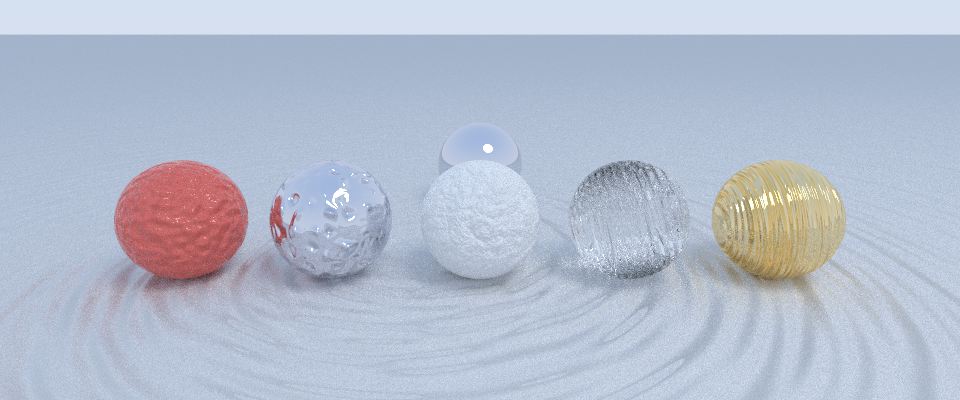

# Bump mapping

Give an object a `"normal"` to make its surface look rough, dented or rippled without changing
its shape: the normal that its material shades with is tilted by a pattern (Blinn, "Simulation
of wrinkled surfaces", SIGGRAPH 1978). The patterns are modelled on POV-Ray's `normal` patterns
of the same names, though not identical to them.



From left to right in [`demo/scenes/bumps.json`](../demo/scenes/bumps.json): bumps, dents,
wrinkles, ripples and waves, on a floor of waves.

```json
{ "type": "sphere", "location": [0, 1, 0], "radius": 1, "material": "GOLD",
  "normal": { "pattern": "waves", "amount": 0.5, "scale": 0.6, "frequency": 3 } }
```

| Field | Default | |
|---|---|---|
| `pattern` | (required) | `bumps`: smooth random bumps. `dents`: mostly flat, with sharp pits. `wrinkles`: creased, crumpled. `ripples`: rings spreading from ten points. `waves`: like ripples, each source with its own wavelength. |
| `amount` | 0.5 | How strongly the normal is tilted. The same at any `scale`. |
| `scale` | 1 | Size of the pattern: a number, or `[x, y, z]` to stretch it. |
| `octaves` | 6 | `wrinkles`: layers of finer detail. |
| `frequency` | 1 | `ripples` and `waves`: rings per unit of the pattern. |
| `phase` | 0 | `ripples` and `waves`: shift of the rings, in cycles; animate it to move them. |

The normal goes on the object, next to its `material` or `medium`, and applies to the whole
surface. It only changes shading: silhouettes and shadows keep the true shape, and a tilt that
would turn the surface away from the ray looking at it is ignored.
