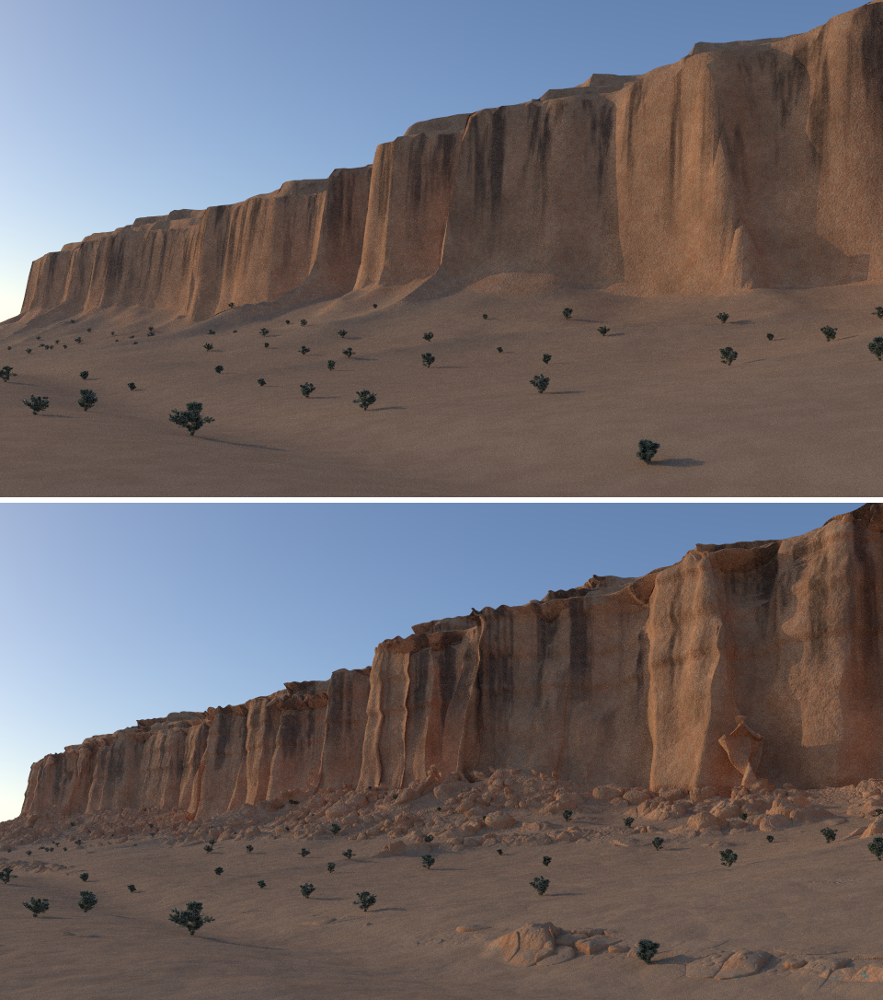
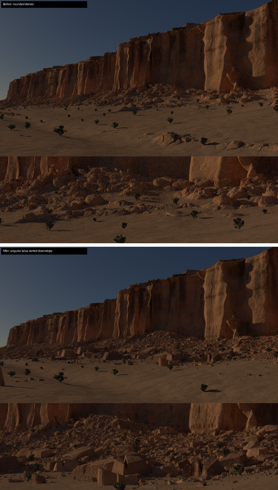
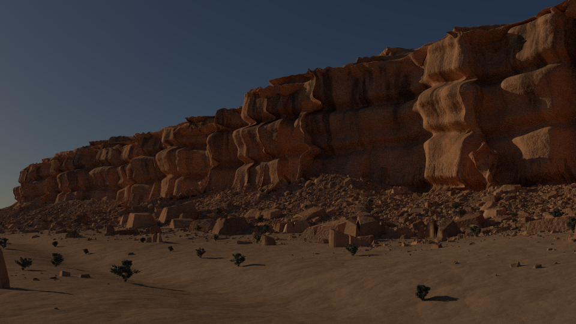
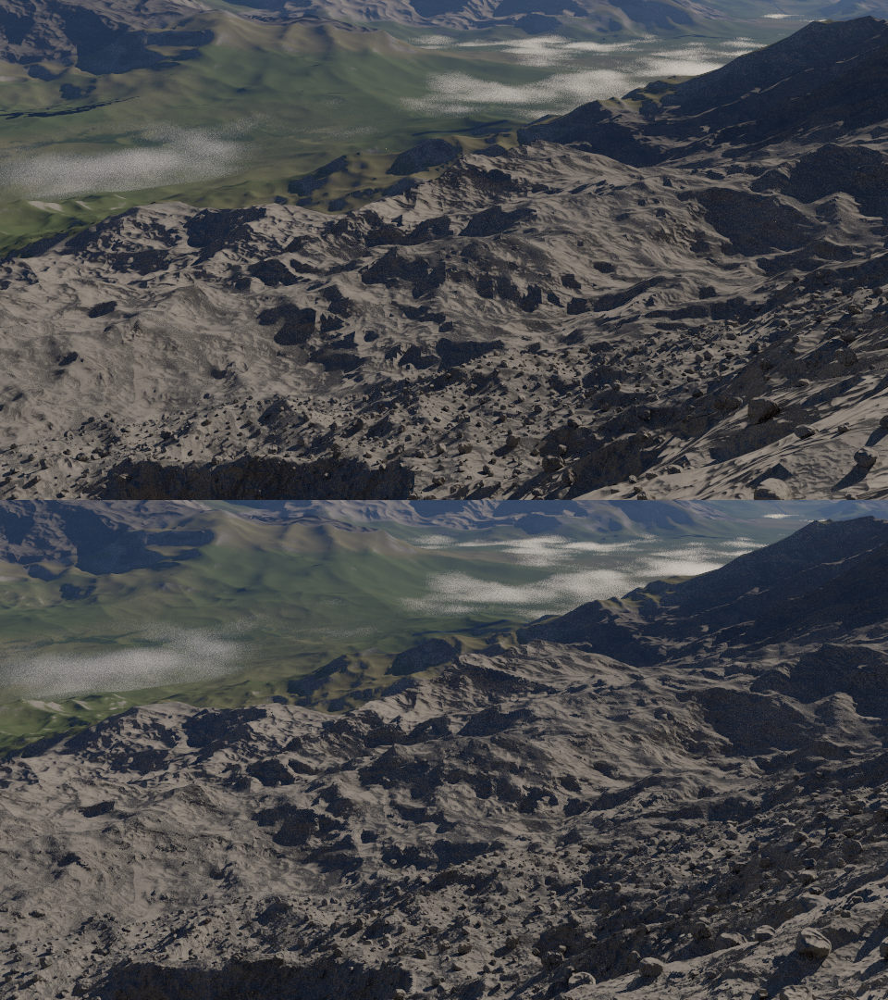
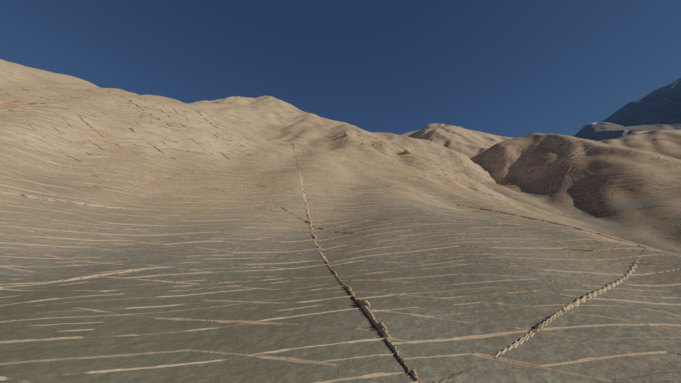

# Displacement and function graphs



*`demo/scenes/displaced-terrain.json`: a sandstone escarpment after the Wingate cliffs of the
Colorado Plateau, about 30 m high, seen along its length in raking late-afternoon light, over a
talus apron and a sandy floor. Top, the 1 m heightmap as triangles, with the same materials.
Bottom, the same heightmap displaced at render time by a function graph: buttresses between
weathered joints, alcoves, bedding, and angular fallen blocks on the talus, sorted with the
biggest rolled out to its toe. The
relief casts its own shadows and changes the cliff's outline, which bump mapping can't do. The
dark streaks of desert varnish are a graph too, the amount of a `mix` of two rocks.*

A terrain stops at its heightmap's resolution. Rock faces, scree and ledges read as real only
when their silhouettes and self-shadowing are real, and bump mapping fails exactly where most of
a landscape is seen: at grazing angles and against the sky. Terragen's answer is displacement
evaluated at render time, down to the size of a pixel, driven by a network of functions. This is
ours.

## Talus (`src/talus.rs`)



*Top, the demo's talus as rounded `cells` stones, all of a size. Bottom, a `talus` node: angular
blocks with flat faces and knocked-off corners, from 5 m down to 8 cm, many small to few large,
the biggest rolled out to the toe and fine scree under the cliff, displaced straight up
(`"vertical_displacement"`) and masked into their own rock material. 16 samples above, 64 below.*

## Function graphs (`src/graph.rs`)

A graph is a small tree of functions written in the scene file as nested JSON: a number, an
expression string, or an object with `"node"`. Define a node once in the scene's `variables` and
reuse it as `"$name"`.

| Node | What it gives |
|------|---------------|
| `fractal` | Perlin noise over octaves from `scale` down to `smallest` metres; `style` `perlin`, `ridged` or `billow`; `roughness`, `lacunarity`, `amplitude`, `seed`, `plan` (2D) |
| `cells` | Worley noise: `style` `f1`, `edges` (cracks between cells) or `stones` (a rounded stone per cell) |
| `talus` | Fallen blocks and scree (`src/talus.rs`): angular polyhedra in layers from `largest` to `smallest` metres, many small to few large by a power law (`exponent`), sorted down the slope by `position` (0 at the toe, 1 at the apex; big blocks roll to the toe); `output` `height`, `mask` or `id` |
| `strata` | Ledges: beds `step` metres thick, each ending in a riser; `breakup` makes them waver |
| `ground` | A landscape's own detail from what its simulation left at each point (`terrain::detail`): ledges of hard beds and each rock's texture on bare rock, stones on scree, hummocks and boulders on till, swales on alluvium, smooth sand, cracked playas, smooth ice; `seed`, `amplitude` (1). Bounds each displaced cell by the ground there (`DisplacedTerrain::tighten`). A full-scale landscape uses it by default near the ground |
| `cross_beds` | A `rock` material's festoon cross-bedding as relief (its `seed`, `scale` and `cross_set` as `set`; `amplitude`), so the laminae its colour shows stand out as ribs; filtered by the narrow laminae, a fortieth of a set (`rock::LAMINA_FINEST`: nine in ten crossed along any line are wider), not their spacing along the foresets |
| `slope`, `altitude` | Masks from 0 to 1 between `from` and `to` (degrees, metres), with a fractal `breakup`; falling instead where `to` is below `from` |
| `aspect` | How squarely the surface faces `direction` (default north, `[0, 0, -1]`), as a mask |
| `biome` | 1 where the landscape's climate is one of the biomes `is` names (`ice`, `tundra`, `taiga`, `temperate_forest`, `grassland`, `steppe`, `cold_desert`, `hot_desert`, `savanna`, `rainforest`), else 0; its edges wander as the ground cover's do |
| `field` | What the surface hit knows about itself: on a landscape, its simulation's sediment, ice, flow, wetness and so on (see [surface layers](surface-layers.md)), when shading or displacing it; give `from` and `to` to displace by one, as a raw field is unbounded |
| `add`, `multiply`, `min`, `max`, `subtract` | Arithmetic |
| `blend` | `a` where `mask` is 0, `b` where 1 |
| `clamp`, `abs`, `power`, `smoothstep`, `remap`, `terrace` | Shaping |
| `warp` | Domain distortion: `input` read at a point moved by noise (`amount`, `scale`) or by nodes `x`, `y`, `z` |
| `expr` | An expression (`expr.rs`) over `x`, `y`, `z`, `slope` and named `inputs`, clamped to `range` |

A graph can also be a material's texture: wherever a colour texture is read (a `mix`'s
`amount`, an albedo), an object with `"node"` is a graph, evaluated at the hit with its normal.
The demo uses one to put sandstone on steep faces and sand on flats and ledge tops:
`"GROUND": {"type": "mix", "materials": ["SAND", "SANDSTONE"], "amount": {"node": "slope", "from": 28, "to": 38}}`.
Its varnish is plan-view noise (`"plan": true`, so constant down a vertical face, as streaks
are) masked to the steepest, highest rock, mixing a dark rock into the sandstone.

A graph can also be a volume's `density` (`volume::GraphDensity`): its value is the extinction
per metre, bounded by the graph's range for delta tracking. After a landscape in the scene, it
reads the landscape's fields and judges `altitude` above the planet, so
`demo/scenes/alpine-closeup.json` lays banks of fog in the valley below about 2,900 m, ragged
at their tops.

Every node knows its range by interval arithmetic and clamps to it, so a displaced surface can
be bounded before it is evaluated. Fractals and cells are filtered: told the spacing of the
vertices where they are evaluated, they fade out octaves finer than twice that, putting each
octave's mean in its place, so a coarsely diced distant surface doesn't alias or shift.

## Displaced terrain (`src/shapes/displaced.rs`)

```json
{ "type": "terrain", "heightmap": {...}, "material": "ROCK",
  "displacement": { "node": "blend", "a": "$scree", "b": "$rock", "mask": "$outcrops" },
  "displacement_detail": { "pixels": 1, "max_level": 8 } }
```

- **Smooth base.** The heightmap is interpolated by Catmull-Rom splines (`HeightGrid::smooth`),
  continuous in height and slope, so no facets of the grid show.
- **Along the normal.** Points move along the base's normal, so cliffs get relief, not just level
  ground (`"displacement_direction": "vertical"` moves them straight up). The graph sees the
  base's normal, for `slope` masks.
- **Straight up, too.** `"vertical_displacement"`, a second graph, is added straight up after
  the first. Fallen blocks stand upright on a slope (along the normal they'd lean downhill),
  and since a block's top then lies right above where it stands, a material can find it: the
  demo's `talus` displaces vertically and the same node with `"output": "mask"` puts rock on
  the blocks and grit between them.
- **Any way at all: overhangs.** `"vector_displacement": {"x", "y", "z", "outward"}`, graphs
  added last: along the terrain's own axes, and `outward`, horizontally away from the slope
  (the base's normal flattened). A heightfield's cliff can't lean out, but moved outward by a
  graph of height its soft beds are cut back under the hard ones and its caprock juts over
  them, so a ray from below meets the underside (`test_outward_displacement_makes_overhangs`).
  Cells' bounds grow by each graph's range, so rays still find them.
- **Shaded where it came from.** A hit on displaced terrain knows the point of the base it was
  displaced from (`Geometry::undisplaced`: the cell's quad under the hit, its corners' grid
  positions interpolated), and graphs used in shading (a `mix` amount, surface layers' masks)
  and a `rock`'s colour are evaluated there, with the filter the displacement had
  (`Context::at_hit`, `Intersection::texture_point`). So masks and colours line up exactly with
  the relief: a talus mask with its blocks however the main displacement moved them, and the
  ribs of `cross_beds` with the laminae a rock shows. (On surfaces not displaced, `talus` judges
  a shading point's block by where it stands, its height below: `Context::lifted`.)
- **Fading at the edges.** `"displacement_falloff"` (metres) fades both graphs to nothing
  within that distance of the grid's edges, so a displaced close-up grid meets the undisplaced
  grid round it (a coarser terrain with a `hole`) without a step or a slit along the join; the
  cells' bounds then reach to no displacement as well.
- **Diced to the pixel.** Each heightmap cell is diced into 2^k x 2^k quads, `k` chosen once per
  cell from the camera so a quad is about `pixels` pixels across, up to `max_level`, and no finer
  than half the graph's finest detail (`min_spacing` overrides). A cell's size is the longer of
  its width and its height range, so a 1 m cell spanning 20 m of cliff is diced finely enough
  up the face, not smeared into vertical streaks. As in Reyes (Cook, Carpenter and
  Catmull 1987) and Pharr and Hanrahan's geometry caching (1996), but per cell and lazily: a
  cell is diced the first time a ray comes near it, then kept. Each diced cell keeps a quadtree
  of boxes that rays descend nearest first; a BVH over the cells' conservative bounds finds
  them.
- **Tight bounds.** A cell's bounds before dicing allow for the displacement only as far as
  its base's normals can carry it: sideways by the graph's reach times the sine of the steepest
  slope the cell's sixteen spline vertices allow (`HeightGrid::smooth_slope_bounds`), up and
  down by the graph's range. On gentle ground that is little more than the cell, so a ray grazing
  the ground dices only the cells it passes close to, not every cell within the graph's reach.
- **Out of view, coarser.** Cells wholly outside the camera's view (a still perspective camera's
  frustum, a few pixels wider, and wider still for what its lens blurs in from beyond the focus)
  are seen only through the shadows and light they cast, and are diced `offscreen` times
  coarser (`"displacement_detail": {"offscreen": 4}`, the default; 1 dices them like the rest).
- **Moved and copied.** A displaced terrain inside transforms, or a named geometry placed
  several times (`{"type": "transform", "item": "cliff", ...}`), learns where each copy is
  (`SceneFile::displaced_instances` follows the scene's transforms and references, and writes
  them into the terrain as `displacement_instances`). Each cell is diced as finely as the copy
  of it nearest the camera needs, and counts as out of view only where every copy is (a copy
  scaled unevenly is never culled, its view no longer being a frustum).
- **Guesses don't dice.** The sky's sampling table (`environment`) only guesses which of the sky
  the camera sees, so it sees displaced terrain as its heightmap's flat cells
  (`displaced::roughly`) rather than dicing every cell around the camera.
- **Dicing on all cores.** Cells diced outside a render's threads (dropping a forest's trees
  onto the terrain) are diced on a pool of threads shared by every displaced terrain when they
  are large.
- **Same surface for every ray.** The level depends on the cell, not the ray, so camera, shadow
  and bounce rays all meet the same geometry.
- **No cracks.** Where a cell meets a coarser neighbour, its edge follows the neighbour's; points
  on edges and corners are evaluated with the filter of the coarsest cell sharing them, so both
  sides compute bit-identical points (`test_no_cracks_between_levels` fires 20,000 rays at the
  seams).
- **Memory.** The scene prints how many vertices it could need if every cell were seen; only
  the cells rays reach are diced.
- **Cost.** The escarpment demo at 960 x 540 and 16 samples: 9 min 49 s and 10.6 GB before these
  optimisations, 3 min 5 s and 0.85 GB after (4 cores). Evaluating the graph at the vertices is still most
  of the time.

Things placed on a heightmap (grass, rocks, trees) stand on its grid, not on the displaced
surface, so keep displacement small or masked off where they are.

## Overhangs



*`demo/scenes/overhangs.json`: the escarpment of `displaced-terrain.json` with
`"vector_displacement": {"outward": "$undercut"}` on its cliffs: beds every few metres weathered
back up to 1.8 m under the ones above, and the caprock's lip jutting 1.4 m out.*

## What next

- Speed: the graph at every vertex is most of the time, and paths are noisy where Terragen
  caches its lighting.
- Arches and caves need surfaces of another topology than a heightfield's, displacement or not.

## On a landscape



*`demo/scenes/alpine-closeup.json`, 960 x 540 at 32 samples. Top, the landscape's mesh alone;
bottom, the ground within 4 km displaced by a graph that reads the simulation: rock ribs where
it is steep and the simulation left the rock bare, stones where it left scree. Both have the
scene's boulders (a `scatter` on the scree) and fog in the valley (a volume whose density is a
graph of altitude). 7 min 56 s against 4 min 17 s (4 cores).*

A full-scale `landscape` takes the same `"displacement"` (and `displacement_detail`,
`vertical_displacement`, `displacement_falloff`). The ground within `displacement_reach`
metres of the camera (1000 by default, each way) becomes heightfields of the landscape's own
surface, displaced as a terrain is; the clipmap's mesh leaves that square out. They are nested
squares of `displacement_cells` cells a side (512), the finest `displacement_spacing` metres
apart (2), each next one twice as coarse and twice as wide, out to the reach: eight kilometres
takes five, and costs about what one does, since what dices them is the camera's pixels. Each
leaves a hole for the one inside it (`displaced::Nest`), which takes the points along its edge
from the outer one, at the levels the outer's cells there are diced to, so they meet without a
crack (`test_nested_terrains_meet_without_cracks`); its heights join the outer's within a few
cells of the edge. Its graphs read the simulation's fields as the ground's materials
do (`field` nodes, and `slope` and `altitude` by the planet's up), so relief can follow what
the simulation left: ribs of rock only where the sediment is thin, stones where the scree
material is, smooth ice on the glaciers. It is shaded where each point came from.

The patch stands upright in the planet's tangent frame under the camera (`scenery::Local`),
put into the scene by a transform, so it holds however far from the scene's origin the camera
is. Its graphs are evaluated at the scene's points, and the frame and grid are snapped (the
frame to whole multiples of the reach, the grid to eight cells), so cameras near each other,
an animation's frames, see the same displacement rather than one that crawls with them. A
camera with `motion` gets a patch centred on the middle of its path, reaching as far past
either end; the camera's view, for dicing, is taken into the patch's frame.

The patches draw the relief to the spacing of the ring each point lies in (`scenery::Clipmap`)
where that is coarser than their own, so at the outermost's edge it is the surface the rings
draw. The rings' triangles that overlap that edge have their vertices inside moved onto its
surface, and its displacement fades out over at least three ring spacings there, so the two
meet without a crack or a step (`test_displaced_patch_meets_the_rings`). Set the reach to
where a pixel covers more than the displacement's detail: a few kilometres for a camera on the
ground, more for wide aerial views.

`demo/scenes/alpine-closeup.json` stands 2 m up a mountainside in the range of
`alpine-layers.json`: ribs of rock on the steep ground, stones on the scree. The landscape
prints how high the camera is above the ground under it, which helps place one: away from the
scene's origin, the planet's curve lowers the ground (about 20 m at 16 km).

### Procedural by default

The landscape's own ground cover shades what lies bare with the library's natural materials
(docs/procedural-materials.md): each rock by its lithology (`granite_outcrop`,
`limestone_cliff`, `sandstone`, `quartzite`, `slate` for shale, `schist`, `gneiss`, `basalt`),
scree, dune sand and river gravel, each chosen at a point by its share of the ground there
(`scenery::Bare`) as snow and ice are; plants, salt crust, snow and ice keep their own. The
materials carry detail from centimetres up, filtered to the pixel, so close up the ground has
grain, crystals, stains and lichen, and from afar their average colours. `"ground_materials":
false` keeps plain colours.

The shapes aim at realism rather than at features: rock is rough at every scale (a fractal from
a few metres to a centimetre whose amplitude falls more slowly than its size, as rock surfaces'
Hurst exponents of 0.7-0.8 have it), joints die out and pick up along their length, broken
blocks are faceted rather than rounded, and loose ground is rough at the scale of its stones.

A full-scale landscape whose camera is within 2 km of the ground displaces it with its own
detail unless the scene says otherwise (a graph of its own, or `"displacement": false`): a
`ground` node, out to 40 times the camera's height (500 m to 4 km), on nested grids whose
finest spacing is about a hundredth of it (a power of two from 6 cm to 2 m). The detail
follows the simulation (`terrain::detail`): where it left bare rock, hard beds stand out as
ledges at their own heights and soft ones are cut back, and the rock has its own texture
(granite's blocks, sandstone's joints, limestone's flutes, basalt's columns); scree is stony,
till hummocky with boulders, alluvium gently swaled, sand smooth, playas cracked, glaciers
smooth. Each cell of the displaced grids is bounded by the detail the fields there allow
(`Graph::range_near`, `DisplacedTerrain::tighten`), so rays grazing sand or alluvium dice
only the cells they touch: a camera standing in a desert basin rendered 13 times faster than
with the detail's whole range. On the smallest cells, where even the local range of rock's
detail is tall beside the cell, a cell is bounded by the detail's value at its centre and how
far it can change across it (`detail::local_bound`: smooth parts by their steepest gradient,
stones' edges and ledges between beds by their whole height), five times faster again for a
camera standing on a rocky slope.

A camera with `"above_ground": true` stands and looks at heights above the landscape's ground:
its `location`'s and `lookat`'s y are metres above the ground under each
(`object::above_ground`, from the world and its surface before anything else is built), so a
close-up scene keeps its camera on the ground however the simulation changes. Give the
landscape a `"focus"`, so its patches don't move with the camera.
`demo/scenes/landscape-closeup.json` stands 4 m up on a sandstone slope of a desert fold belt
with nothing placed by hand: the world's close level under the camera (30 m cells inside its
150 m patch, `world::close_level`), gullies below that (`Relief::gullies`), its own detail
and its own boulders: sandstone in thin ledges along its beds, cut by joints that die out and
open in stretches (960 x 540 at 32 samples: 3 min to build from a cached world, about 35 to
render). The landscape's own displacement dices quads two pixels across, at most seven levels
down, unless the scene says otherwise: a render keeps every tile it dices, and bounced light
reaches nearly every cell near the camera. Boulders are placed on the ground diced coarsely,
to an eighth of a cell, in tiles dropped afterwards (`displaced::coarsely`): diced for the
camera, the tile under each of thousands of candidates took gigabytes.



## In the desert scenes

`desert-overlook.json` stands on slickrock seen from a couple of metres to a few hundred: its
close-up grid was 8 cm, with the cross-bedding baked into the heights (`laminae`). It is now
50 cm, displaced by `cross_beds` (worn smooth in patches), low steps where beds crop out round
the domes, potholes on the level crowns, patches of thin polygonal cracks and rounded
weathering, in 40% less memory. `desert-butte.json` displaces a 1.5 m grid round its butte (the
rest of the near country has a `hole` there): wavering bedding breaks, weathered joints,
alcoves and vertical fluting on the cliffs (a `plan` ridged fractal, the same all the way down
a face), fallen blocks in patches on the talus, slickrock domes on the top and low swells on
the floor. The fluting and blocks are a metre or two across, about what a pixel at the butte
resolves, which a 1.5 m grid alone cannot. Both fade their displacement out at the close-up
grid's edges (`displacement_falloff`: 4 m on the overlook, 20 m round the butte), where it
meets the near country.
