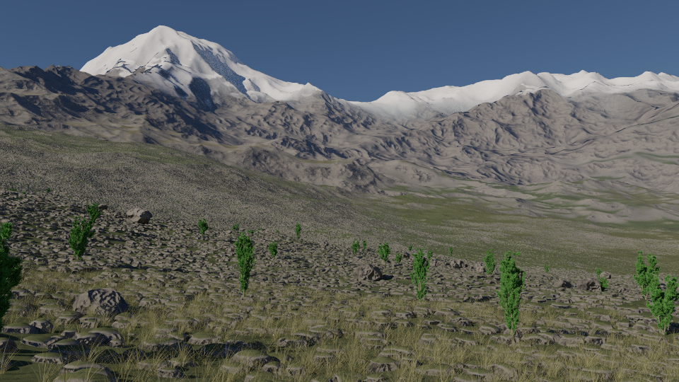

# Placement by rules: ecosystems



*`demo/scenes/alpine-meadow.json`: one `ecosystem` on the landscape of `alpine-layers.json`,
standing in the valley at 2,960 m. Junipers where the ground is gentle, in patches; boulders
in clusters, in the room the junipers leave; tussock and fescue grass on all but the steepest
ground, thinning out with distance.*

Trees, shrubs, rocks and grass are placed by **rules**: function graphs
([displacement.md](displacement.md)) from 0 to 1, read on the ground where each thing would
stand, with its normal. Where a rule is 1 things grow as thickly as they can; where it is 0,
not at all. A rule can use:

- `slope` and `altitude` (on a landscape, by the planet's up and height above it), `aspect`
  (which way the ground faces);
- noise (`fractal`, `cells`), to break up edges and make patches;
- on a landscape, its simulation's fields (`field`: sediment, wetness, flow, ice,
  `snowline`, `treeline`, temperature, precipitation) and its climate's biome (`biome`, eg.
  `{"node": "biome", "is": ["taiga", "temperate_forest"]}`).

Every placing object takes its rule as `"where"`: a `forest`, a `scatter` (also as `density`),
`grass` (where it multiplies its conditions' own `max_slope` and altitude limits). Each can
stand on a geometry, or on the scene's landscape (`"surface": "landscape"`; grass,
`"heightmap": "landscape"`), after the landscape in the scene's objects.

```json
"where": { "node": "multiply", "inputs": [
    { "node": "field", "field": "treeline", "from": 50, "to": -150 },
    { "node": "slope", "from": 35, "to": 25 },
    { "node": "biome", "is": ["taiga", "temperate_forest"] } ] }
```

## Ecosystems

```json
{ "type": "ecosystem", "seed": 3, "surface": "landscape", "populations": [
    { "forest": { "reach": 150, "spacing": 7, "species": [{ "species": "juniper" }], "where": {...} } },
    { "scatter": { "reach": 100, "spacing": 3, "items": [{ "boulder": {}, "size": [0.15, 1.2] }] } },
    { "grass": { "reach": 30, "density": 350, "species": ["tussock", "fescue"], "where": {...} } } ] }
```

An ecosystem places its populations together, in the order listed, so that they compete for
the ground (`procedural::ecosystem`), as Deussen et al. place plants (SIGGRAPH '98):

- Each tree or rock claims a disc where nothing after it grows: its `base`, a fraction of its
  spacing radius for trees (0.25, the trunk and roots), of its size for rocks (0.9).
- Trees shade a disc around them, their `canopy` (1.3 of their spacing radius), where what
  comes after grows `shade` (0.6) less thickly, deepest by the trunk.
- So list the largest first: trees, then shrubs, then rocks, then grass.

Each population is written as its own object would be, and takes the ecosystem's `surface`,
`seed` and `area` unless it has its own. Without an `area`, it covers the ground about the
camera, `reach` metres out (300 for forests, 150 for scatters, 25 for grass), and grass thins
out over the last 40% of that (`fade`), in a circle, so there is no edge to see. Grass grows on
the ecosystem's surface itself, sampled every `cell` metres (0.25).

Trees far off cost little: give the forest a `"lod"` (see [adaptive meshes](adaptive-meshes.md)).

## Flora by biome

On a landscape with a climate, an ecosystem can take its plants from the biomes instead of a
list: `"flora": true` (`terrain::flora`).

```json
{ "type": "ecosystem", "seed": 4, "surface": "landscape", "flora": true }
```

The climate gives every point a biome (tundra, taiga, temperate forest, grassland, steppe,
cold and hot desert, savanna, rainforest, ice), its edges wandering with the weather from year
to year, and lower with height as the air cools. Each biome has several plant communities,
and which grows where is decided region by region: each community has a smooth noise of its
own, about 4 km across, and holds the ground where its noise leads its biome's others, fading
into the next over a narrow ecotone. So every community has a fair share of its biome, and
different valleys of one climate grow different woods (`terrain::flora::COMMUNITIES`):

| biome | communities (their main plants; ground plants) |
|---|---|
| tundra | dwarf-shrub heath (dwarf birch, juniper; heather, cottongrass); alpine meadow (tussock, fescue, buttercup, daisy); krummholz (mountain pine, juniper) |
| taiga | spruce-fir forest (Norway spruce, balsam fir, birch); pine heath (Scots pine, birch, juniper; heather); larch and birch (larch, silver birch, dwarf birch; fireweed, sedge) |
| temperate forest | beech wood (beech, oak, hazel); oak and hazel (oak, birch, aspen, hazel, hawthorn; meadow, buttercup); maple and tupelo (sugar maple, tupelo, black oak); montane mixed forest (spruce, beech, larch, pine) |
| grassland | flower meadow (hawthorn; meadow grasses, daisy, oxeye, buttercup, clover); parkland (scattered oak, aspen, birch, hawthorn); tall-grass prairie |
| steppe | sagebrush steppe; pinyon-juniper woodland; ponderosa parkland; Mediterranean scrub (olive, stone pine, prickly pear; wild oat, poppy) |
| cold desert | sagebrush desert; Joshua tree woodland; pinyon desert |
| hot desert | saguaro desert (saguaro, ocotillo, cacti, creosote); creosote flats; agave slopes |
| savanna | acacia savanna (acacia, thornbush); baobab savanna; eucalypt woodland; palm savanna |
| rainforest | lowland rainforest (kapok emergents over tupelo, palm, tree fern); cloud forest (tree fern); palm forest |

Plants of wet ground grow in the communities that have them only where water gathers
(`wetness`): willows and grey alders by temperate and boreal rivers, mesquite in desert washes.
The tundra's shrubs are stunted (to 0.6 m on the heath, 1.5 m as krummholz).

Each plant is a population of its own, its rule the sum over the communities about the camera
that it grows in of their weight times its abundance there; on ground no steeper than it holds,
off ice, dunes and playas, a fifth as thick on bare rock; trees below the treeline, shrubs below
the snow. Trees come first, then shrubs, then each community's ground plants, so each grows in
the room those before it leave. Only the communities found about the camera (their weights at
12 x 12 points over 300 m) choose plants, and the load prints them:

```
Flora: oak and hazel (temperate_forest) 71%, beech wood (temperate_forest) 29% about the camera; 13 populations: ...
```

`"flora"` can also be `{"strata": ["trees", "shrubs", "ground"], "reach": 300, "samples": 12}`,
to grow only some layers, or survey further. Populations the ecosystem lists itself (rocks,
say) are placed after the flora's.

An ecosystem on a landscape hands it the crowns of the trees it placed (`terrain::canopy`), and
the landscape draws forest floor under them (`scenery::Ground::cover`): humus and litter, red-
brown needles under conifers and browner leaves under broadleaves, moss where it isn't dry,
shaded with the soil material's `forest_floor`; only cliffs stay bare. Materials and placement
rules after the ecosystem read the same as a field, `canopy` (0 to 1). The ground's relief
doesn't: its displaced cells' bounds are found before the trees are planted.

Beyond the trees planted about the camera, the landscape draws woods of its own from the same
communities (`flora::Regions::woods`: how much of the ground their trees' crowns cover, and how
much of that is conifers'), so the forests carry on to the horizon: a canopy material of crowns
(`Bare::Woods`, `Bare::Conifers`: `cells` domes 8 m apart for broadleaves, 5 m for conifers,
lit by their relief, dark in the gaps between), thinner and thicker from place to place, below
the treeline and off cliffs. Within the planted trees' reach the ground between them is open,
and the two fade into each other as the trees thin out towards it (`canopy::Slot::planted`). Nothing grows within `"clear"` metres of the camera (12 with
a flora, 0 otherwise), so it doesn't stand inside a tree. The flora's trees grow `reach` metres
out (shrubs half as far), thinning out over the last third of it.
