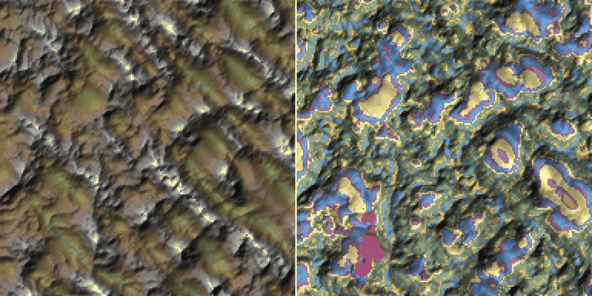

# Geology

A `landscape`'s bedrock is no longer a uniform stack of hard and soft layers. It is a
sedimentary cover folded along the mountain belts, over a crystalline basement, with granite
plutons. Rivers and glaciers each erode every rock at a rate of their own. The code is in
`src/terrain/geology.rs` (with the sources it follows); `Planet::structure` places the geology
on the planet, and `Terrain` carries it through the landscape's evolution.




## Rocks, rivers and ice

| Rock | Rivers | Glaciers | Why they differ |
|------|--------|----------|-----------------|
| shale | 2.2 | 1.8 | weak; little to quarry |
| sandstone | 1.0 | 1.3 | |
| limestone | 0.8 | 1.2 | strong against gravel, but soft to abrade |
| quartzite | 0.45 | 0.85 | the hardest for rivers, but brittle and closely jointed: ice plucks it |
| schist | 1.4 | 1.9 | splits along its foliation |
| gneiss | 0.62 | 0.67 | |
| granite | 0.57 | 0.45 | massive, widely jointed: domes and roches moutonnées |
| basalt (lava) | 0.3 | 1.5 | columnar joints are quarried readily |
| sediment | 3 | 3 | |

These are erodibilities relative to average bedrock, multiplying the stream power law's K for
rivers and the abrasion coefficient K_g for glaciers, at the default `contrast` of 5. For
rivers the order follows rock strength (Sklar and Dietrich 2001). For glaciers it follows how
easily the rock is quarried along its joints as well as how hard it is to abrade (Hallet 1996,
Iverson 2012, Krabbendam and Glasser 2011, Dühnforth et al. 2010). The order follows those
sources. The values are model choices (`Rock::scores`), and `contrast` scales them all.

Hillslopes creep in proportion to the rivers' erodibility too: weak rock weathers faster into
soil that creeps, so slopes on shale relax while hard beds hold cliffs.

Rock is also weaker where it is fractured. Folding cracks an anticline's crest open as its
outer arc is stretched, and thrusts are flanked by damage zones. Molnar, Anderson and Anderson
("Tectonics, fracturing of rock, and erosion", JGR 112, 2007) argue that fracturing sets much
of rock's erodibility. Quarrying depends on it more than abrasion does, so glaciers make more
of it than rivers: the most fractured rock is `1 + fracturing` times as erodible to glaciers
(2.5 by default) and `1 + 0.35 fracturing` times to rivers (Whipple, Hancock and Anderson,
GSA Bulletin 112, 2000, find plucking dominant in jointed rock). So glaciers dig out
anticline crests and thrust zones, while rivers barely notice them.

Slopes can only stand so steep before they fail, and how steep depends on the rock (Schmidt
and Montgomery, "Limits to relief", Science 270, 1995): where rivers or glaciers cut down
faster than the slopes can follow, the slopes steepen until they fall in landslides. Each rock
has a critical slope over a simulation's cells (`Rock::critical_slope`, after Selby's rock
mass strength), from loose debris at about 37° and shale at 42° to massive granite at 63°,
lowered where the rock is fractured. Steeper slopes fail onto their steepest neighbour, and the
debris lies as sediment at their feet (`fluvial::landslide`). Ice holds up the walls it
carves, so they don't fail while it is there; when it melts, walls in weak rock fall in, and
only strong rock keeps the steep sides of glacial troughs. At time zero the noise topography is
relaxed to what its rock holds before anything else happens. `slope_strength` scales every
limit (0 for no landslides). The limits are for cells of 300 m; as slopes measured over
longer distances are gentler, they are steeper on finer grids and gentler on coarser, as
(300 m / spacing)^0.2, so nested patches agree roughly on how steep the ground stands.

Glaciers erode only where their bed is at the melting point: thin ice on cold summits and
plateaus freezes to its bed and protects it, while thick, warm-based valley glaciers dig
troughs between (`glacier`'s "Frozen beds").

So the same mountains erode differently under the two processes. Rivers leave quartzite and
basalt standing as ridges and cut valleys along the shale. Glaciers dig into quartzite, basalt
and schist, and leave granite as domes.

## The column

Above the basement (gneiss, or schist in places) lies a sedimentary cover about
`cover_thickness` thick, of hard beds (sandstone or limestone) alternating with shale, the pair
averaging `strata_thickness`. Bed thicknesses and which bed lies at a given depth vary over
hundreds of kilometres. In the mountain belts the basement was brought up by erosion before the
simulation began (`exhumation`), and the cover near it is metamorphosed: sandstone to
quartzite, shale to schist. Granite plutons rise into the cover as domes, mostly in the belts
and volcanic arcs (`plutons`).

Oceanic crust, where the plates' crust is oceanic (or, without plate tectonics, where the
continents' noise is below sea level), is basalt all the way down: the sea floor and the
volcanic islands on it.

Uplift carries the rock up with the ground (`Terrain::exhumed`), so erosion that keeps pace
with uplift cuts into older rock.

## Folds

In the mountain belts the cover is folded, with axes along the belt (across the direction of
shortening, which is taken to be the direction in which the belt's strength changes fastest).
The folds are phasor noise (Tricard et al. 2019) following that direction: long parallel
trains that end or fork in places, rising and falling along their axes as doubly plunging
anticlines. Folding shapes the ranges in three ways:

- **Relief at time zero**: a share of the folds' structural relief (`fold_relief`) is
  topography, and the ridges are raised on the anticlines and lowered in the synclines, so
  the ranges line up along the folds.
- **Growth**: anticlines are uplifted faster than synclines (`fold_growth`).
- **Vergence**: the folds lean towards the foreland, their steep limbs facing away from the
  belt's centre (`fold_vergence`), so the ranges have steep fronts and gentler backs. They are
  upright at the belt's centre, where real orogens fan out both ways.
- **Thrusts**: where the folds lean, their steep limbs break along thrusts, each sheet riding
  up over the next towards the foreland (`thrust_throw`), so the same beds crop out again
  behind each thrust, hard against soft. The thrusts offset the strata but not the initial
  relief, and die out where the folds end.
- **Lithology**: as erosion cuts down, the folded beds crop out in bands along the belt.
  Breached anticlines expose older rock in their cores, ringed by younger beds.

The belts keep shortening: their thrust sheets carry the rock towards the foreland
(`shortening_rate`, 5 mm/yr in the strongest belts; the Zagros shortens at about 10), folds,
beds and ground together, through the belt's uplift, which stays where it is. Over a few
million years that is further than a fold's wavelength, so divides migrate and folds pass
through the zone of uplift. The ground moves by whole cells as the rock passes each (moving
it by fractions of a cell would blur it), and each cell's rock is that of where it came
from, so rock enters from the planet's geology beyond the patch's edge.

Folds narrower than about two cells of a simulation are left out of it, so a planet-wide
simulation sees only the broad structure, and the nested patches add the folds.

## In a scene

```json
{
  "type": "landscape", "seed": 0, "time": 200000, "scale": 1000,
  "domain": {"type": "patch", "cells": 192, "spacing": 300},
  "geology": {"fold_wavelength": 6000, "fold_amplitude": 2000, "contrast": 8},
  "lava_glacial_erodibility": 1.5,
  "geology_map": "geology.png"
}
```

- `geology`: `strata_thickness` (600 m), `contrast` (5), `fold_amplitude` (1500 m),
  `fold_wavelength` (8000 m), `fold_relief` (0.5), `fold_growth` (0.5), `fold_vergence` (0.6), `thrust_throw` (800 m), `fracturing` (1.5), `slope_strength` (1), `shortening_rate` (0.005 m/yr), `warp_amplitude`
  (400 m), `cover_thickness` (3000 m), `exhumation` (4000 m), `plutons` (1; 0 for none). The
  older top-level `strata_thickness`, `strata_contrast` and `fold_amplitude` are still read.
- `sediment_erodibility` (3), `lava_erodibility` (0.3): to rivers; `sediment_glacial_erodibility`
  (3), `lava_glacial_erodibility` (1.5): to glaciers.
- `geology_map`: also write a map of the rock exposed, in the customary colours of geological
  maps, over shaded relief (for a full-scale landscape, of the finest patch).

Bare rock in the default ground cover takes the colour of the rock at the point's own height,
so beds show as bands across cliffs. In function graphs, `field` nodes can read `rock` (its
number) and `hardness`; see [surface layers](surface-layers.md).

## Not modelled

The direction of shortening comes from the belt's shape, not from the plates' motion (where
plates converge obliquely, real belts mostly partition the motion between strike-slip faults
and shortening across the belt, so folds run along the belt anyway, as here); thrusts offset
the strata but don't stand as scarps at time zero; fracturing comes only from the folds and
thrusts (not from unloading, cooling or weathering);
there is no karst, and no soil whose depth limits how fast the rock beneath it weathers (at a
simulation's cell sizes, creep is far slower than bare rock weathers, so it would rarely bind).
