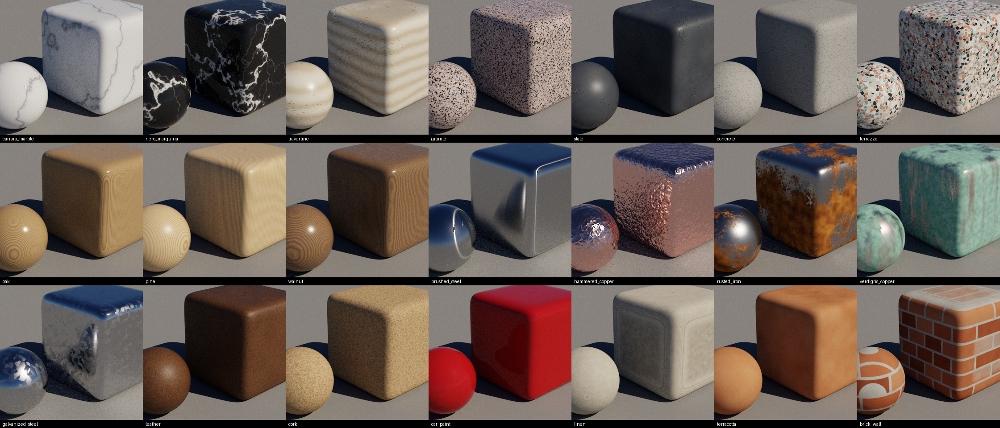

# Procedural materials

Everything real has fine detail. A noisy render hides its absence; once it converges, surfaces
of one flat colour look like plastic. POV-Ray answered this with a texture language (a
*pattern* coloured by a *colour map*, a *normal* perturbed by a pattern, a *finish*) and large
libraries written in it (`stones.inc`, `woods.inc`, `metals.inc`). This renderer now has the
same pieces, built on its function graphs (`src/graph.rs`), with sources of noise from the
literature, filtering so detail finer than a pixel fades instead of aliasing, and a library of
ready-made materials.



The library, by `scripts/material-gallery.py` (each preset alone, on a block 40 cm across and a
sphere): carrara_marble, nero_marquina, travertine, granite, slate, concrete, terrazzo; oak,
pine, walnut, brushed_steel, hammered_copper, rusted_iron, verdigris_copper; galvanized_steel,
leather, cork, car_paint, linen, terracotta, brick_wall.

## Using the library

```json
"materials": {
  "TABLE": { "type": "library", "name": "oak" },
  "FLOOR": { "type": "library", "name": "travertine", "scale": 2, "seed": 7, "roughness": 0.15 }
}
```

`scale` sizes every pattern in the material, and its relief with them; `seed` moves every
pattern to another part of its noise, so two objects of one material differ; any other field
replaces the preset's own (here a more polished travertine). Patterns are sized in metres.

Each preset is an ordinary material definition in
[`src/material/library.json`](../src/material/library.json): copy one into a scene to change it.

| Preset | What it is, and what it's made of |
|---|---|
| `carrara_marble` | White marble with grey veins: Perlin's marble, a wave of a gradient bent by turbulence (\|sin\| for veins that are thin and sharp), over cloudy white. Polished. |
| `nero_marquina` | Black marble with a network of white calcite veins: the zero crossings of warped noise (\|noise\| small), finer veins from a second noise. Polished. |
| `travertine` | Cream bands of deposition, warped, with pits drawn out along them: cells stretched by a transform, masked by noise. Pits darker and hollow (the same graph bumps it). Honed. |
| `granite` | Pink granite: crystals of feldspar, quartz and biotite as Worley cells, each coloured by its own random value (`cells` style `id`), warped so they interlock. |
| `slate` | Riven slate: the cleft face stepped by terracing noise, coloured by the same steps. |
| `concrete` | Mottled cement with sand and aggregate (cell ids), and air pores (pits). |
| `terrazzo` | Marble chips in white cement: cells' interiors (`edges`) coloured by their ids. |
| `oak` | Growth rings about a trunk along y (`rings`, a `ramp` wave: pale earlywood darkening to latewood, then the next year), distorted at two scales; the large pores of oak's earlywood as cells stretched along the grain, in the earlywood only, dark and recessed; fibres of Gabor noise. After Liu, Dong, Hašan and Marschner. Varnished. |
| `pine` | Wide pale rings with narrow orange-brown latewood. Matt varnish. |
| `walnut` | Dark, wavy rings with a figure of phasor noise, and small pores throughout. Oiled. |
| `brushed_steel` | Anisotropic roughness, rough across the brushing (x) and smooth along it, varied in streaks of anisotropic Gabor noise, which also bump it slightly. |
| `hammered_copper` | Copper dimpled by a hammer: the relief is F2 of cells, squared; dimples smoother than the metal between. |
| `rusted_iron` | A mix: rust (lambertian, raised and scaly) over dull pitted steel, where noise and cells say. |
| `verdigris_copper` | A mix: green patina over copper, streaked downwards. |
| `galvanized_steel` | Zinc spangle: each crystal (a cell, centimetres across) reflects with its own roughness. |
| `leather` | Pebbled grain: creases between rounded cells, dark and recessed, and fine pores. |
| `cork` | Granules of bark, each its own shade, with dark gaps between. |
| `car_paint` | Glossy red with the faint orange-peel waviness of a sprayed clear coat. |
| `linen` | A plain weave of threads a millimetre apart, in the x-z plane (for cloth lying flat). |
| `terracotta` | Fired clay, mottled, with a gritty surface. |
| `brick_wall` | Bricks in running bond (courses along y), each its own shade, in recessed mortar. |

## Patterns and colour maps

Any colour (a lambertian's or plastic's `albedo`, a mix's `amount`, a roughness) can be a
pattern coloured by a map, as POV-Ray's `pigment { pattern color_map { ... } }`:

```json
"albedo": { "pattern": { "node": "wave", "shape": "scallop",
                         "input": { "node": "add", "inputs": [
                           { "node": "gradient", "direction": [1, 0.35, 0.2], "scale": 0.14 },
                           { "node": "fractal", "style": "billow", "scale": 0.35, "amplitude": 1.6 } ] } },
            "color_map": [ [0, [0.32, 0.33, 0.35]], [0.14, [0.7, 0.71, 0.72]], [1, [0.86, 0.86, 0.85]] ],
            "interpolation": "smooth" }
```

The pattern is a function graph (see `src/graph.rs` for every node). Its value picks a place in
the map, whose entries are sorted by value; the colour is blended from the two entries about
it (`"linear"`, `"smooth"`, or `"step"` for hard edges). An entry may itself be a texture,
another pattern too, as POV-Ray's `pigment_map`; a number is a grey level, for roughness maps.

### Sources of detail

Beyond Perlin noise (`fractal`, with `ridged` and `billow` styles) and Worley's cells:

| Node | |
|---|---|
| `gabor` | Sparse Gabor convolution noise (Lagae et al. 2009): Gabor kernels, a Gaussian times a cosine, scattered at random. Its spectrum is a blob about one frequency, so it can be anisotropic (`direction`, with `spread`: brushed metal, grain, fibres) and is filtered exactly. `frequency` or `wavelength`, `bandwidth` (default half the frequency: smaller for more regular, slower), `impulses` (16), `plan`, `seed`, `amplitude`. |
| `phasor` | Phasor noise (Tricard et al. 2019): the same kernels as complex exponentials, keeping the phase of the sum, turned into a `profile` (`sine`, `saw`, `square`): oscillations of constant contrast, as wood figure, fingerprints, sand ripples. |
| `cells` | Worley's noise, now with styles `f2` and `id` (a random value per cell: crystals, chips, granules), a `metric` (`euclidean`, `manhattan`: faceted, `chebyshev`: square) and `jitter` (0: a regular lattice, 1 the default). |
| `gradient`, `rings`, `spherical` | POV-Ray's gradient (distance along `direction`), cylindrical rings (distance from the line through `center` along `axis`), and onion shells, each over `scale`. |
| `wave` | Any input turned into repeating bands, `frequency` per unit of it, `phase`, as POV-Ray's wave types: `shape` `ramp`, `triangle`, `sine`, `scallop` (\|sin\|), `square`; `exponent` sharpens. |
| `checker`, `brick` | POV-Ray's: alternate cubes `size` across; bricks `size` [x, y, z] (default a UK brick in metres) in running bond with `mortar` between, `style` `mortar` (1 in it) or `id` (a value per brick). |
| `transform` | Its `input` scaled, rotated (degrees about x, then y, then z) and moved (`translate`): stretch cells into pores, turn bands. |

### Filtering

A pattern finer than a pixel aliases: it glitters, or shows moiré where a surface recedes.
Patterns are therefore evaluated with the pixel's footprint where the surface is hit (as image
textures are, `textures::footprint`):

- `fractal` octaves finer than the footprint fade to their mean, as they always have on
  displaced terrain;
- Gabor and phasor noise are attenuated by exp(-2π² σ² F²), which is what convolving a kernel
  with a Gaussian of deviation σ does to it at its frequency F (Lagae et al., section 4);
- `wave`, `checker` and `brick` are box filtered exactly, by differences of their integrals
  over the footprint (Apodaca and Gritz's `filteredpulsetrain`); a wave measures how fast its
  input changes across the surface to know how many cycles the footprint spans.

## Bumps that follow the pattern

Colour and relief in real materials come from the same structure: a marble's veins are
softer, a travertine's pits are hollow, oak's pores are both dark and recessed. A bump can be
any graph, as a height in metres:

```json
"normal": { "graph": "$pits", "amount": -0.003 }
```

and the graph can be the one the colours come from (define it once in `variables` and refer to
it by `"$name"` in both). The normal is tilted against the height's gradient across the surface,
taken by central differences half a footprint apart of the graph filtered to that footprint, so
relief finer than a pixel fades rather than sparkling. `amount` scales the heights.

A `"normal"` in a material's definition goes with the material wherever it is used (an
object's `"normal"` adds to it), so a library material carries its relief. In a `mix`, each
material keeps its own: rust raised over pitted steel.

## Roughness maps

`plastic` and `conductor` take a texture for `"roughness"`: a pattern with a map of numbers, so
a surface can be shinier in places (worn, polished, each crystal of galvanizing its own). For a
conductor the map scales `roughness_u` and `roughness_v` (1 unless given), keeping anisotropy.

## Patterns go with their objects

A pattern is read in its object's own space: moved and turned with the object's `transform` (a
plank turned turns its grain, a moving object doesn't slide through its texture), but not
scaled, so a library material keeps its size in metres on any object (`Geometry::pattern_frame`).

## References

- K. Perlin, "An image synthesizer", SIGGRAPH 1985 (marble as turbulence); "Improving noise", SIGGRAPH 2002.
- S. Worley, "A cellular texture basis function", SIGGRAPH 1996.
- J. P. Lewis, "Algorithms for solid noise synthesis", SIGGRAPH 1989 (sparse convolution).
- A. Lagae, S. Lefebvre, G. Drettakis and P. Dutré, "Procedural noise using sparse Gabor convolution", SIGGRAPH 2009.
- A. Lagae et al., "A survey of procedural noise functions", Computer Graphics Forum 29(8), 2010.
- T. Tricard, S. Efremov, C. Zanni, F. Neyret, J. Martínez and S. Lefebvre, "Procedural phasor noise", SIGGRAPH 2019.
- D. S. Ebert, F. K. Musgrave, D. Peachey, K. Perlin and S. Worley, "Texturing and Modeling: A Procedural Approach", 3rd ed., 2003.
- A. A. Apodaca and L. Gritz, "Advanced RenderMan", 2000, chapter 11 (antialiasing procedural textures).
- A. J. Liu, Z. Dong, M. Hašan and S. Marschner, "Simulating the structure and texture of solid wood", SIGGRAPH Asia 2016.
- J. F. Blinn, "Simulation of wrinkled surfaces", SIGGRAPH 1978.
- I. Quilez, "Domain warping", <https://iquilezles.org/articles/warp/>.
- POV-Ray 3.7 reference: "Pattern", "Color Map", "Normal"; and its include files `stones.inc`, `woods.inc`, `metals.inc`.
