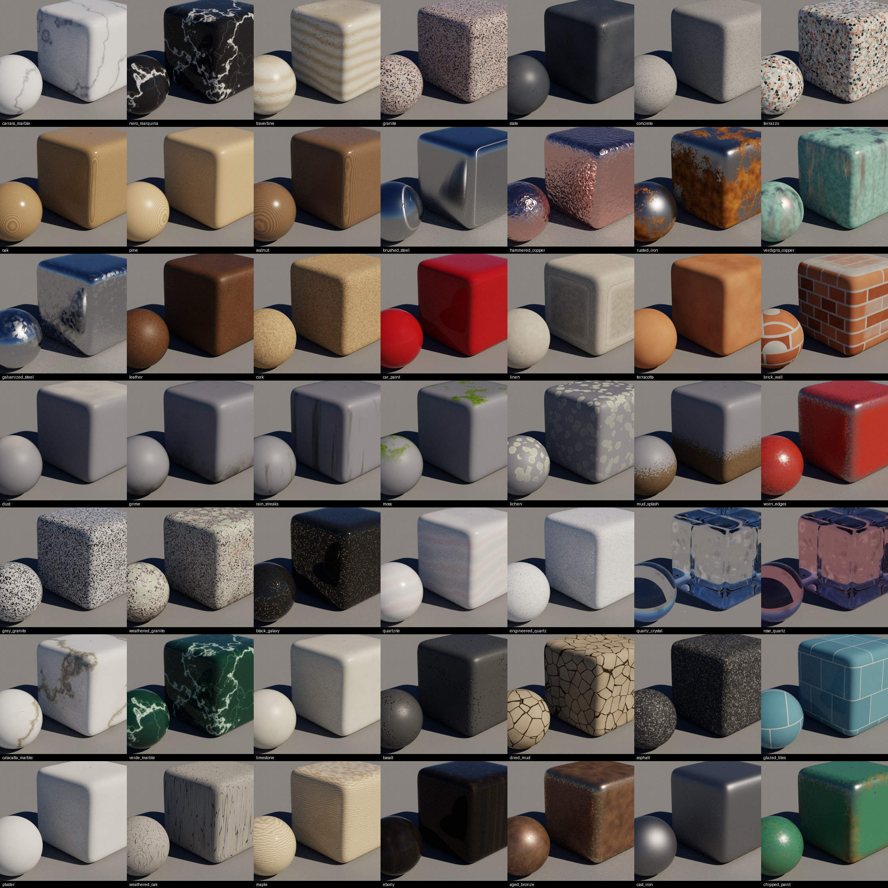
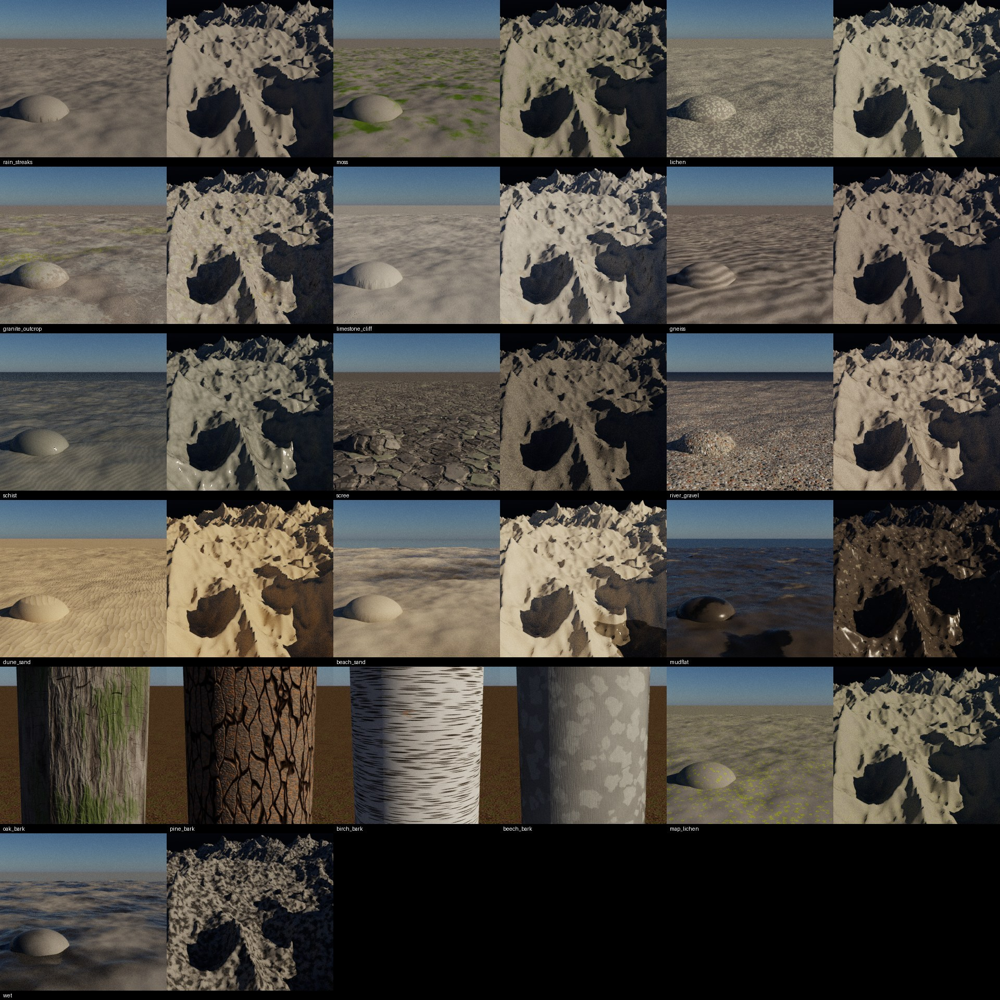
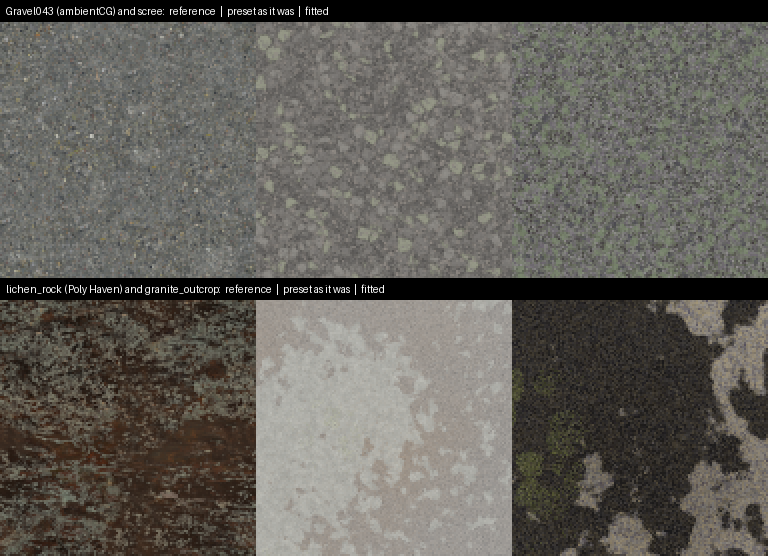
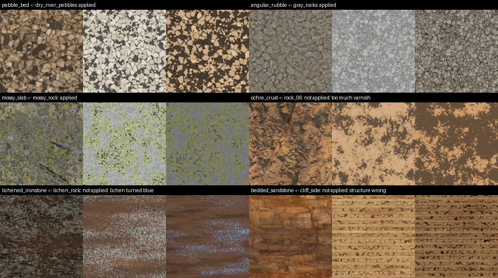

# Procedural materials

Everything real has fine detail. A noisy render hides its absence; once it converges, surfaces
of one flat colour look like plastic. POV-Ray answered this with a texture language (a
*pattern* coloured by a *colour map*, a *normal* perturbed by a pattern, a *finish*) and large
libraries written in it (`stones.inc`, `woods.inc`, `metals.inc`). This renderer now has the
same pieces, built on its function graphs (`src/graph.rs`), with sources of noise from the
literature, filtering so detail finer than a pixel fades instead of aliasing, and a library of
ready-made materials.



The library, by `scripts/material-gallery.py` (each preset alone, on a block 40 cm across and a
sphere, in rows of seven, in the library's order: the first table's first 21, then the seven
overlays, over plain grey stone (`worn_edges` over red paint), then the rest of the first table).

## Using the library

```json
"materials": {
  "TABLE": { "type": "library", "name": "oak" },
  "FLOOR": { "type": "library", "name": "travertine", "scale": 2, "seed": 7, "roughness": 0.15 }
}
```

`scale` sizes every pattern in the material, and its relief with them; `seed` moves every
pattern to another part of its noise, so two objects of one material differ; any other field
replaces the preset's own (here a more polished travertine). Patterns are sized in metres.

Each preset is an ordinary material definition in
[`src/material/library.json`](../src/material/library.json): copy one into a scene to change it.

### Presets of your own

A scene can bring its own presets with a top-level `"library"`, read when the scene is loaded:
a file in the same form as `library.json`, an object of presets written in the scene, or a list
of these (later ones over earlier). They come before the built-in presets, so one of the same
name replaces it, and they can build on built-in ones:

```json
"library": ["materials/alpine.json", {
  "red_granite": { "doc": "Granite with a red palette.",
    "material": { "type": "library", "name": "granite",
      "palette": [[0, [0.03, 0.02, 0.02]], [0.25, [0.5, 0.2, 0.15]], [1, [0.7, 0.3, 0.22]]] } } }],
"materials": { "PLINTH": { "type": "library", "name": "red_granite", "scale": 2 } }
```

A preset is `{"doc", "variables", "material"}` (and optionally `overlay`, `seed_direction`,
`show`): `variables` are graphs and values used in `material` as `"$name"`, and are also its
parameters. The scene's own `variables` don't reach into a library; presets have their own.
Files are found as a scene's other files are (`crate::assets`, so the browser builder can
provide them). A resumed render hashes the library files' contents with the scene, so editing
a preset starts it afresh. To tune a preset, put it in a file and render it with
`scripts/material-gallery.py --library FILE --only NAME`: no rebuild is needed.

| Preset | What it is, and what it's made of |
|---|---|
| `carrara_marble` | White marble with grey veins: Perlin's marble, a wave of a gradient bent by turbulence (\|sin\| for veins that are thin and sharp), over cloudy white. Polished. |
| `nero_marquina` | Black marble with a network of white calcite veins: the zero crossings of warped noise (\|noise\| small), finer veins from a second noise. Polished. |
| `travertine` | Cream bands of deposition, warped, with pits drawn out along them: cells stretched by a transform, masked by noise. Pits darker and hollow (the same graph bumps it). Honed. |
| `granite` | Pink granite: crystals of feldspar, quartz and biotite as Worley cells, each coloured by its own random value (`cells` style `id`), warped so they interlock. |
| `slate` | Riven slate: the cleft face stepped by terracing noise, coloured by the same steps. |
| `concrete` | Mottled cement with sand and aggregate (cell ids), and air pores (pits). |
| `terrazzo` | Marble chips in white cement: cells' interiors (`edges`) coloured by their ids. |
| `oak` | Growth rings about a trunk along y (`rings`, a `ramp` wave: pale earlywood darkening to latewood, then the next year), distorted at two scales; the large pores of oak's earlywood as cells stretched along the grain, in the earlywood only, dark and recessed; fibres of Gabor noise. After Liu, Dong, Hašan and Marschner. Varnished. |
| `pine` | Wide pale rings with narrow orange-brown latewood. Matt varnish. |
| `walnut` | Dark, wavy rings with a figure of phasor noise, and small pores throughout. Oiled. |
| `brushed_steel` | Anisotropic roughness, rough across the brushing (x) and smooth along it, varied in streaks of anisotropic Gabor noise, which also bump it slightly. |
| `hammered_copper` | Copper dimpled by a hammer: the relief is F2 of cells, squared; dimples smoother than the metal between. |
| `rusted_iron` | A mix: rust (lambertian, raised and scaly) over dull pitted steel, where noise and cells say. |
| `verdigris_copper` | A mix: green patina over copper, streaked downwards. |
| `galvanized_steel` | Zinc spangle: each crystal (a cell, centimetres across) reflects with its own roughness. |
| `leather` | Pebbled grain: creases between rounded cells, dark and recessed, and fine pores. |
| `cork` | Granules of bark, each its own shade, with dark gaps between. |
| `car_paint` | Glossy red with the faint orange-peel waviness of a sprayed clear coat. |
| `linen` | A plain weave of threads a millimetre apart, in the x-z plane (for cloth lying flat). |
| `terracotta` | Fired clay, mottled, with a gritty surface. |
| `brick_wall` | Bricks in running bond (courses along y), each its own shade, in recessed mortar. |
| `grey_granite` | `granite` with a grey `palette`: white feldspar, grey quartz, black biotite. |
| `weathered_granite` | Granite left outdoors: honed dull, feldspar chalky, iron stains, `grime` in its hollows and `lichen` on top: overlays on a preset. |
| `black_galaxy` | Polished black granite flecked with coppery bronzite that glints (a mix with a conductor, by cell). |
| `quartzite` | Sugary fused quartz grains, faintly banded grey and rose, each grain its own roughness. |
| `engineered_quartz` | A worktop of crushed quartz in white resin, grey specks and tiny mirror flecks. |
| `quartz_crystal` | Clear quartz (n = 1.544) with milky veils of inclusions: a mix of clear and frosted glass by billowed noise; `tint` for smoky quartz. |
| `rose_quartz` | `quartz_crystal` tinted pink. |
| `calacatta_marble` | Warm white with bold, wide grey and gold veins. |
| `verde_marble` | `nero_marquina`'s vein network in a green `palette`: Verde Alpi. |
| `limestone` | Pale cream, mottled, with scattered shell fragments (flattened cells' walls) and pores. |
| `basalt` | Fine dark grey with vesicles: round gas holes, dark and hollow. |
| `dried_mud` | A crust cracked into polygons (cells' walls, warped), the plates curling up at their edges. |
| `asphalt` | Black bitumen packed with grey and pale stones, worn smooth on top. |
| `glazed_tiles` | 15 cm glazed tiles (`brick` with square bricks), each a shade between `color` and `color2`, in grout. |
| `plaster` | Trowelled lime plaster, off-white, with the shallow sweeps of the trowel. |
| `weathered_oak` | Oak's rings silvered grey, the earlywood worn back so the grain stands up, and checks split along it. |
| `maple` | Curly maple: pale, with the rippling flame figure of phasor noise across the grain. |
| `ebony` | Nearly black, with faint brown streaks along the grain, French polished. |
| `aged_bronze` | Brown-black patina, darkest in hollows, rubbed bright on its edges (`worn_edges` over a patina). |
| `cast_iron` | Dark, sand-rough cast metal with a little rust in its hollows. |
| `chipped_paint` | Paint (`color`) flaking in patches and worn on edges, rusted iron beneath. |

Presets have parameters: the variables a preset defines can be set by fields of the same name,
`{"type": "library", "name": "granite", "palette": [[0, [0.1, 0.1, 0.1]], ...]}`, as
`grey_granite` is made. Those worth knowing: `palette` (granite, nero_marquina, oak),
`color` (glazed_tiles, chipped_paint, the overlays), `tint` (quartz_crystal), `amount` (the
overlays).

### Weathering

Overlays lie over another material, `"over"` (a name, or a definition), so anything can be
weathered, and stacked:

```json
"OLD_STEP": { "type": "library", "name": "moss", "amount": 0.5,
              "over": { "type": "library", "name": "grime", "over": "STONE" } }
```

| Overlay | Lies where |
|---|---|
| `dust` | On what faces up, thicker in places (slope, broken up by noise). `amount`, `color`. |
| `grime` | In crevices, corners and where objects meet: the `occlusion` node's short rays find them. `amount`, `color`, `reach` (metres). |
| `rain_streaks` | Dark runs down steep faces, long and thin. `amount`, `color`. |
| `moss` | Raised cushions on what faces up and in damp hollows. `amount`. |
| `lichen` | Round crusts with paler rims, more on faces turned up. `amount` (the share of possible patches), `color`, `rim`. |
| `mud_splash` | Thick at the foot, spattered above, up to `height` metres above the ground (the scene's y = 0). `amount`, `color`. |
| `worn_edges` | Wears through the material on convex edges and corners (the `occlusion` node, cast inwards) to what is `under` it (bare steel by default). `amount`, `width` (metres: about the edges' rounding). |

Overlays are `surface_layers`: the base's bump stays under them (dust lies on the stone's
relief), and a layer with its own bump adds it (moss cushions). Their masks read slope, aspect
and altitude in the scene's directions, whichever way the object is turned, and noise in the
object's own space.
## Natural landscapes



*The natural set (`scripts/material-gallery.py`): ground and rock as a patch of rough ground with a
half-sunk boulder from eye height, beside hills a few hundred metres across from above; the
natural overlays over a plain grey rock; bark on a trunk.*

These are made for the landscapes: each has structure at every scale from centimetres (crystals,
grains, ripples, lichen) through metres (stains, streaks, colonies of lichen, stones) to tens of
metres (tone), all filtered to the pixel, so the same material serves a boulder at your feet and
a cliff a kilometre away, and far off becomes its true average colour rather than noise. They
read the scene's slope and aspect (water streaks run down steep faces, lichen and moss grow on
what faces up, algae on the shaded side of a trunk) and, on a landscape, its fields.

| Preset | |
|---|---|
| `sandstone` | Desert sandstone: buff to orange, in laminae a few centimetres thick that waver across the face, sugary grains, iron stains in patches, dark desert varnish down steep faces. |
| `granite_outcrop` | Weathered granite: grey crystalline rock, mottled, iron-stained, black water streaks down steep faces, grey crustose and yellow-green map lichen on what faces up. |
| `limestone_cliff` | Pale grey crag, ochre where fresh, striped black by cyanobacteria where water runs, fluted by solution (karren) on steep faces, pitted on top. |
| `gneiss` | Folded bands and lenses of pale quartz-feldspar and dark biotite. |
| `schist` | Silvery grey-green, finely foliated, glittering with mica (each flake its own roughness). |
| `scree` | Angular stones in three sizes (35, 11 and 3.5 cm) lying on each other with dark gaps, each its own shade, older ones with lichen. |
| `river_gravel` | Rounded pebbles of many rocks on sand. |
| `dune_sand` | Ripples 11 cm apart across the `wind` (a direction; phasor noise with a sawtooth profile: gentle upwind, steep downwind), heavy minerals dark in their troughs, smooth on slopes steeper than sand rests. |
| `beach_sand` | Pale dry sand with shell fragments; below `waterline` (scene y, metres) dark, glossy and rippled by waves. |
| `mudflat` | Wet glossy mud, water standing in hollows, cracked where it has dried. |
| `oak_bark`, `pine_bark`, `birch_bark`, `beech_bark` | Furrowed ridges with algae on the side away from `shade`; plates and fissures; white with lenticels, black and rough below `rough_below` metres; smooth grey with lichen. Furrows run along y. |
| `map_lichen` (overlay) | Rhizocarpon's yellow-green crusts, tiled by black cracks, in colonies on what faces the sky. |
| `wet` (overlay) | Darker and glossy under water: where a landscape's `wetness` field says water gathers, elsewhere `amount` of it in patches. |

`lichen`, `moss` and `rain_streaks` (above) belong here too.

On a landscape, use them as the layers of its `surface_layers`, masked as before by its fields:

```json
"Ground": { "type": "surface_layers", "layers": [
  { "material": { "type": "library", "name": "granite_outcrop" } },
  { "material": { "type": "library", "name": "scree" },
    "mask": { "node": "field", "field": "sediment", "from": 0.05, "to": 1 } },
  { "material": { "type": "library", "name": "wet", "over": { "type": "library", "name": "mudflat" } },
    "mask": { "node": "field", "field": "flow", "from": 5, "to": 6 } } ] }
```

Seen from a kilometre, centimetre detail only sets a material's average, so it is close to the
ground (a figure on a path, a boulder in the foreground) that these show; from afar, it is the
landscape's own layers and their masks that make it read.

## Fitting presets to scans



*Top: `scree` fitted to ambientCG's Gravel043 (1.6 m of fine grit): it starts with too few,
too large, too pale stones, and the fit takes it to the scan's grain size and tone (mean
colour within 1/255; a slight olive cast left). Bottom: `granite_outcrop` fitted to Poly
Haven's lichen_rock (2 m): the fit gets the darkness, but not the iron-red rock or the fine
streaky lichen, which the preset's graph can't make: its stains vary over 15 m and its lichen
comes in blotches. A fit tunes a preset's parameters; it can't change its structure.*

`scripts/fit-material.py` tunes a preset's parameters to a scanned surface:

1. A preset's entry in `library.json` lists the scans it is compared with, in `references`:
   each a CC0 scan's `source` (`polyhaven:lichen_rock`, `ambientcg:Gravel043`), its `size` in
   metres, and `params`, what to search: the library material's fields (`scale`, or a preset
   variable by name) and places in the preset's JSON, numbers or colours (searched as a
   lightness and a tint of limited `chroma`, as natural colours are mostly unsaturated). See the
   script's documentation; `scree` and `granite_outcrop` have the two above. The renderer
   ignores everything in an entry but its `material`, `variables`, `seed_direction`, `scale` and
   `overlay`, so tools may keep what they like there.
2. `scripts/fetch-material-reference.py` fetches a scan's albedo map and size into
   `references/materials/` (not committed); the fit does this itself when it needs to.
3. `scripts/fit-material.py scree -o fit` (or `scree:1` for its second reference, or a spec
   file of the same form) renders each candidate as
   the scan was taken: straight down, orthographic, at the scan's size, under a uniform white
   sky (so a lambertian surface renders as its albedo, checked exactly), at twice the
   resolution and averaged down; through a library file read at run time, so nothing is
   rebuilt. It compares them with the scan by their statistics rather than their pixels
   (procedural noise never lines up with a photograph): a multi-scale sliced Wasserstein
   distance between distributions of 5x5 patches (after Heitz et al., CVPR 2021, and Elnekave
   and Weiss, ECCV 2022, on raw patches), plus colour distributions along opponent axes, which
   the patches alone barely see (left to them, the optimiser traded grey stones for sub-pixel
   confetti of saturated colours averaging grey). CMA-ES searches the parameters (the renderer
   isn't differentiable). About a second a candidate; 30 generations take 15 to 25 minutes.
   (That was the first loss; the next section has what replaced it.)
4. It writes `fitted.json` (the fitted preset as a library file, ready for a scene's
   `"library"`), `compare.png` and `log.csv`; with `--record`, it also writes the fit into the
   reference's `fit` in `library.json`: the losses, the settings, and the fitted values by
   parameter, with `"applied": false` until a person who has looked at the comparison copies
   them into the preset.

### What the loss can see

A fit finds whatever its loss can't see, so the loss is tested by itself:
`scripts/loss-benchmark.py` compares crops of the scans whose right answer is known, without
rendering. A quadrant of a scan is set against another quadrant rescaled (is the loss least at
the right scale?), its phases randomised (the same sizes and colours, blobs for shapes),
recoloured both ways by about a just noticeable difference (redder, yellower, lighter, more
saturated, more contrast), its chroma moved to the wrong places (the same histograms), and
every other scan coloured like it (does it know its own scan?). The first loss mostly saw mean
colour:

| at 128 pixels a quadrant | patch loss (first) | `ColourLoss` alone | `FitLoss` (colour and structure) |
|---|---|---|---|
| least at the right scale | 12% | | 59% |
| shapes against blobs (log ratio) | 0.07 | | 0.11 (0.39 at 256 pixels) |
| its own scan nearest | 35% | | 71% (82% at 256) |
| contrast changed (log ratio) | 0.24 | 0.51 | |
| colours in the wrong places | 0.06 | 0.45 | |
| the five kinds of colour error alike (spread, smaller better) | 1.5 | 0.35 | |

(A sum's log ratios are diluted by each part's floor, so colour is scored on the colour loss
alone; colour parameters move only it, structure being compared on normalised lightness.)

So fits now compare colour in Oklab (`ColourLoss`: the mean; the distribution about it with
chroma counting as much as lightness; and each pixel's colour beside its neighbourhood's), and
structure on normalised lightness (`StructureLoss`: an oriented log-Gabor bank's joint
responses with the next scale's, after Portilla and Simoncelli, which tells shapes from blobs;
and the radial power spectrum, which tells sizes), and see the scan twice: whole, and a
quarter of it across at the same pixels against four of its tiles, as at 128 pixels across two
metres a leaf is a pixel or two and no loss can see its shape. `--no-structure` and
`--no-detail` go back to the first loss and the whole view alone.

What the loss sees, a preset still has to be able to make: refitted with it, trail_dirt's scale
ran to its smallest, the loss rightly missing the scan's fine grit everywhere and the preset
having none to give it but by shrinking everything.

### Solved colours, palettes and free graphs

The latest round of fits (its settings now the defaults) changed what is searched, what is compared and how
the result is judged:

- **Colours are solved, not searched.** A rendered preset is linear in its colours, so the fit
  renders the preset once with its fitted colours black and once per three colours with each
  in one channel, and composes any choice of colours from those. The scan's pixels are matched
  to the composed render's by iterated sliced optimal transport (in Oklab, in just noticeable
  differences), and the colours come from a weighted least squares, pulled a little towards the
  author's and kept in [0.003, 0.95] (`ColourSolve`). This reached granite_outcrop's dark rock,
  which the bounded tints couldn't; the colours then cost nothing in the search's dimensions.
- **A palette of the scan.** `PaletteLoss` clusters the scan's colours into six (k-means in
  Oklab) and labels every pixel of both images by its nearest. It then compares each colour's
  share, the sizes of its connected patches (as a distribution in octaves), which colours lie
  beside which at 1, 3 and 9 pixels, the power spectra of lightness and the two chroma axes, and
  each colour's own spectrum. A histogram can't tell sparse large stones from a confetti of
  small ones; these parts can.
- **Measured against the scan itself.** `FloorLoss` divides every part of the colour,
  structure and palette losses by how much it differs between the scan's own four detail tiles
  (plus a quarter of its typical value, so a part the scan is uniform in doesn't dominate), and
  takes their root mean square. A loss of 1 is about as far from the scan as the scan is from
  itself; the score averages the whole and the detail view (`--loss floor`, the default).
- **Lit by a sun.** A uniform sky at one sample a pixel left about 11% noise in the albedo,
  which the spectra read as grain and the search exploited. A sun straight down (on a wall,
  straight in) with the relief stripped gives the albedo exactly at one sample.
- **Every number free** (`--free`). The preset's graphs are searched as written:
  - lengths (scales, cells, wavelengths, warps, sprite sizes) within ×/÷4;
  - amplitudes, densities, multipliers and stretches within ×/÷2.5;
  - roughness, jitter, spread, widths and coverage by ±0.25;
  - offsets and smoothstep edges by ±0.3;
  - each colour map's stops shifted and stretched;
  - numeric variables within ×/÷3.

  The same node with the same seed and value is tied into one parameter. A preset gains 11 to
  50 dimensions, about 45 minutes a preset at 60 generations. A candidate the renderer refuses
  is scored as far off, and bombing sizes are kept as the parser takes them.

Each preset's loss as a multiple of its scan's own variation, measured on the detail view at 8
samples (the fits' own scores, over both views, are lower):

| Preset | As written | Fitted | | Preset | As written | Fitted |
|---|---|---|---|---|---|---|
| ochre_crust | 6.84 | 0.62 | | veined_basalt | 83.5 | 1.73 |
| bedded_sandstone | 6.14 | 0.90 | | shingle | 49.9 | 2.10 |
| lichened_ironstone | 25.3 | 0.91 | | weathered_grey_rock | 39.5 | 2.14 |
| mossy_slab | 16.6 | 1.07 | | granite_outcrop | 116 | 2.21 |
| caliche_ground | 14.4 | 1.20 | | stony_bank | 123 | 3.00 |
| trail_dirt | 97.3 | 1.35 | | angular_rubble | 12.9 | 3.09 |
| pebble_bed | 7.78 | 1.59 | | foliated_rock | 190 | 3.66 |
| weathered_pink_granite | 26.8 | 1.62 | | laterite | 199 | 3.88 |
| leaf_litter_gravel | 26.0 | 2.26 | | scree | 80.1 | 4.35 |

All but two of the seventeen are applied. angular_rubble's fit is closer in tone but turns its angular stones
into blobs close up. ochre_crust's fit swirls where the scan cracks. Both keep the presets as
written.

The fits furthest from their scans are broken stone and crusted ground. The fits move sizes,
contrasts and colours freely, so what is left is structure the graphs can't make: angular,
sharp-edged stones lying on one another, and cracks. Those needed new sprites rather than more search:
`bombing`'s `stone` shape (below).

### Roaming: fitting on fresh ground

A fit sees one patch of the preset, and with fifty free numbers it can learn that patch: a stone
just where the scan has one, a blotch that happens to balance the palette. Scored again on three
patches it never saw (the camera moved by up to 25 of the preset's sizes), some applied fits
lost much of their gain: weathered_grey_rock 1.90 → 4.55, granite_outcrop 1.00 → 1.95,
bedded_sandstone 0.81 → 1.44, mossy_slab 0.80 → 1.32.

So fits now roam (the default; `--fixed` keeps the camera still). Each generation of the search
renders its candidates on a new patch, the same for all of them so they are compared fairly, and
the search can only keep what holds everywhere. At the end the author's preset (colours solved),
the best of three late generations and the search's mean are each judged on `--judges` (3) fresh
patches, and the lowest is chosen if it beats the author's. The record keeps those scores under
`judged`. The `stone` sprites (angular, faceted, rimmed) rebuilt angular_rubble and stony_bank.

Scores on the three fresh patches, the presets applied before against the roaming fits:

| Preset | Before | Roaming fit | Applied |
|---|---|---|---|
| angular_rubble | 10.61 | 1.22 | yes (rebuilt with `stone` sprites) |
| stony_bank | 2.30 | 2.28 | yes (rebuilt with `stone` sprites) |
| granite_outcrop | 1.95 | 0.73 | yes |
| mossy_slab | 1.32 | 0.97 | yes |
| bedded_sandstone | 1.44 | 1.10 | no: a large dark blotch close up |
| weathered_grey_rock | 4.55 | 4.56 | no |

A fit's score on its own patch is no longer the measure; one on fresh ground is.

Three presets were then written with the new blocks and fitted the same way (judged on fresh
patches, as written with colours solved → fitted): desert_pavement 2.84 → 1.08 (`stone` chips
on a crust crazed by `cells` edges), dark_stony_soil 8.21 → 2.43 (grit and stones in patches) and
cracked_riverbed 8.58 → 1.44 (plates with lighter lips and finer cracks within). Their fits are
right in tone and from afar, less so close up: desert_pavement's larger stones went dark where
the scan's are pale, dark_stony_soil's grit is too regular, and cracked_riverbed's plates came
out smaller and lumpier than the scan's.

### Reworks, `hold`, and the first fits of the landscape presets

Those three were then reworked for their close-up faults (a separate layer of dark stones on
the pavement, a finer grit layer in the soil, the riverbed's plate size held) and refitted on
roaming patches. Judged on fresh patches against the fits applied before, desert_pavement went
1.08 → 0.96 and was applied (its crust's cracks are now visible close up, if heavy). The other
two scored better but looked worse and were left as they were: dark_stony_soil 2.43 → 2.20,
greyer from afar and a mosaic of rimmed stones close up; cracked_riverbed 1.44 → 2.65, small
plates crazed by too many fine cracks. A score on fresh patches is necessary, not sufficient:
every fit is looked at, near and far, before it is applied.

A reference may list numbers a `--free` search must leave as written, `"hold"`: entries of
`{"node", "field", "seed"}`, any of them left out matching every value. The barks hold their
`transform` nodes' `scale`, the stretch that makes plates and ridges run up the trunk: a free fit
of pine_bark matched the scan's colours but squashed its plates round, gravel from afar.

scree was rebuilt from three layers of `stone` sprites (grain, gravel and cobble sizes over
fines, coloured by each stone's `id`) and fitted: 3.21 → 1.99 on fresh patches, applied. Its
fine gravel is close to the scan's; its cobbles come out larger and more sharply rimmed than
the scan's, pale spots from afar.

Six natural presets had their first scans (Poly Haven), searching all their numbers but the
held ones, and solving their colours:

| Preset | Scan | Author's, colours solved | Fit | Applied |
|---|---|---|---|---|
| pine_bark | pine_bark | 5.11 | 0.67 | yes |
| oak_bark | jolcham_oak_bark_01 | 2.38 | 0.94 | no: the scan's pale lichen and moss came out as dark streaks; the preset needs a lichen layer |
| sandstone | sandstone_cracks | 40.9 | 4.55 | no: bedding meant for cliff faces is contour rings seen from above; needs a cliff scan, fitted as a `wall` |
| dune_sand | dense_sand | 55.2 | 29.3 | no: the scan has no ripples |
| beach_sand | damp_beach_sand | 2694 | 2608 | no: renders near white in the fitting scene |
| mudflat | brown_mud_02 | 2847 | 2.36 | no: its wet sheen mirrors the white sky and sun |

The last two are glossy where wet, and the fitting scene, lit to read albedo off matte ground,
shows the gloss as white sheets and glints: wet materials need to be fitted without it. Nearly
uniform scans also make large scores, since the loss is relative to how much the scan varies
between its own tiles.

So `strip_relief` now draws a `plastic` layer as `lambertian` in its own albedo, as it already
takes bumps off: the scans are albedo maps, without gloss. Refitted that way, with better scans
for two of them and a lichen layer for the oak:

| Preset | Scan | Author's, colours solved | Fit | Applied |
|---|---|---|---|---|
| beach_sand | damp_beach_sand | 10.7 | 4.04 | yes: the scan's damp tan; its damp patches blotchier than the scan's |
| dune_sand | ambientCG Ground098 (rippled) | 16.6 | 9.67 | yes: warm tan, ripples 0.18 m apart (in the bump, so unseen by the fit) |
| mudflat | brown_mud | 42.0 | 1.53 | yes (brown_mud_02, dry crumbly soil, had pulled it towards dry ground) |
| oak_bark | jolcham_oak_bark_01 | 2.71 | 0.99 | yes: with pale lichen crusts; blotchier than the scan close up, the lichen beige |

A free fit's search leaves the bump out, as the fit doesn't render it; but a stone layer's relief
is a copy of its albedo's `bombing` node (`height` beside `mask`), and kept its authored cells
and sizes while the albedo's moved, so the fitted stones were raised on other stones' cells
(scree's cobbles coloured on cells of 7.5 cm, raised on cells of 4; desert_pavement's relief a
second set of cracks). A bump's node of the same kind, seed and authored value as an albedo's
now moves with it, and the applied fits were repaired from the versions they started from.
scree's cobbles were also set back to 2-5 cm and held, as its fit had grown them into pale spots
the scan (fine gravel) doesn't have. Refitted so: 1.99 → 1.67 on fresh patches, applied; its fit made the
stones' facets more contrasting than the scan's, polished-looking close up.

### Choosing scans

Five more first fits were all left unapplied, though each scored better: asphalt (4.62 against
8.33 as written), plaster (12.3 against 67.0), concrete (1.10 against 6.15), limestone_cliff
(1.13 against 15.1) and gneiss (1.05 against 7.59). The man-made presets are generic clean
surfaces and their scans one dirty example each (green-stained grey plaster, board-marked
concrete), which the fits imitated in streaks and blotches; asphalt's aggregate grew into a
mosaic of chips where the preset was already close. The cliffs' scans were the wrong rocks, a
brown iron-stained face and dark rock strewn with leaves, and the fits turned limestone brown and
wiped out the gneiss's banding. A scan must be of the material the preset names: the same rock,
or for a generic surface a clean, typical one. Two presets were written for scans instead and
fitted: crazed_sandstone (Poly Haven's rock_boulder_cracked: tan sandstone crazed into plates,
pitted along its cracks; 4.96 → 1.30) and mossy_mud (brown_mud_leaves_01: red-brown mud with
patches of small leaves, by `bombing`; 14.4 → 1.06, its smallest leaves a dense litter close up
where the scan has bare mud between sprigs).

The polished stones were then fitted to ambientCG's slabs of the stones they name, sizes not
recorded (taken as 1 m and searched): carrara_marble to Marble021 (11.3 → 1.29, applied: near
white with faint veins and soft mottling, in place of regular grey stripes) and nero_marquina to
Marble016 (11.1 → 1.43, applied: the slab's dense net of fine white veins in place of one bold
one). travertine (to Travertine009, 13.0 → 2.77) mottled where the vein-cut slab is banded, and
granite (to Granite003A, 15.0 → 5.52) went blue-grey, the slab not the pink it looked in a
thumbnail; neither applied. grey_granite is a variant (a `library` reference to granite with its
own palette), which the fit's renders don't follow, so nothing moved; it takes granite's
structure as it is. A palette held in a variable (`"color_map": "$palette"`) is solved like any
other colours once the reference names its stops.
Refitted to Granite001A, a warm pinkish slab (its mean colour checked this time), granite
went 4.13 → 2.40, applied: interlocking crystals of pink-beige, grey and black like the slab's.
verde_marble, a variant of nero_marquina, could only move its colours and came out black with
white speckle; calacatta_marble's scan (Marble014) is a beige marble, not calacatta's warm white
with bold veins, and the fit made it beige and lacy. Neither applied.
cork (to ambientCG's Cork003, agglomerated granules) went 6.29 → 3.90, applied: the scan's
warm orange granules and dark gaps in place of pale beige. leather (to Leather037) went 38.3 →
32.6, applied for its colour, the scan's rich brown: a leather's albedo is nearly uniform (its
pebbling is in the bump, which the fit leaves alone), so the fit flattened the grain in the
colour and its score stays large.

Two more presets were written for ground scans and fitted: forest_sand (Poly Haven's
forrest_sand_01: grey-beige sand darkened by humus, pine needles in clumps by `bombing` leaves
drawn thin; 5.62 → 1.27, applied, its needles lying in denser mats than the scan's) and
shore_gravel (low_tide_rocks: packed centimetre pebbles and shell fragments, by `stone`
sprites; 11.3 → 1.24, applied, close to the scan from afar, its pebbles softer and less varied
in colour close up). A `conductor` mirrors the fitting sun as wet layers did, so it is drawn
matte in its `reflectance` too; rusted_iron, fitted so to ambientCG's Metal064 (orange-brown rust
in patches over grey steel), went 4.93 → 0.74, applied: red-brown rust and grey steel like the
scan's, in place of orange over pale grey.
verdigris_copper (to Metal058C, a turquoise patina streaked down over copper, seen as a wall)
went 5.40 → 1.64, applied: the scan's turquoise in place of a pale wash, though blotchier and
less streaked than the scan from afar. 
A variant (a preset whose material is another preset with some of its variables set, as
grey_granite is granite with its own palette) kept its base's gloss in the fitting render, which
strips only the materials it sees, so it mirrored the sun and nothing moved. The fit now inlines
the base with the variant's fields as its variables first (`resolve_variant`), and a variant's
palette is solved: grey_granite (to Granite002A) 19.0 → 5.40, softer and with less black like the
slab, and verde_marble (to Marble009) 148 → 2.66, near-black green with faint veins like the slab
in place of a bright teal; both applied, their structure their bases'. (Judged on the fitting
patch: with only colours to move there was no search to roam.) The overlay variants
(weathered_granite, aged_bronze, chipped_paint) need a material under them and aren't fitted.

The woods run their grain up the scene's y and are seen on a wall, while wood scans are taken
with the grain across; a reference's `"rotate"` turns the scan by quarter turns before it is
compared. oak, fitted so to ambientCG's Wood049 (flat-sawn oak), went 38.4 → 2.80, applied: the
scan's mid brown and wavering grain in place of pale, ruled lines.
maple (to Poly Haven's white_maple_veneer, 11.0 → 6.11) lost its curl, the scan being plain
maple, and pine (to coated_pine, 13.4 → 6.99) took the scan's amber coating, not the preset's
pale matt pine; neither applied. The walnut veneers are grey, not oiled chocolate, and weren't
tried.

Three more presets were written for Poly Haven's ground scans, their needles, leaves and twigs
`bombing` leaves of different widths, and fitted: burned_ground (burned_ground_01: charred soil,
ash and brown earth, bleached needles and charred twigs; 4.08 → 1.06, applied, its ash in paler,
softer patches than the scan's), mossy_leaf_litter (forest_leaves_02: olive moss, fallen leaves,
needles and twigs; 2.18 → 0.77, applied) and wet_leaf_mat (winter_leaves: dark wet leaves matted
over one another; 5.89 → 1.46, applied, close to the scan near and far).

Seen on a block and a sphere (`scripts/material-gallery.py --objects`), the presets built of
`bombing` sprites streaked down every vertical face: the sprites lay over the plane x-z, as on
the ground, so a wall showed each one drawn out along y. A bombing node now scatters its sprites
over the plane a surface faces most, projected along the axis nearest its normal and blended
across the seams, each plane by its own seed; ground facing up sees exactly the sprites it did
(by the node's own seed on x-z), so the fits stand, and `"plan": true` keeps the old projection.

Three more ground presets: red_clay_ground (Poly Haven's red_mud_stones: rusty red-brown earth,
fine cracks, a few pale stones; 2.14 → 0.78, applied, its dry patches speckled paler than the
scan's), dry_leaf_litter (dry_decay_leaves: dry leaves lying thick; 2.92 → 0.93, applied) and
root_mat (roots: ochre earth with dark roots). root_mat's roots, first drawn from cells' edges,
came out of their fit as speckle; drawn instead as thin `bombing` leaves warped so they curve,
it went 4.02 → 1.36, applied, its roots spindlier than the scan's close up.

And three more: petal_strewn_dirt (flower_scattered_dirt: brown dirt strewn with lilac petals by
`bombing` leaves; 4.40 → 2.01, applied, but for one petal colour the fit had browned, kept lilac
by hand), dry_grass_mat (withered_grass: straw blades matted flat; 9.48 → 1.80) and tilled_soil
(farm_soil: dark clods and crumbs; 3.32 → 1.01). The last two took only their fitted colours:
the search scored better by blowing the blades and clods up to several times their size, which
a close look rejects.

Four more, all applied: trodden_snow (snow_02: grey-white snow with smudges of grime; 1.01 →
0.68, its scuffs soft blotches where the scan's are thin bootprint edges), coastal_turf
(coast_sand_rocks_02, 15 m: turf over earth with pale rock breaking through, the rock a mask
of noise rather than sprites, which drew it as hexagons; 11.8 → 0.77), shell_grit
(shell_floor_01: grey and buff grit; 10.5 → 2.08, its grains rounder close up than the scan's
broken shell) and sparse_grass (sparse_grass: green shoots over brown soil, straw across them;
3.82 → 0.84).

And four more: patchy_snow (snow_03: snow melting off in lumps over dark ground; 9.89 → 0.76,
blockier close up than the scan), rocky_trail (rocky_trail: tan dirt packed with grit and
stones; 268 → 1.54, its stones more even in size than the scan's), slabby_path
(forest_ground_04: flat grey slabs and flakes in brown earth; 963 → 0.88, the fit fading the
slabs into the earth, which matches the scan at its scale but not close up; its colours alone
left them dark or chalky) and moss_carpet (aerial_grass_rock, 15 m: yellow-green moss over
rock, bare patches and grit; 35.5 → 0.92).

### Presets modelled on scans



*Each: the scan, the preset as written, and fitted (the first ten; the six after them aren't pictured). All sixteen fits of that round were applied (leaf_litter_gravel's after its leaves were remade by `bombing`); the round above has since refitted sixteen of them.*

Sixteen presets were written to imitate particular Poly Haven scans, each scan recorded in the
preset's `references`:

| Preset | Scan | |
|---|---|---|
| `pebble_bed` | dry_river_pebbles | Packed rounded pebbles, pale and dark |
| `angular_rubble` | gray_rocks | Packed angular grey stones, soil between |
| `mossy_slab` | mossy_rock | A mosaic of mosses and lichens over grey rock, a few cracks |
| `ochre_crust` | rock_06 | Ochre rock blotched with dark varnish, sharp cracks |
| `lichened_ironstone` | lichen_rock (a wall) | Iron-dark rock streaked along its grain, lichen in clumps gathered in drifts |
| `bedded_sandstone` | cliff_side (a wall) | Beds of random thickness, each its own tone, rust partings, joints ending at them |
| `trail_dirt` | forest_ground_04 | Compacted brown earth with sparse pale stones |
| `laterite` | red_laterite_soil_stones | Rust-red earth with sparse pale nodules |
| `foliated_rock` | quarry_wall (a wall) | Dark wavy foliation along a `dip`, from phasor noise |
| `shingle` | coast_sand_03 | Grey-beige gravel and sand in lighter and darker drifts |
| `veined_basalt` | dark_rock (a wall) | Near-black rock, a network of pale veins, horizontal fractures |
| `weathered_grey_rock` | rock_01 | Smooth grey-brown rock, mottled, speckled, a few pits |
| `weathered_pink_granite` | rock_04 | Coarse granite weathered rough, salmon feldspar among grey-brown |
| `caliche_ground` | coral_gravel | Brown gravelly soil with ragged patches of pale lime crust |
| `stony_bank` | river_small_rocks | Grey-beige silt with small flat stones bedded in it |
| `leaf_litter_gravel` | leaf_scattered_gravel | Dark gravel with small brown leaves, pointed, ribbed and each its own shade (`bombing`), heaped between the stones and a few lying on them |
| `desert_pavement` | dry_ground_rocks | An ochre crust crazed by fine cracks, with angular chips and stones scattered over it (`stone` sprites) |
| `dark_stony_soil` | brown_mud_rocks_01 | Dark peaty earth thick with grit and small angular stones in patches |
| `cracked_riverbed` | mud_cracked_dry_riverbed_002 | Silty mud split into plates with lighter curled lips and finer cracks within |

Cliffs are fitted as walls (`"view": "wall"`), so their beds and streaks run along y as on a
landscape's cliffs.

A fit is applied only once someone has looked at it: `scripts/apply-fit.py pebble_bed` copies
the recorded values into the preset and marks them applied. A fitted size becomes the
preset's own `scale`, multiplied into whatever a scene asks for. Re-rendering an applied
preset gives the recorded loss. Fits correct colour and size; where a preset still differs
from its scan it is in structure, which is the author's to improve: the sandstone's partings
are thinner and more regular than the scan's chunky blocks, the ironstone has less lichen,
the foliation's streaks are crisper, the trail's stones fewer and smaller, the caliche's lime patches fewer, and the stony bank's stones fainter.

What the first attempts taught, now built into `fit-material.py`:

- An optimiser left free with each colour swaps their roles (the pale pebbles become the dark
  ones) and wanders into hues the scan hasn't got (green and pink pebbles), matching the
  statistics with a picture that looks nothing like the scan. A colour's lightness is now held
  near its author's and its tint close to theirs: a fit refines a preset's colours, it doesn't
  choose them.
- A search's cost grows with its dimensions (CMA-ES wants of the order of a hundred
  evaluations per dimension), so a preset's colours are best fitted as groups, each as one
  colour is: a gain on lightness, two small tint shifts and a contrast, keeping the colours'
  relations. Gains on red, green and blue apiece let a group's hue wander (grey lichen turned
  blue, ochre pink); and colours of different hues (rock and lichen) belong in separate groups.
- Colours that cover little of the surface hardly move the loss, so their tint drifts: give
  them a smaller `chroma` (trail_dirt's stones, a tenth of its area, turned mint green).
- The eye judges a surface's hue by its mean first; the patch distributions barely see a mean
  shifted from tan to pink. The mean colour is now compared besides, along the opponent axes.
- Size is held near the author's (0.7 to 1.4 of it): left free, it ran to its bound.

The comparison sees albedo only, so it fits colour and pattern, not relief or gloss (the scans'
normal and roughness maps could be compared the same way), and the plastic presets' coats add a
little to their apparent albedo. Classifying whether a fit reads as the right material (a
network trained on MINC, or CLIP) would need weights this environment can't download yet.

## Patterns and colour maps

Any colour (a lambertian's or plastic's `albedo`, a mix's `amount`, a roughness) can be a
pattern coloured by a map, as POV-Ray's `pigment { pattern color_map { ... } }`:

```json
"albedo": { "pattern": { "node": "wave", "shape": "scallop",
                         "input": { "node": "add", "inputs": [
                           { "node": "gradient", "direction": [1, 0.35, 0.2], "scale": 0.14 },
                           { "node": "fractal", "style": "billow", "scale": 0.35, "amplitude": 1.6 } ] } },
            "color_map": [ [0, [0.32, 0.33, 0.35]], [0.14, [0.7, 0.71, 0.72]], [1, [0.86, 0.86, 0.85]] ],
            "interpolation": "smooth" }
```

The pattern is a function graph (see `src/graph.rs` for every node). Its value picks a place in
the map, whose entries are sorted by value; the colour is blended from the two entries about
it (`"linear"`, `"smooth"`, or `"step"` for hard edges). An entry may itself be a texture,
another pattern too, as POV-Ray's `pigment_map`; a number is a grey level, for roughness maps.

### Sources of detail

Beyond Perlin noise (`fractal`, with `ridged` and `billow` styles) and Worley's cells:

| Node | |
|---|---|
| `gabor` | Sparse Gabor convolution noise (Lagae et al. 2009): Gabor kernels, a Gaussian times a cosine, scattered at random. Its spectrum is a blob about one frequency, so it can be anisotropic (`direction`, with `spread`: brushed metal, grain, fibres) and is filtered exactly. `frequency` or `wavelength`, `bandwidth` (default half the frequency: smaller for more regular, slower), `impulses` (16), `plan`, `seed`, `amplitude`. |
| `phasor` | Phasor noise (Tricard et al. 2019): the same kernels as complex exponentials, keeping the phase of the sum, turned into a `profile` (`sine`, `saw`, `square`): oscillations of constant contrast, as wood figure, fingerprints, sand ripples. |
| `cells` | Worley's noise, now with styles `f2` and `id` (a random value per cell: crystals, chips, granules), a `metric` (`euclidean`, `manhattan`: faceted, `chebyshev`: square) and `jitter` (0: a regular lattice, 1 the default). |
| `gradient`, `rings`, `spherical` | POV-Ray's gradient (distance along `direction`), cylindrical rings (distance from the line through `center` along `axis`), and onion shells, each over `scale`. |
| `wave` | Any input turned into repeating bands, `frequency` per unit of it, `phase`, as POV-Ray's wave types: `shape` `ramp`, `triangle`, `sine`, `scallop` (\|sin\|), `square`; `exponent` sharpens. |
| `bombing` | Texture bombing (Glanville, GPU Gems 2004): sprites scattered over the ground plane (x, z) from a grid of `cell`s, `density` a cell on average, each at its own place, angle, length (`size` [smallest, largest]) and layer; where they overlap the topmost shows. `shape` `leaf` (a lens pointed at both ends, `width` 0.35 of its length, with a midrib) `disc` (an ellipse) or `stone` (an irregular convex polygon of 5 to 8 corners at random radii: broken, angular stones). `output`: `mask` (coverage, softened over the footprint), `id` (the topmost's own random value: a colour each), `vein` (its midrib), `height` (stacked and rounded at the edge, for a bump), `edge` (1 at the topmost's outline, fading a fifth of the way in: the dark rims where stones meet) or `facet` (a slope of shade across it, each its own way: broken faces catching more light or less). Unlike cells, which tile the plane, sprites overlap and leave gaps, each turned its own way: leaf litter, petals, flakes, rubble. |
| `checker`, `brick` | POV-Ray's: alternate cubes `size` across; bricks `size` [x, y, z] (default a UK brick in metres) in running bond with `mortar` between, `style` `mortar` (1 in it) or `id` (a value per brick). |
| `occlusion` | The share of `rays` (6) short rays, `radius` (0.05 m) long, that meet something: cast out from the surface, how enclosed it is (`style` `cavity`: crevices, corners, where objects meet, as dirt gathers there); cast in from under it, how near a convex edge it is (`style` `edges`: wear). Directions are hashed from the point, so they converge over a pixel. Costs rays: use it in masks, not in bumps. |
| `transform` | Its `input` scaled, rotated (degrees about x, then y, then z) and moved (`translate`): stretch cells into pores, turn bands. |

### Filtering

A pattern finer than a pixel aliases: it glitters, or shows moiré where a surface recedes.
Patterns are therefore evaluated with the pixel's footprint where the surface is hit (as image
textures are, `textures::footprint`):

- `fractal` octaves finer than the footprint fade to their mean, as they always have on
  displaced terrain;
- Gabor and phasor noise are attenuated by exp(-2π² σ² F²), which is what convolving a kernel
  with a Gaussian of deviation σ does to it at its frequency F (Lagae et al., section 4);
- `wave`, `checker` and `brick` are box filtered exactly, by differences of their integrals
  over the footprint (Apodaca and Gritz's `filteredpulsetrain`); a wave measures how fast its
  input changes across the surface to know how many cycles the footprint spans.

## Bumps that follow the pattern

Colour and relief in real materials come from the same structure: a marble's veins are
softer, a travertine's pits are hollow, oak's pores are both dark and recessed. A bump can be
any graph, as a height in metres:

```json
"normal": { "graph": "$pits", "amount": -0.003 }
```

and the graph can be the one the colours come from (define it once in `variables` and refer to
it by `"$name"` in both). The normal is tilted against the height's gradient across the surface,
taken by central differences half a footprint apart of the graph filtered to that footprint, so
relief finer than a pixel fades rather than sparkling. `amount` scales the heights.

A `"normal"` in a material's definition goes with the material wherever it is used (an
object's `"normal"` adds to it), so a library material carries its relief. In a `mix`, each
material keeps its own: rust raised over pitted steel.

## Roughness maps

`plastic` and `conductor` take a texture for `"roughness"`: a pattern with a map of numbers, so
a surface can be shinier in places (worn, polished, each crystal of galvanizing its own). For a
conductor the map scales `roughness_u` and `roughness_v` (1 unless given), keeping anisotropy.

## Patterns go with their objects

A pattern is read in its object's own space: moved and turned with the object's `transform` (a
plank turned turns its grain, a moving object doesn't slide through its texture), but not
scaled, so a library material keeps its size in metres on any object (`Geometry::pattern_frame`).

## References

- K. Perlin, "An image synthesizer", SIGGRAPH 1985 (marble as turbulence); "Improving noise", SIGGRAPH 2002.
- S. Worley, "A cellular texture basis function", SIGGRAPH 1996.
- J. P. Lewis, "Algorithms for solid noise synthesis", SIGGRAPH 1989 (sparse convolution).
- A. Lagae, S. Lefebvre, G. Drettakis and P. Dutré, "Procedural noise using sparse Gabor convolution", SIGGRAPH 2009.
- A. Lagae et al., "A survey of procedural noise functions", Computer Graphics Forum 29(8), 2010.
- T. Tricard, S. Efremov, C. Zanni, F. Neyret, J. Martínez and S. Lefebvre, "Procedural phasor noise", SIGGRAPH 2019.
- D. S. Ebert, F. K. Musgrave, D. Peachey, K. Perlin and S. Worley, "Texturing and Modeling: A Procedural Approach", 3rd ed., 2003.
- A. A. Apodaca and L. Gritz, "Advanced RenderMan", 2000, chapter 11 (antialiasing procedural textures).
- A. J. Liu, Z. Dong, M. Hašan and S. Marschner, "Simulating the structure and texture of solid wood", SIGGRAPH Asia 2016.
- J. Portilla and E. P. Simoncelli, "A parametric texture model based on joint statistics of complex wavelet coefficients", IJCV 40(1), 2000.
- B. Ottosson, "A perceptual color space for image processing" (Oklab), <https://bottosson.github.io/posts/oklab/>, 2020.
- S. Glanville, "Texture bombing", GPU Gems, chapter 20, 2004.
- J. F. Blinn, "Simulation of wrinkled surfaces", SIGGRAPH 1978.
- I. Quilez, "Domain warping", <https://iquilezles.org/articles/warp/>.
- POV-Ray 3.7 reference: "Pattern", "Color Map", "Normal"; and its include files `stones.inc`, `woods.inc`, `metals.inc`.
