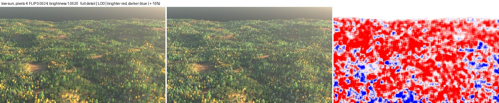
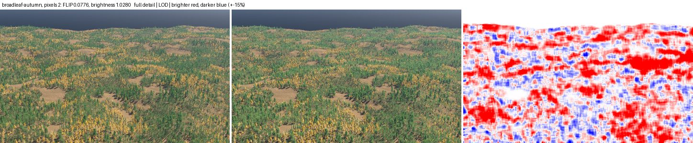
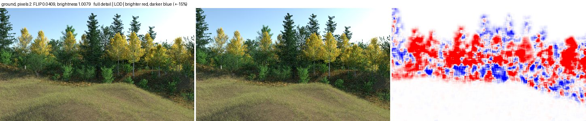

# The suite: levels of detail under many conditions

`scripts/lod-suite.py` renders demo forests, each changed one way, at full detail (the reference)
and with `"lod"` at `pixels` 1, 2 and 4. For each it records FLIP, brightness against the
reference (all, and the near and far halves by depth), memory and time, with a picture. Results
from this run are in [suite.csv](suite.csv).

Settings: 480 × 280 at 32 spp, from the code after stage 8 (crossed cards from 64 pieces; large
clusters shadowed by their own leaves at their albedo). The LOD renders shared a tree cache
filled as the run went. That changes no image, but it raises peak memory where levels were being
written: cached levels are held encoded and decoded at once.

```
scripts/lod-suite.py --pixels 1,2,4         # the standard cases
scripts/lod-suite.py --all                   # and the heavy ones (dense, sunlit)
scripts/lod-suite.py --list                  # the cases
```

## Results

| Case | `pixels` | FLIP | Brightness | Near | Far | Peak MiB (full) | Render s (full) |
|---|---|---|---|---|---|---|---|
| aerial | 1 | 0.0557 | +0.2% | −1.1% | +1.3% | 599 (3937) | 33.7 (98.7) |
| aerial | 2 | 0.0614 | +1.7% | +0.4% | +3.3% | 545 (3937) | 28.7 (98.7) |
| aerial | 4 | 0.0730 | +2.4% | +1.8% | +3.6% | 435 (3937) | 25.6 (98.7) |
| low | 1 | 0.0280 | +0.0% | +0.0% | +0.3% | 669 (3974) | 22.5 (47.0) |
| low | 2 | 0.0306 | +0.1% | −0.4% | +2.1% | 347 (3974) | 19.0 (47.0) |
| low | 4 | 0.0341 | +0.3% | −0.5% | +4.3% | 284 (3974) | 15.8 (47.0) |
| nadir | 1 | 0.0566 | +0.0% | +0.2% | −0.2% | 300 (3973) | 37.6 (91.2) |
| nadir | 2 | 0.0624 | −0.5% | −0.3% | −0.8% | 218 (3973) | 31.4 (91.2) |
| nadir | 4 | 0.0765 | +0.1% | +0.5% | −0.3% | 202 (3973) | 27.8 (91.2) |
| low-sun | 1 | 0.0397 | +1.2% | +0.2% | +2.5% | 528 (3962) | 40.2 (101.9) |
| low-sun | 2 | 0.0445 | +3.0% | +0.8% | +5.8% | 317 (3962) | 31.0 (101.9) |
| low-sun | 4 | 0.0524 | +5.2% | +3.9% | +8.2% | 232 (3962) | 26.5 (101.9) |
| backlit | 1 | 0.0460 | +0.5% | −0.5% | +1.3% | 531 (3953) | 37.2 (104.6) |
| backlit | 2 | 0.0494 | +1.2% | +0.9% | +2.1% | 312 (3953) | 31.4 (104.6) |
| backlit | 4 | 0.0573 | +1.7% | +2.6% | +2.4% | 233 (3953) | 25.3 (104.6) |
| broadleaf-autumn | 1 | 0.0668 | +0.9% | −0.2% | +2.0% | 403 (1967) | 28.8 (69.3) |
| broadleaf-autumn | 2 | 0.0776 | +2.8% | +2.5% | +3.5% | 460 (1967) | 26.2 (69.3) |
| broadleaf-autumn | 4 | 0.0953 | +2.6% | +4.0% | +1.7% | 434 (1967) | 22.8 (69.3) |
| conifers | 1 | 0.0463 | +2.0% | +3.0% | +1.9% | 420 (2184) | 40.3 (115.6) |
| conifers | 2 | 0.0485 | +1.8% | +2.0% | +2.4% | 216 (2184) | 32.5 (115.6) |
| conifers | 4 | 0.0570 | +2.7% | +2.6% | +3.8% | 199 (2184) | 26.8 (115.6) |
| sparse | 1 | 0.0357 | −0.9% | −1.1% | −0.9% | 377 (3896) | 24.3 (47.9) |
| sparse | 2 | 0.0393 | −0.8% | −1.2% | −0.5% | 197 (3896) | 21.1 (47.9) |
| sparse | 4 | 0.0475 | −0.6% | −1.1% | −0.3% | 129 (3896) | 19.5 (47.9) |
| ground | 1 | 0.0252 | +0.8% | +0.2% | +4.6% | 2927 (3104) | 230.9 (241.8) |
| ground | 2 | 0.0409 | +0.8% | +0.0% | +5.0% | 2450 (3104) | 232.0 (241.8) |
| ground | 4 | 0.0545 | +0.2% | −0.4% | +3.2% | 2460 (3104) | 208.5 (241.8) |

The heavy cases (`dense`, `sunlit`) were not run.

## What it shows

**Where the LOD holds up.**
- **Seen straight down, from 90 m up, and with trees far apart:** brightness is within about 1%
  overall and FLIP grows gently with `pixels`.
- **Backlit, with light through the leaves:** +1.2% at `pixels: 2`.
- **Memory and time:** LOD uses 5–18× less memory than full detail from the air, and renders
  2–4× faster.

**A low sun is the worst case for brightness.** With the sun 9° up, LOD is +3.0% at `pixels: 2`,
+5.2% at `pixels: 4` and +8.2% in the far half. The difference map is red almost everywhere:



A card's self-shadowing (`self_lit`) is one number averaged over light from the whole sky.
Light from near the horizon crosses more of a crown than light from above, so a low sun is
shadowed more by the real leaves than the card allows. Stage 7 listed this as the cost of one
number for all directions; this case measures it. **A lit fraction that depends on the light's
elevation** (two or three bytes per card) is the candidate fix.

**Broadleaves in autumn have the highest FLIP** (0.0776 at `pixels: 2`, against 0.0485 for
conifers). Their bright, varied crowns make each card's choice of one leaf to shade more visible
as noise and blotches, and they are +2.8% bright.



**Conifers alone are about 2% bright at every setting,** even at `pixels: 1`. The 4–9% that
their cards are hit more often than their needles (stage 7) shows here.

**At eye height, LOD saves little.**
- Peak memory is 2.4–2.9 GiB against 3.1 GiB, and render time 209–232 s against 242 s.
- Trees near the camera are seen at full detail, or nearly. A tree seen at level 0 keeps its
  whole mesh, so the nearest few trees set the memory, and most of the render's time is spent
  on them.
- Brightness is right overall, but FLIP doubles from `pixels: 1` to 4. Blotches show in the
  middle distance, where the crowns are a few pixels across:



Close views need a different lever than coarser cards: levels between full detail and the finest
cards. For instance, simplified meshes of the twigs that keep each leaf where it is.

## Next

1. **Self-shadowing that depends on the sun's elevation**, checked against `low-sun`.
2. **The conifers' 2% excess coverage**, in the same harness that found it.
3. **The heavy cases**, once memory allows. `sunlit`'s full detail may not fit in 15 GB.

## Second run: self-shadowing that light and paths agree on

After the first run, a review found the cards' self-shadowing applied to shadow rays only. A
path's next ray left its cluster freely, so the two halves of each light estimate saw
different crowns. Now the same draw stops both:
- a stopped next ray scatters off one of the cluster's leaves (`CardSet::stopped`, stage 8);
- the lit fraction is plain visibility, since the path now follows the light the leaves pass
  on to each other;
- the cards are told which vertex a ray leaves (`shapes::leaving`), so integrators agree.

Same cases, references and settings, with both renders on the path tracer:

| Case | `pixels` | FLIP, first run → now | Brightness, first run → now |
|---|---|---|---|
| aerial | 2 | 0.0614 → 0.0608 | +1.7% → −1.5% |
| low | 2 | 0.0306 → 0.0304 | +0.1% → −0.0% |
| nadir | 2 | 0.0624 → **0.0672** | −0.5% → −2.8% |
| low-sun | 2 | 0.0445 → **0.0405** | +3.0% → −1.8% |
| backlit | 2 | 0.0494 → 0.0489 | +1.2% → −1.5% |
| broadleaf-autumn | 2 | 0.0776 → **0.0734** | +2.8% → −0.4% |
| conifers | 2 | 0.0485 → 0.0486 | +1.8% → −0.8% |
| sparse | 2 | 0.0393 → **0.0427** | −0.8% → −2.2% |
| ground | 2 | 0.0409 → 0.0411 | +0.8% → +0.8% |

Every setting's rows are in [suite.csv](suite.csv).

**Reading it.**
- **The low sun is fixed.** It was the worst case for brightness (+3.0%, and +8% in the far half
  at `pixels: 4`). Now it is −1.8% with 9% lower FLIP. Broadleaves in autumn improve as much
  (FLIP −5%).
- **The bias has one sign now.** It was bright in most cases and dark in a few. Now every case
  is within ±3% and mostly slightly dark, −1.5% to −2.8% from the air.
- **Straight down and sparse forests got worse** (FLIP +8% and +9%). Both show most ground and
  the tops of crowns.
- **Eye height is unchanged.** Its nearest trees are full detail.

**What the remaining darkness points to.** One visibility number per card, averaged over the
sky, now shadows light from above a little too much. Light from straight above meets fewer of a
cluster's leaves than light from lower down. A lit fraction by the light's elevation remains
the candidate, now for light from above rather than below.
