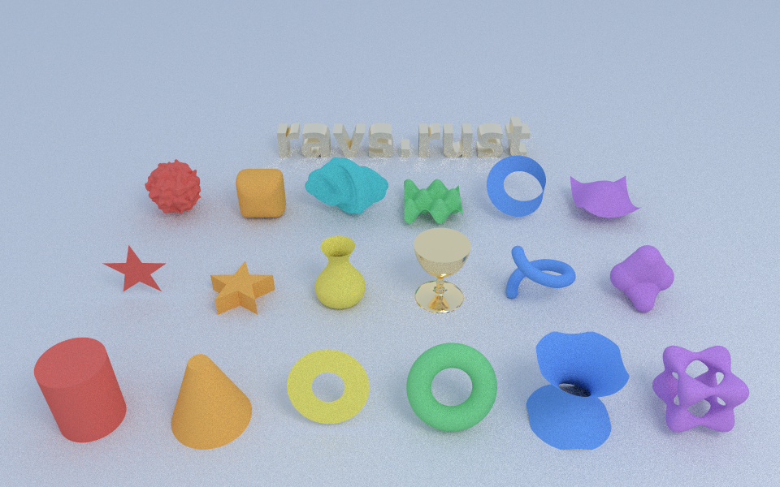

# Shapes

The scene file's `objects` take these geometry types besides `sphere`, `plane`, `box`,
`triangle`, `mesh` and `smoothmesh`. They follow POV-Ray's shapes of the same names, and use the
same coordinates (except that POV-Ray is left-handed: see `text`). Any of them can be placed with
a `transform`, given a `material`, and (the solid ones) used in a `difference`.

[`demo/scenes/shapes.json`](../demo/scenes/shapes.json) has an example of each.

Points are `[x, y, z]`, 2D points `[a, b]`. Fields marked * are required; the rest show their
defaults.

## Quadric shapes

| Type | Fields | |
|---|---|---|
| `cylinder` | `base`*, `cap`*, `radius`*, `open: false` | Closed by flat ends unless `open`. |
| `cone` | `base`*, `base_radius`*, `cap`*, `cap_radius`*, `open: false` | A truncated cone. |
| `disc` | `center`*, `normal`*, `radius`*, `hole_radius: 0` | Flat, with an optional hole. Can be an area light. |

## Polynomial surfaces

Solved exactly as polynomials along the ray. Inside is where the polynomial is negative.

| Type | Fields | |
|---|---|---|
| `torus` | `major`*, `minor`* | About the y axis, centred on the origin. |
| `quadric` | `squares: [A, B, C]`, `mixed: [D, E, F]`, `linear: [G, H, I]`, `constant: J`, `bounds` | A x² + B y² + C z² + D xy + E xz + F yz + G x + H y + I z + J = 0. |
| `poly`, `cubic`, `quartic` | `order` (for `poly`), `coefficients`, or `terms`; `bounds` | `coefficients` in POV-Ray's order (x², xy, xz, x, y², yz, y, z², z, 1 for order 2), or `terms: [[c, i, j, k], ..]` for c xⁱ yʲ zᵏ. |

The polynomial surfaces may be unbounded; `bounds: {"min": [..], "max": [..]}` clips them to a
box.

## Outlines and revolutions

| Type | Fields | |
|---|---|---|
| `polygon` | `points`* | Flat, in the plane of its 3D points. A loop closes when its first point repeats; a loop inside another is a hole. |
| `prism` | `points`* (2D, [x, z]), `height1`*, `height2`*, `spline: "linear"`, `sweep: "linear"`, `open: false`, `steps: 16` | An outline in the xz plane swept along y. `spline: "bezier"` takes four points per segment. `sweep: "conic"` scales the outline by its height, towards an apex at the origin. |
| `lathe` | `points`* (2D, [radius, y]), `spline: "linear"` | The profile spun about y. `"cubic"` is a Catmull-Rom curve through all but the first and last points; `"bezier"` takes four points per segment. |
| `sor` | `points`* (2D, [radius, y]), `open: false` | Surface of revolution: squared radius is a cubic in y through all but the first and last points. Heights must increase, and the squared radius must stay positive between points. |
| `sphere_sweep` | `spheres`* (`[x, y, z, radius]`), `spline: "linear"`, `steps: 16` | A sphere moved along a path. `"cubic"` passes through all but the first and last spheres; `"b_spline"` passes near them. Curves are sampled into `steps` straight pieces per segment. |

## Fields and functions

| Type | Fields | |
|---|---|---|
| `blob` | `threshold`*, `components`* | Components are `{"type": "sphere", "center", "radius", "strength": 1}` or `{"type": "cylinder", "base", "cap", "radius", "strength": 1}`. Each adds strength × (1 − d²/r²)² within its radius; the surface is where the total reaches the threshold. Negative strengths carve away. |
| `isosurface` | `function`*, `threshold: 0`, `contained_by`, `max_gradient: 1.1`, `accuracy: 0.001`, `open: false` | The surface where the function of x, y, z equals the threshold. `contained_by` is `{"box": {"min", "max"}}` (default the cube from -1 to 1) or `{"sphere": {"center", "radius"}}`. `max_gradient` must be at least the function's steepest slope, or holes appear. |
| `superellipsoid` | `e`*, `n`* | (\|x\|^(2/e) + \|y\|^(2/e))^(e/n) + \|z\|^(2/n) = 1, in the cube from -1 to 1. |
| `julia_fractal` | `c`* (`[a, b, c, d]`), `slice: 0`, `max_iteration: 20`, `accuracy: 0.0001` | The quaternion Julia set of q² + c, at fourth component `slice`. |

Functions are written as text in x, y and z (u and v for `parametric`): numbers, `+ - * /`, `^`
for powers, parentheses, `pi`, `e`, and `sin cos tan asin acos atan atan2 sinh cosh tanh sqrt abs
exp ln log floor ceil sqr pow min max mod noise3d select`.

## Meshes made from other shapes

These are turned into triangles when the scene loads.

| Type | Fields | |
|---|---|---|
| `height_field` | `src` (an image) or `function` (of x and z) with `resolution: [128, 128]`; `smooth: false`, `water_level: 0` | Over the unit square in x and z, heights 0 to 1 from the image's brightness. The image's top row is at z = 1. |
| `parametric` | `x`*, `y`*, `z`* (functions of u and v), `u: [0, 1]`, `v: [0, 1]`, `resolution: [64, 64]` | |
| `bicubic_patch` | `points`* (16: four rows of four), `steps: 16` | A Bezier patch. |
| `text` | `font`* (a .ttf or .otf file), `string`*, `thickness: 1`, `offset: [0, 0]`, `steps: 8` | Letters about one unit high on the baseline y = 0 from x = 0, from z = 0 to z = thickness. In this right-handed renderer they read left to right from the +z side; turn them 180° about y (`"rotate": {"pitch": 180}`) to face a camera on the -z side. |
