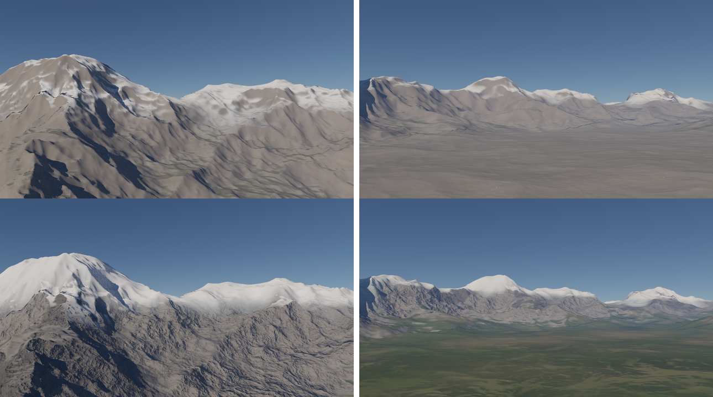

# Surface layers



*`demo/scenes/alpine-layers.json` (bottom of each pair) against the landscape's built-in ground
cover (top). The same evolved terrain, light and camera: a cold high range, its glaciers grown by
the landscape simulation. The layers put snow where it is above the snowline and level enough to
lie (lower on north faces), bare ice on the glaciers below it, talus where the simulation left
thin colluvium at the foot of slopes, frost-shattered debris on gentle high ground, alpine grass
on the sediment of the basins, and sedge where water gathers on the flats.*

Real ground is a stack of slightly different things: rock in bands, scree under cliffs, grass
where soil holds, wet ground where water gathers, snow only where it can lie. That variety, more
than any one material, is what makes Terragen's terrain read as photographic. Its Surface Layers
stack materials, each masked by altitude, slope and fractal breakup. Ours do the same with the
[function graph](displacement.md), and can also be masked by what the landscape simulation
computed, which Terragen can't.

## The material

```json
"Ground": { "type": "surface_layers", "layers": [
    { "material": "Rock" },
    { "material": "Scree", "mask": { "node": "multiply", "inputs": [
        { "node": "field", "field": "sediment", "from": 0.05, "to": 1 },
        { "node": "slope", "from": 40, "to": 33 } ] } },
    { "material": "Snow", "mask": { "node": "field", "field": "snowline", "from": -100, "to": 100,
        "breakup": { "node": "fractal", "scale": 700, "amplitude": 150 } }, "coverage": 1 }
] }
```

Layers are listed from the bottom up; the first is the base. Each other layer covers what is
below it by its `mask` (a graph, 0 to 1) times its `coverage`. As with `mix`, each scattering
picks the layer on top stochastically, so each keeps its own BSDF (a `rock` with fractal relief
on the rock layer, a plain Lambertian for snow) and the result is unbiased. Masks above the
chosen layer are the only ones evaluated.

## Fields

A landscape (`"type": "landscape"`, a scaled patch or full scale) takes `"material"`: a
material for all its ground but rivers and lakes, in place of its fixed cover classes. Graphs
evaluated on it, in `surface_layers` masks or a `mix`'s amount, can read its fields with
`{"node": "field", "field": name}` (smoothly 0 to 1 between `from` and `to` if given, with a
`breakup`; the raw value otherwise; `default`, 0, on surfaces without fields):

| Field | Meaning |
|-------|---------|
| `sediment` | Loose sediment over the rock, metres: alluvium in basins, colluvium at the foot of slopes |
| `ice` | Glacier ice, metres |
| `lava` | Volcanic rock under the sediment, metres |
| `flow` | log10 of the area draining through the point, m² |
| `wetness` | Topographic wetness index, ln(a / tan β): high in hollows and on flats, low on ridges |
| `convexity` | Metres above the mean of the neighbouring cells: ridges positive, gullies negative (depends on the simulation's cell size) |
| `elevation` | Metres above sea level, the planet's curvature and the scale taken out |
| `snowline`, `treeline` | Metres above the snowline and treeline, from the climate model (or by latitude) |
| `temperature`, `precipitation` | The climate's mean annual °C and mm a year (full scale only) |

Each is kept at the simulation's cell corners and interpolated by Catmull-Rom splines, so
masks follow the landscape without showing its grid; at full scale the nested patches are
blended as their surfaces are. The thresholds in the demo came from looking at the fields
first: render a `mix` of two `flat` materials with the field `remap`ped to its amount.
